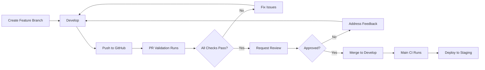
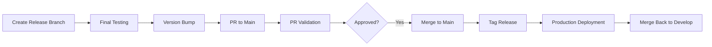

# CI/CD Workflow Documentation

## Overview

This document explains the CI/CD pipelines configured for the project, their triggers, and what they do.

## Workflows

### 1. PR Validation (`pr-validation.yml`)

**Trigger**: When a Pull Request is opened or updated targeting `main`, `develop`, or `release/**` branches

**Purpose**: Ensure code quality before merging

**Jobs**:

#### Code Quality (5-7 minutes)

- ✅ ESLint checks
- ✅ TypeScript compilation
- ✅ Prettier formatting verification
- **Fail Conditions**: Linting errors, type errors, formatting issues

#### Tests (3-5 minutes)

- ✅ Unit tests
- ✅ Integration tests
- ✅ Coverage reporting (uploaded to Codecov)
- **Fail Conditions**: Test failures, coverage below threshold

#### Build Verification (4-6 minutes)

- ✅ Production build
- ✅ Bundle size analysis
- ✅ Build artifacts uploaded
- **Fail Conditions**: Build errors, bundle size exceeded

#### Security Scan (2-3 minutes)

- ✅ npm audit
- ✅ Snyk vulnerability scan
- **Fail Conditions**: High severity vulnerabilities

**Total Time**: ~15-20 minutes

**PR Requirements**:

- All jobs must pass
- At least 1 approval (develop) or 2 approvals (main)
- All conversations resolved

---

### 2. Main Branch CI (`main-ci.yml`)

**Trigger**: Push to `main` branch

**Purpose**: Deploy to staging and prepare release

**Jobs**:

#### Full Test Suite (5-8 minutes)

- ✅ Complete test coverage
- ✅ Upload coverage reports
- **Fail Conditions**: Any test failure

#### Build & Deploy to Staging (6-10 minutes)

- ✅ Build with staging configuration
- ✅ Deploy to staging environment
- ✅ Create deployment status
- **Fail Conditions**: Build or deployment errors

#### Create Release Draft (2-3 minutes)

- ✅ Generate changelog from commits
- ✅ Create draft release on GitHub
- **Fail Conditions**: None (non-blocking)

**Total Time**: ~15-20 minutes

**Outputs**:

- Staging deployment URL
- Draft release with changelog

---

### 3. Production Deployment (`deploy.yml`)

**Trigger**:

- Release published
- Manual workflow dispatch

**Purpose**: Deploy to production environment

**Jobs**:

#### Deploy to Production (10-15 minutes)

- ✅ Run full test suite
- ✅ Build for production
- ✅ Deploy to production environment
- ✅ Create deployment record
- ✅ Send Slack notification

**Total Time**: ~10-15 minutes

**Manual Deployment**:

```bash
# Via GitHub UI
Actions → Production Deployment → Run workflow
Select environment: staging | production
```

**Rollback Procedure**:

1. Go to Releases
2. Find previous stable release
3. Click "Re-run workflow"
4. Select production environment

---

## Environment Variables

### Required Secrets

Configure in GitHub Settings → Secrets and variables → Actions:

```yaml
# Production
PROD_API_URL: https://api.yourapp.com
PROD_DATABASE_URL: <production-db-url>

# Staging
STAGING_API_URL: https://staging-api.yourapp.com
STAGING_DATABASE_URL: <staging-db-url>

# Services
SNYK_TOKEN: <snyk-api-token>
SLACK_WEBHOOK_URL: <slack-webhook-url>
CODECOV_TOKEN: <codecov-token>

# Deployment
AWS_ACCESS_KEY_ID: <aws-key>
AWS_SECRET_ACCESS_KEY: <aws-secret>
```

### Environment Files

**Every `.env*` path is gitignored.** The version-controlled sources are
`.env.example` and `docker/env/<mode>.env`; `scripts/ensure-env.js` copies them
into the `.env*` files Vite actually reads. Nothing generated is ever committed,
so a hostname, internal URL or secret dropped in `.env.local` cannot leak.

| Version-controlled source    | Materialised to              | Mode                                            |
| ---------------------------- | ---------------------------- | ----------------------------------------------- |
| `.env.example`               | `.env`                       | base, all modes                                 |
| `docker/env/development.env` | `.env.development`           | `pnpm dev`                                      |
| `docker/env/test.env`        | `.env.test`                  | `pnpm test` (Vitest)                            |
| `docker/env/staging.env`     | `.env.staging`               | `pnpm build --mode staging`                     |
| `docker/env/production.env`  | `.env.production`            | `pnpm build`                                    |
| —                            | `.env.local`, `.env.*.local` | personal overrides, never written by the script |

A fresh clone has no `.env*`, so provision them once:

```bash
pnpm env:init        # or: make env-init
pnpm env:init:force  # overwrite existing files (discards local overrides)
pnpm env:check       # non-zero exit if anything is missing
```

`predev`, `pretest` and `prebuild` run the script automatically, and it never
overwrites an existing file unless `--force` is passed. The Dockerfile performs
the same two copies inline, so image builds are hermetic and do not depend on
anything from the host.

`VITE_APP_ENV` selects the axios profile in
`src/core/configs/api/axios/axios.env.ts` and is set per-mode, never in `.env`.
A production build **fails** if `VITE_APP_ENV` resolves to `development` or is
missing, so a misconfigured pipeline cannot silently ship the development
profile to production.

### Docker Runtime Variables

These are **not** Vite variables. They are injected by
`docker/docker-compose.yml`, which supplies a default for every one of them, so
a missing value can never break `docker compose config`:

| Variable                   | Default                | Purpose                               |
| -------------------------- | ---------------------- | ------------------------------------- |
| `PORT`                     | `8080`                 | Host port mapped to container port 80 |
| `NODE_ENV`                 | `production`           | Container process environment         |
| `VITE_APP_ENV`             | `production`           | Written into the generated `env.js`   |
| `BACKEND_HOST`             | `host.docker.internal` | nginx upstream host                   |
| `BACKEND_PORT`             | `8070`                 | nginx upstream port                   |
| `HEALTHCHECK_INTERVAL`     | `30s`                  | Container healthcheck spacing         |
| `HEALTHCHECK_TIMEOUT`      | `5s`                   | Container healthcheck timeout         |
| `HEALTHCHECK_RETRIES`      | `3`                    | Container healthcheck retries         |
| `HEALTHCHECK_START_PERIOD` | `10s`                  | Grace period before healthcheck fails |
| `CONTAINER_CPU_LIMIT`      | `1`                    | CPU hard limit                        |
| `CONTAINER_MEMORY_LIMIT`   | `512M`                 | Memory hard limit                     |
| `CONTAINER_CPU_RESERV`     | `0.25`                 | CPU reservation                       |
| `CONTAINER_MEMORY_RESERV`  | `128M`                 | Memory reservation                    |

All container files live in `docker/`:

```
docker/
├── Dockerfile
├── docker-compose.yml      # build context is the repo root (..)
├── entrypoint.sh
├── env/                    # committed per-mode Vite config
│   ├── development.env
│   ├── test.env
│   ├── staging.env
│   └── production.env
└── nginx/
    └── nginx.conf.template
```

`.dockerignore` stays at the repository root, because the build context is the
repository root. Override the variables above with a gitignored `.env.docker`:

```bash
docker compose -f docker/docker-compose.yml --env-file .env.docker up -d
```

The `make` targets wrap the same command:

```bash
make up            # docker compose -f docker/docker-compose.yml up -d
make down          # ... down
make docker-build  # ... build --no-cache
make docker-logs   # ... logs -f
make teardown      # ... down -v --remove-orphans --rmi local
```

> The build context is the repository root, not `docker/`, so `.dockerignore`
> must be applied by whichever tool builds the image.

### Ignore Files

There is exactly **one** file to edit: `.gitignore`. `.dockerignore` is
generated from it and must never be hand-edited.

```bash
pnpm dockerignore:sync    # regenerate .dockerignore after editing .gitignore
pnpm dockerignore:check   # verify it is current (runs in PR CI)
```

Git reads `.gitignore` and Docker reads `.dockerignore`. The two cannot be one
file — the names are hardcoded per tool — so the duplication is removed by
generating instead of maintaining both:

```
.gitignore          everything git ignores. Single source of truth. Edit this.
.dockerignore       GENERATED = .gitignore + DOCKER_ONLY (in the script)
docker/Dockerfile   materialises .env + .env.<mode> at image build time
```

`DOCKER_ONLY` in `scripts/sync-dockerignore.js` holds the eight paths that only
Docker needs (`.git`, `.github`, `.vscode`, `.storybook`, `coverage`,
`*.tsbuildinfo`, `apps`, `stats.html`). They are kept in the script rather than
in `.gitignore` because every line in `.gitignore` also applies to git, and
`.github/` and `.vscode/` hold tracked content — ignoring them there would
silently block adding a workflow or re-adding `.vscode/extensions.json`, while
appearing to work today because gitignore does not apply to tracked files.

The generator refuses to write if the env rules stop behaving, in either
direction: `.env`, `.env.local` and `.env.<mode>` must stay out of the context
and `.env.example` must stay in it. That is the invariant the image build
depends on, and the one that broke when `!.env.example` was added to
`.gitignore` but not to `.dockerignore`.

---

## Workflow Diagrams

### Feature Development Flow



### Release Flow



---

## Monitoring & Notifications

### Slack Notifications

Configured channels:

- `#deployments` - All deployment notifications
- `#ci-failures` - Failed CI runs
- `#releases` - New releases

### Status Badges

Add to README.md:

```markdown


[](https://codecov.io/gh/yourorg/yourrepo)
```

---

## Troubleshooting

### CI Failure: "npm ci failed"

**Cause**: package-lock.json out of sync

**Solution**:

```bash
rm package-lock.json
npm install
git add package-lock.json
git commit -m "chore: update package-lock.json"
```

### CI Failure: "Type check failed"

**Cause**: TypeScript errors

**Solution**:

```bash
npm run type-check
# Fix reported errors
```

### Deployment Failed

**Immediate Actions**:

1. Check GitHub Actions logs
2. Verify environment variables
3. Check deployment service status
4. Rollback if necessary

**Rollback**:

```bash
# Via GitHub UI
Go to failed deployment → Re-run jobs
OR
Go to previous release → Re-run workflow
```

### Slow CI Times

**Optimization Tips**:

1. Enable dependency caching (already configured)
2. Run jobs in parallel (already configured)
3. Use `npm ci` instead of `npm install` (already configured)
4. Reduce test timeout values
5. Split large test suites

---

## Best Practices

### 1. Keep CI Fast

- Target: < 15 minutes for PR validation
- Use caching aggressively
- Run only necessary checks

### 2. Fail Fast

- Run quick checks first (linting, type-check)
- Run expensive checks last (E2E tests)

### 3. Clear Feedback

- Descriptive job names
- Helpful error messages
- Link to relevant documentation

### 4. Security

- Never commit secrets
- Use GitHub Secrets for sensitive data
- Rotate credentials regularly

### 5. Maintainability

- Document workflow changes
- Version workflow files
- Test workflow changes in feature branches

---

## Metrics & KPIs

Track these metrics:

- **CI Success Rate**: Target > 95%
- **Average CI Time**: Target < 15 minutes
- **Deployment Frequency**: Track daily/weekly
- **Mean Time to Recovery**: Target < 1 hour
- **Change Failure Rate**: Target < 5%

View metrics:

- GitHub Insights → Actions
- Custom dashboards (if configured)

---

## References

- [GitHub Actions Documentation](https://docs.github.com/en/actions)
- [Workflow Syntax](https://docs.github.com/en/actions/reference/workflow-syntax-for-github-actions)
- [Security Best Practices](https://docs.github.com/en/actions/security-guides/security-hardening-for-github-actions)
