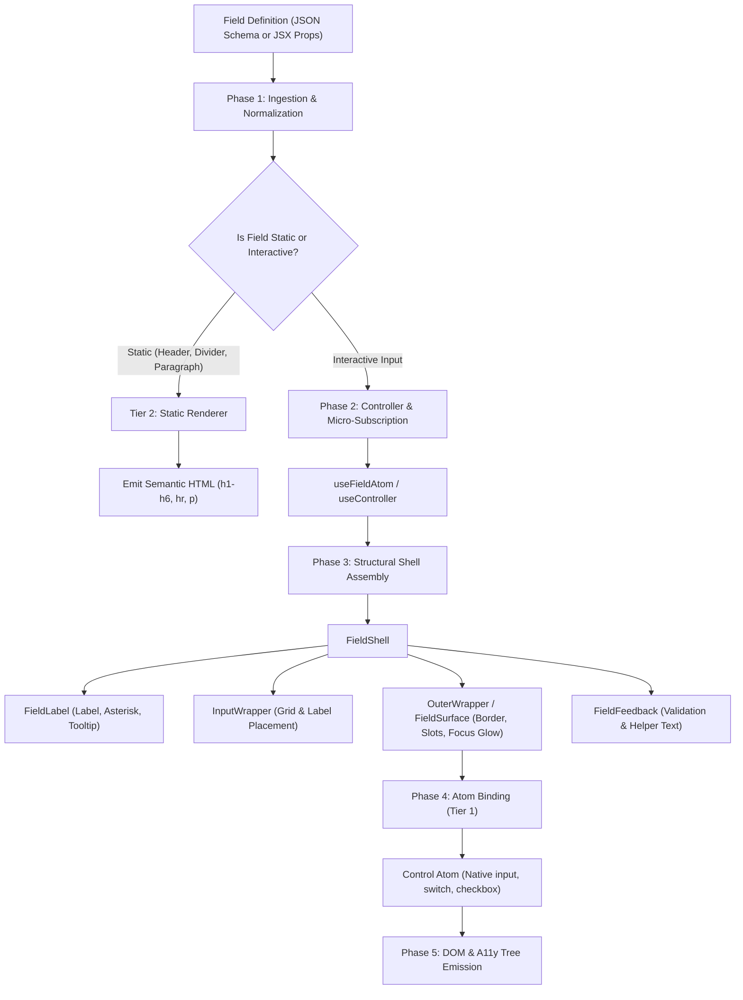

# Field Presentation & Rendering Architecture: Atoms, Static, Structure & Wrapped Fields

**Status:** Architecture Blueprint & Audit  
**Domain:** ZenOS Form Engine & DetailRenderer UI Field System  
**Audience:** Core Engineers, UI/UX Designers, Architectural Reviewers  
**Standards:** Clean Architecture, DDD-lite, SOLID Principles, WAI-ARIA 1.2+  

---

## 1. Executive Summary & Architectural Principle

A design system's field hierarchy must maintain a strict separation between two orthogonal concerns:
1. **Native Behavior (Headless Contract)**: Keyboard navigation, accessibility roles and states, form submission participation, native change events, focus trapping, and validation constraints.
2. **UI Presentation (Visual Skin & Layout)**: Design tokens, surfaces, cards, focus glows, track/thumb animations, layout grids, icon slots, and label/feedback placement.

### The Golden Rule of Field Architecture
> **An Atom must only govern its native control and its immediate visual indicator. Layout, cards, labels, helper descriptions, error reservations, and action slots belong strictly to Structures and Wrapped Fields.**

When this principle is violated, components develop **leaky abstractions**:
- Primitive atoms start rendering their own labels and cards, forcing higher-order wrappers (`withAtom`) to pass ad-hoc suppression flags (`showLabel: false`, `wrapOuter: false`).
- Higher-order layout wrappers pass presentation props down into leaf DOM nodes, forcing primitive inputs to manually discard dozens of extraneous props.
- Custom stylized components visually look like switches or segmented buttons, but screen readers and keyboard users encounter broken ARIA roles or missing roving `tabIndex`.

---

## 2. In-Depth Audit: Mixing Native Behaviors and UI in the Existing System

Before refactoring or introducing new code, this section details the exact architectural friction points and antipatterns identified across the codebase.

```
┌──────────────────────────────────────────────────────────────────────────────────┐
│                   CURRENT CODEBASE ENTANGLEMENT AUDIT                            │
├────────────────────┬─────────────────────────────────────────────────────────────┤
│ Component          │ Architectural & Implementation Violations                   │
├────────────────────┼─────────────────────────────────────────────────────────────┤
│ RadioField         │ • Monolithic group + item + layout + card + segmented logic │
│                    │ • Native <input> hidden with `sr-only`; no roving tabIndex  │
│                    │ • Intercepts native event: `() => onChange?.(opt.value)`    │
│                    │ • Renders option labels, descriptions, and card borders     │
├────────────────────┼─────────────────────────────────────────────────────────────┤
│ SwitchField        │ • Missing default `role="switch"` (defaults to checkbox)   │
│                    │ • Outer <label> wraps entire row/card; click bubbling issue │
│                    │ • Directly renders label, description, and card container   │
│                    │ • Hardcodes track & thumb styles inside input primitive     │
├────────────────────┼─────────────────────────────────────────────────────────────┤
│ CheckboxField      │ • Directly renders label, description, and card surface     │
│                    │ • Inlines checkmark and indeterminate SVG icons             │
│                    │ • Forces `showLabel: false` in `FormCheckboxField`          │
├────────────────────┼─────────────────────────────────────────────────────────────┤
│ TextField          │ • Leaks `useFormOrchestrator` mode check (`mode === "view"`)│
│                    │ • Manually strips 20+ wrapper props (`reserveErrorSpace`...)│
│                    │ • Formats password masking (`••••••••`) inside input atom   │
├────────────────────┼─────────────────────────────────────────────────────────────┤
│ withAtom /         │ • Inconsistent label ownership (split between atom & shell) │
│ FieldShell         │ • Double-wrapping prevention relies on suppression flags    │
└────────────────────┴─────────────────────────────────────────────────────────────┘
```

---

### 2.1 RadioField (`src/shared/ui/form/fields/primitive/RadioField.tsx`)

#### Identified Violations:
1. **God Component (SRP Violation)**:
   - `RadioField` is not an atomic radio button. It is simultaneously:
     - A radio group orchestrator (`<div role="radiogroup">`).
     - An option array iterator (`options.map(...)`).
     - A segmented button bar (`isSegmented`).
     - A 2-column card grid (`isCard`).
     - An icon dispatcher (`getIcon(opt.icon)`).
     - A label and description typography formatter.
2. **Missing WAI-ARIA Keyboard Navigation**:
   - According to the W3C WAI-ARIA Authoring Practices Guide (APG), a `radiogroup` must support:
     - `ArrowDown` / `ArrowRight`: Move focus and check next radio in the group.
     - `ArrowUp` / `ArrowLeft`: Move focus and check previous radio in the group.
     - `Space`: Check focused radio.
     - Roving `tabindex`: The checked radio has `tabindex="0"`; all other radios have `tabindex="-1"`.
   - In `RadioField`, all inputs are rendered with `className="sr-only peer"`. Because there is no roving `tabIndex` or keyboard event handler, navigating using arrow keys relies on whatever underlying native browser heuristics exist, which fails when labels intercept mouse/touch events or when assistive tech navigates virtual groups.
3. **Event Signature Contamination**:
   - `onChange={() => onChange?.(opt.value)}` completely swallows the native `React.ChangeEvent<HTMLInputElement>`. Consumers cannot inspect `event.target`, prevent default, or integrate with standard HTML form libraries without custom adapters.

---

### 2.2 SwitchField (`src/shared/ui/form/fields/primitive/SwitchField.tsx`)

#### Identified Violations:
1. **ARIA Role Omission**:
   - Line 152: `role={(rest as any).role || (field?.properties as any)?.role}`.
   - Because no default is provided, the rendered element is an `<input type="checkbox">` without `role="switch"`. Assistive technology announces it as a standard "checkbox, unchecked" instead of a "switch, off", violating WCAG 4.1.2 (Name, Role, Value).
2. **Click Target & Event Bubbling Ambiguity**:
   - The root element is a `<label htmlFor={resolvedId}>` that encloses the label, description, and switch track.
   - If a developer includes a link or an interactive tooltip in the description, any click on the link or tooltip bubbles to the `<label>`, unintentionally flipping the switch state.
3. **Card Container & Label Conflation**:
   - When `variant="card"` is enabled, `SwitchField` renders a full elevated card container with `p-4 rounded-xl border`.
   - In the 4-tier taxonomy, a Card is a **Tier 3 Structure** (`CardField` / `DetailKeyDetailsCard`). By embedding card layout directly inside an atom, `SwitchField` duplicates layout logic and bypasses `FieldShell`.

---

### 2.3 CheckboxField (`src/shared/ui/form/fields/primitive/CheckboxField.tsx`)

#### Identified Violations:
1. **Duplicated Label & Description Rendering**:
   - `CheckboxField` renders `resolveTranslation(resolvedLabel)` and `resolveTranslation(resolvedDescription)` inside its own markup.
   - Consequently, when wrapped in `wrapped-fields.ts`:
     ```typescript
     export const FormCheckboxField = withAtom(CheckboxField, {
       showLabel: false,
       wrapOuter: false,
     });
     ```
   - This breaks the polymorphic contract of `withAtom`. The outer shell is stripped of its label-rendering responsibility because the atom greedily rendered it.

---

### 2.4 TextField (`src/shared/ui/form/fields/primitive/TextField.tsx`)

#### Identified Violations:
1. **Leaky Orchestrator Context**:
   - `TextField` imports `useFormOrchestrator` and checks `mode === "view"`.
   - If in view mode, it returns `<div className="...">•••••••• or safeValue</div>`.
   - An input primitive in Tier 1 should never know whether the parent form is in view, edit, or modal mode. In Clean Architecture, presentation mode is governed by the Use Case / Parent Composer, not the leaf DOM element.
2. **Prop Bloat & Manual Sanitization**:
   - Lines 183-203 manually destructure and discard 21 props (`reserveErrorSpace`, `showLabel`, `wrapOuter`, `labelPlacement`, `vitality`, `validation`, `properties`, `meta`, `componentProps`, `description`, `tooltip`, `labelAction`, `startContent`, `endContent`, `prefix`, `suffix`...) to prevent React from logging "React does not recognize the prop on a DOM element" warnings.
   - This occurs because `withAtom` dumps every shell property directly onto the atom via `...rest`.

---

## 3. The 4-Tier Field Taxonomy: Presentation & Rendering Contracts

The field ecosystem is organized into four distinct tiers:

```
┌────────────────────────────────────────────────────────────────────────┐
│                        4-TIER FIELD TAXONOMY                           │
├───────────────┬────────────────────────────────────────────────────────┤
│ Tier 4        │ Wrapped Fields (FormTextField, FormSwitchField, etc.)  │
│               │ Pre-composed with `withAtom` + Wrapper Trinity         │
├───────────────┼────────────────────────────────────────────────────────┤
│ Tier 3        │ Structures & Layout                                    │
│               │ FieldShell, InputWrapper, OuterWrapper, CardField,     │
│               │ TabsField, AccordionField, RepeaterField, SlotField    │
├───────────────┼────────────────────────────────────────────────────────┤
│ Tier 2        │ Static Fields                                          │
│               │ HeaderField, DividerField, ParagraphField, HtmlField   │
├───────────────┼────────────────────────────────────────────────────────┤
│ Tier 1        │ Atoms (Primitive Inputs & Detail Value Displays)       │
│               │ Raw Input Atoms, Visual Indicators, DetailValueDisplay │
└───────────────┴────────────────────────────────────────────────────────┘
```

---

### 3.1 Tier 1: Atoms

Tier 1 contains the elemental building blocks. They have **zero dependencies on forms, schemas, or orchestrators**.

#### 1. Control Atoms (Headless & Interactive)
- **Responsibility**: Pure native HTML element with accessible keyboard handling and change event dispatching.
- **Components**:
  - `NativeInput`: Base `<input>` handling type, value, and native events.
  - `SwitchControl`: Accessible `<button role="switch">` or `<input type="checkbox" role="switch">` managing only the sliding track & thumb.
  - `RadioControl`: Pure `<input type="radio">` with visual indicator.
  - `CheckboxControl`: Pure `<input type="checkbox">` with check/indeterminate indicator.
- **Contract**:
  ```typescript
  interface ControlAtomProps<TValue> {
    id: string;
    name?: string;
    value?: TValue;
    checked?: boolean;
    disabled?: boolean;
    readOnly?: boolean;
    required?: boolean;
    "aria-invalid"?: boolean;
    "aria-describedby"?: string;
    onChange?: (e: React.ChangeEvent<HTMLInputElement>) => void;
    onBlur?: (e: React.FocusEvent<HTMLInputElement>) => void;
    onFocus?: (e: React.FocusEvent<HTMLInputElement>) => void;
  }
  ```

#### 2. Visual Indicators
- Pure SVG or CSS animations representing state (the checkmark icon, the radio dot scale, the switch thumb transform, spinner loaders).
- Must have `aria-hidden="true"`.

#### 3. Display Atoms (Read-Only Presentation)
- **Component**: `DetailValueDisplay`.
- **Responsibility**: Pure functional formatting of values without inputs or form bindings.
- **Supported Formats**:
  - Status badges, option pills, dates, currencies, secure links, email anchors, and muted fallback tokens (`—`).

---

### 3.2 Tier 2: Static Fields

Static fields provide visual hierarchy, narrative flow, and section separation without capturing user input.

- **`HeaderField`**: Semantic headings (`<h1>` - `<h6>`) with typography scaling and alignment (`left`, `center`, `right`).
- **`DividerField`**: Semantic `<hr>` rule with optional centered section label backdrop.
- **`ParagraphField`**: Narrative text with optional HTML sanitization support.
- **`HtmlField`**: Controlled HTML content for rich marketing or audit intros.
- **Rendering Contract in Form UI vs Detail UI**:
  - **In Form UI**: Renders within the grid layout, aligned with form input columns.
  - **In Detail UI**: Renders as section headers, dividing definition lists (`<dl>`) without unnecessary container borders.

---

### 3.3 Tier 3: Structures & The Wrapper Trinity

Structures govern spatial arrangement, responsive grid distribution, labels, feedback, and surface containers.

#### The Wrapper Trinity

Every interactive field surface is composed of three concentric wrappers:

```
┌────────────────────────────────────────────────────────────────────────┐
│ OuterWrapper (FieldSurface)                                           │
│  - Etched border, surface background, focus-within glow ring           │
│  - Prefix & Suffix adornment slots (startContent / endContent)         │
│  - Interactive actions (password toggle, clear button)                │
│ ┌────────────────────────────────────────────────────────────────────┐ │
│ │ InputWrapper                                                       │ │
│ │  - Spatial layout (labelPlacement: "top" | "side" | "inline")      │ │
│ │  - FieldLabel (<FieldLabel />) with required mark (*) & tooltip    │ │
│ │  - FieldFeedback (<FieldFeedback />) with error & helper messages  │ │
│ │ ┌────────────────────────────────────────────────────────────────┐ │ │
│ │ │ Control Atom (Tier 1)                                          │ │ │
│ │ │  - Native input / switch / checkbox element                    │ │ │
│ │ └────────────────────────────────────────────────────────────────┘ │ │
│ └────────────────────────────────────────────────────────────────────┘ │
└────────────────────────────────────────────────────────────────────────┘
```

#### Structural Containers
- **`CardField`**: Elevated card container (`bg-card border rounded-2xl shadow-xs`).
- **`TabsField`**: Interactive multi-tab layout with tab panels.
- **`AccordionField`**: Collapsible container for progressive disclosure.
- **`RepeaterField`**: Dynamic sub-form array manager with add/remove row operations.
- **`SlotField`**: Inversion-of-control container for custom client components.

---

### 3.4 Tier 4: Wrapped Fields

Wrapped fields are the canonical components used by feature developers and schema compilers:
- `FormTextField`, `FormSelectField`, `FormNumberInputField`, `FormSwitchField`, `FormCheckboxField`, `FormRadioField`, `FormTextareaField`, `FormButtonField`.

#### Composition Mechanics: `withAtom` (The DCS Layer)
- Bridges the low-level Control Atom (Tier 1) with the Wrapper Trinity (Tier 3).
- Connects the field to `useFieldAtom` for **O(1) micro-subscriptions** (updates re-render only the affected field, never the entire form tree).
- Provides an **autonomous fallback**: When used outside a form context (e.g. in Storybook or simple widgets), it manages internal state automatically.

---

## 4. End-to-End Rendering Pipeline

This diagram illustrates how a field definition progresses from JSON schema or JSX through the 4 tiers down to the DOM:



### Detailed Pipeline Phases:
1. **Phase 1: Ingestion & Normalization**:
   - `synthesizeFormField` normalizes inline props and schema definitions into a canonical `FormField` contract.
2. **Phase 2: Controller & Micro-Subscription**:
   - `useController` or `useFieldAtom` connects the field to the atomic form store via `useSyncExternalStore`.
3. **Phase 3: Structural Shell Assembly**:
   - `FieldShell` mounts `FieldLabel`, calculates multi-target ARIA IDs (`aria-describedby` linking error, helper, and tooltip), and determines `labelPlacement` (`top` vs `side`).
4. **Phase 4: Surface & Slot Decoration**:
   - `OuterWrapper` wraps the control in an etched surface border, mounting `startContent` (search icon) and `endContent` (password visibility toggle).
5. **Phase 5: Atom Binding & DOM Emission**:
   - The leaf Control Atom receives filtered, safe HTML attributes and dispatches native events, emitting clean, accessible DOM nodes.

---

## 5. Form UI vs. Detail UI: Presentation Matrix

| Dimension | Form UI (`FormComposer` / `wrapped-fields`) | Detail UI (`DetailRenderer` / `DetailRenderers`) |
| :--- | :--- | :--- |
| **Primary Intent** | Interactive user data mutation & validation. | Read-only entity inspection & specification sheets. |
| **DOM Root** | `<form role="form" onSubmit={...}>` | Semantic `<article data-detail-renderer="true">` |
| **Rendering Strategy** | Editable Control Atoms wrapped in `FieldShell`. | Definition list `<dl>` with `<dt>` labels and `<dd>` formatted values. |
| **Empty State** | Placeholder text (`placeholder="Enter SKU..."`). | Standardized muted fallback token (`—`). |
| **Runtime Overhead** | Active Zustand store, validation pipeline, dirty tracking. | **Zero form runtime overhead** in display mode. |
| **Boolean Display** | Interactive sliding switch or checkbox. | Status pill badge with `Check` or `X` icon. |
| **Options / Radios** | Selectable radio items or dropdown select. | Option label pill with category icon. |
| **Action Areas** | Submit button (`type="submit"`), Reset, Draft. | Sticky action bar (`DetailBottomActions`): Export, Share, Edit. |

---

## 6. Target Decoupling Blueprint (Clean Architecture Roadmap)

To eliminate the antipatterns identified in Section 2, the following decoupled architecture is planned:

```
src/shared/ui/form/
├── atoms/                          # Tier 1: Pure Atoms
│   ├── controls/                   # Headless interactive controls
│   │   ├── SwitchControl.tsx       # Pure <button role="switch"> or <input role="switch">
│   │   ├── RadioControl.tsx        # Pure <input type="radio"> + visual dot
│   │   ├── CheckboxControl.tsx     # Pure <input type="checkbox"> + check/dash SVG
│   │   └── InputControl.tsx        # Pure <input> text/number/email
│   └── display/                    # Pure display value formatters
│       ├── DetailValueDisplay.tsx  # Read-only values, pills, badges
│       └── StatusBadge.tsx
│
├── static/                         # Tier 2: Static Fields
│   ├── HeaderField.tsx
│   ├── DividerField.tsx
│   └── ParagraphField.tsx
│
├── structure/                      # Tier 3: Structures & Layout
│   ├── FieldShell.tsx              # Single orchestrator of labels & feedback
│   ├── FieldLabel.tsx              # Exclusive owner of label text & required mark
│   ├── FieldFeedback.tsx           # Exclusive owner of validation & helper text
│   ├── FieldSurface.tsx            # Exclusive owner of borders, focus ring & slots
│   └── containers/                 # CardField, TabsField, AccordionField
│
└── fields/                         # Tier 4: Wrapped Fields
    ├── wrapped-fields.ts           # withAtom compositions (FormTextField, FormSwitchField)
    └── Field.tsx                   # Smart dynamic Field controller
```

### Core Decoupling Rules:
1. **Atoms never render labels or descriptions**: All labels and descriptions are rendered exclusively by `FieldLabel` and `FieldFeedback` inside `FieldShell`.
2. **Atoms always declare explicit ARIA roles**: `SwitchControl` defaults to `role="switch"` and `aria-checked`.
3. **Radio Groups own roving tabindex**: A dedicated `RadioGroup` container manages keyboard arrow navigation (`ArrowUp`/`ArrowDown`/`ArrowLeft`/`ArrowRight`), while individual `RadioControl` items remain pure inputs.
4. **Clean prop forwarding**: `withAtom` strips all structural props before passing `forwardedProps` to the atom, eliminating manual prop destructuring inside inputs.
5. **No view mode in atoms**: View mode rendering is owned exclusively by `DetailRenderer` or `withAtom` inline edit decorators, keeping primitive inputs 100% focused on editable input.
