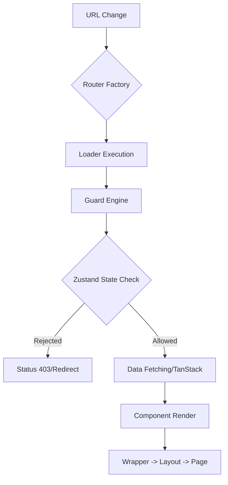

# ADR 006: React Routing Strategy

- **Status**: Accepted
- **Owner**: Frontend Team
- **Decided**: 2026-03-30

## Context

The application requires a scalable, secure, and metadata-rich routing system. Standard JSX-based routes become difficult to manage as the application grows, especially when generating dynamic navigation menus (sidebars), breadcrumbs, and enforcing cross-cutting concerns like Role-Based Access Control (RBAC).

## Decision: Configuration-Driven Routing (v6.4+)

We have implemented a custom routing abstraction built on top of `react-router-dom` v6 (`createBrowserRouter`). All routes are defined as static configurations instead of component hierarchies.

### 1. The `AppRoute` Interface

Routes are defined as `AppRoute` objects, decoupling route identity from its implementation:

- **Layouts & Wrappers**: Support for hierarchical layout composition.
- **Guards**: Declarative security handlers that run before the route renders.
- **Loaders/Actions**: Native React Router data fetching integration.

### 2. Solving the Lifecycle Timing Problem

To prevent "Flash of Unauthorized Content" (FOUC), security checks must happen in the `loader` layer. However, `loaders` run outside the React render cycle, making it impossible to use React Context hooks (`useContext`).

**Decision**: Use **Zustand** (or any state-management with a synchronous `.getState()` method) to provide routing-level state.

- **Implementation**: The `runGuards` helper injects the current store state into the `LoaderContext`.

### 3. Rendering Tree & Composition

The transformation utility `buildRouteObject` recursively converts configuration trees into valid React Router `RouteObject`s, automatically injecting `<Suspense/>` boundaries and metadata layers.



### 4. Standardized Response Handling

To ensure consistent UX, all route rejections and loader errors are mapped centrally:

- **Authorization Rejections**: Trigger a 302 redirect to `/login` or `/403`.
- **Validation Failures**: Handled via the route's `errorElement`.
- **Default Boundaries**: All routes are wrapped in a global `ErrorBoundary` via `GlobalBoot` to prevent application crashes.

### 5. Portal Orchestration Pattern

To support Modals, Drawers, and Side-Canvas actions without disrupting the parent page layout, we use a specialized `SmartPortalOutlet`.

- **Mechanism**: The parent page remains mounted. The child route (Modal) is "projected" into a top-level `#portal-root` via `createPortal`.
- **URL Synchronization**: The Modal is a true nested route. Refreshing the page at `/products/123/edit` correctly reloads the Product List in the background and opens the Edit Modal in the foreground.
- **Positioning**: Supports `portalProps` (width, title, offset) defined in the route config to control the Modal's look and feel from the routing layer.

### 6. Identity Resolver Pattern (Dynamic Breadcrumbs)

To ensure that breadcrumbs remain descriptive and context-aware, we use dynamic resolvers tied to route data.

- **Mechanism**: Each `AppRoute` can define a `breadcrumb` resolver function: `(data: any) => string`.
- **Data Injection**: The resolver receives the data returned by the route's `loader`.
- **Result**: A path like `/products/:id/edit` resolve to `Home > Products > Edit: MacBook Pro` instead of just a static label.
- **Intent**: The `intent` field (`create` | `edit` | `list`) allows for standardized prefixes across the application.

### 7. Unified State & Navigation Pulse (The Mediator)

To treat the application as a single reactive entity, we use a **State-Navigation Mediator**.

- **Bidirectional Bridge**: A pure-JS service that subscribes to the Global Store (`zustand.subscribe`) and React Context Mirrors.
- **Reactive Triggers**: Routes can define `triggers` (Store Keys) that, when changed, automatically force a route `revalidate()` to ensure the view remains fresh with zero manual code.

### 8. Context Mirroring Pattern (plug-and-play)

To solve the **Lifecycle Timing Problem** for standard React Context, we use a **Sink Mirror** approach.

- **Mechanism**: A `ContextMirror` component is dropped into a Provider tree to "push" context updates into the Mediator.
- **Data-Phase Access**: This "mirrors" the transient context state into a synchronous store that **Loaders** and **Guards** can read _before_ the render phase.

### 9. Routing Resilience & Timeout Policy

To prevent hanging loaders or infinite loops from crashing the UI, we enforce **Supervised Execution**.

- **Hard Timeout**: All `loaders` and `guards` are wrapped in a `withTimeout` HOC. If a request exceeds its limit (default 5s), it throws a 408 Timeout error for the `errorElement` to handle.
- **Windowing Strategy (Debounce)**: Micro-state changes are batched into a **Reactive Window** (50ms) before triggering a re-validation, preventing UI churn during rapid state updates.
- **Abort Signaling**: We leverage native `AbortSignal` propagation in all async operations to ensure that stale navigation attempts are immediately cancelled.

## Design Patterns (GoF) & Structural Architecture

The routing framework is built upon several Gang of Four (GoF) patterns to ensure high decoupling and scalability.

### 1. Structural Patterns

- **Composite Pattern**: The `AppRoute` configuration is a recursive tree. Each route can be a standalone "Leaf" or a "Composite" parent containing nested children, which are handled uniformly by the router builder.
- **Adapter Pattern**: The transformation layer acts as an Adapter between our strict domain-specific types (`AppRoute`) and the framework-specific `RouteObject` required by React Router.
- **Facade Pattern**: The `createAppRouter` and `createAppRouterFromRoutes` functions serve as Facades, hiding the inherent complexity of guard injection and recursive element composition.

### 2. Behavioral Patterns

- **Mediator Pattern**: The **`SmartPortalOutlet`** serves as a Mediator between two colleagues: the **Browser History (URL)** and the **UI Shell (Portal Root)**. It coordinates when and where to "project" the foreground task while maintaining the background state.
- **Selector/Strategy Pattern**: The `RouteGuard` engine uses a Strategy-based approach for security. Different security strategies (RBAC, Feature Flags) are "selected" and executed in a pipeline before route activations.

### 3. Creational Patterns

- **Builder Pattern**: The `buildRouteObject` utility (and the future `RouteBuilder` class) follows the Builder pattern, decoupling the "Recipe" (JSON/Object Config) from the "Construction" (React Component Tree).

---

## SOLID Principles Mapping

- **Single Responsibility (S)**: The routing layer is responsible ONLY for navigation and security orchestration. It does not contain domain business logic.
- **Open/Closed (O)**: The framework is open for extension (e.g., adding a `drawer` display mode) but closed for modification of the core recursive builder.
- **Liskov Substitution (L)**: Any `RouteModule` or `AppRoute` can be swapped or nested without breaking the global routing tree.
- **Interface Segregation (I)**: The `AppRoute` interface provides granular, optional metadata (SEO, Analytics, Guards) to avoid forcing implementations to depend on unused features.
- **Dependency Inversion (D)**: The UI components depend on the `useLoaderData` abstraction, not on the specific data-fetching implementation.

---

## Separation: CDD vs Composite Components

To ensure a clean architecture, we distinguish between these two fundamental approaches:

- **Component Driven Development (CDD)**: Used for building the **"Atoms"** and **"Organisms"** (Buttons, Cards, Forms). These are built in isolation (e.g., Storybook) and focused on UI/UX purity.
- **Composite Component (The Router)**: The Router is the **"Composite Orchestrator."** It takes the isolated CDD components and "composes" them into logical page hierarchies and workflow screens. CDD focuses on **"Look & Feel,"** whereas Global Composite focuses on **"Intent & Lifecycle."**

---

## Standard of Care & Implementation Policies

To maintain the integrity of this architecture, developers must adhere to the following implementation standards:

### 1. Z-Index Layer Management (The "Stacking Policy")

To prevent "Modal-on-Modal" stacking bugs, the `SmartPortalOutlet` must implement a **Layered Z-Index Strategy**:

- **Base Level**: Application Shell (z-0).
- **Secondary Level**: Sideboards/Drawers (z-100).
- **Tertiary Level**: Prime Modals (z-200).
- **Overlays**: Contextual Popovers/Tooltips (z-300).
- **Enforcement**: Any child workflow trying to launch a portal deeper than its parent should be managed via a **Stack Manager** within the Portal Mediator.

### 2. Preventing "Contextual Leaks" (The "URL-as-State" Discipline)

There is a risk of **Prop-Drilling** if a Modal depends on state _only_ available in the parent component memory.

- **Policy**: If a Modal/Drawer requires identifying data (e.g., `productId`), it **must** be retrieved from the URL via `useParams()` or the `loader`.
- **Constraint**: Passing functional props (callbacks) from the background page to the modal page is discouraged. Use the **Global Mediator (Zustand)** or **Navigate-to-Action** patterns instead.

### 3. Animation Lifecycle & "Exit Guards"

Using `AnimatePresence` with `createPortal` is complex.

- **Policy**: All transition-based portals must implement an **Exit Guard**.
- **Implementation**: The `SmartPortalOutlet` must not unmount a child route instantly if an "exit animation" is active. It should use a `deferred` unmount handler to ensure smooth transitions between workflow steps.

### 4. Resilience & Error Standard of Care

- **Hanging Mitigation**: Every implementation of a loader **MUST** be timeout-aware.
- **Retry Mechanism**: Critical paths should include a "Retry Policy" within the `errorElement`, allowing the user to recover from transient network failures without a full page reload.

## Example Definition

```typescript
export const productEditRoute: AppRoute = {
  path: ":id/edit",
  displayMode: "modal",
  intent: "edit",
  breadcrumb: (data) => `Edit: ${data.productName}`, // 🚀 Dynamic Identity!
  portalProps: { title: "Edit Product", width: 600 },
  guards: [AdminGuard],
  page: EditProductForm,
};
```
