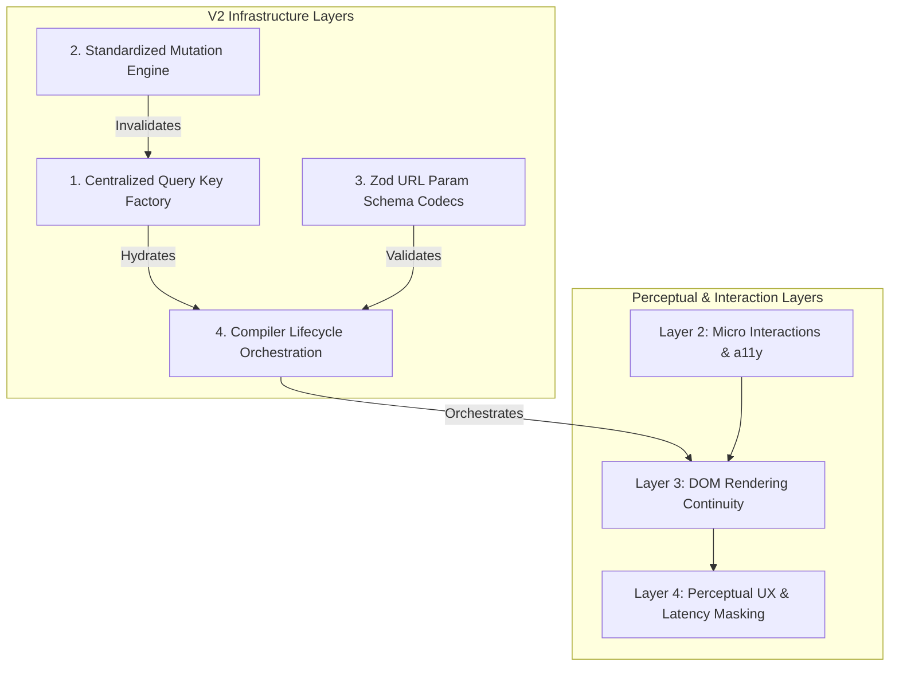

# ADR 007: ZenOS Frontend Architecture Evolution (V2)

- **Status**: Accepted
- **Owner**: Principal Architect & Antigravity
- **Decided**: 2026-05-22

## Context

After one year of successful operations under the **ZenOS V1 Frontend Architecture** (defined in `CONTRIBUTING.md` and detailed in the historical analysis), the platform has scaled dramatically. The strict Container/Presenter separation, Loader pre-warming, deep-link resilience, and dynamic wrapper isolation have proven highly resilient, preventing typical page-level data coupling and render deadlocks.

However, to transition from a highly-optimized _React application_ into an enterprise-grade **Frontend Runtime Platform**, we must systematically address the core vulnerabilities and missing abstractions identified in the architecture review:

1. **Query Key Fragmentation**: Cache collisions and invalidation bugs due to ad-hoc, string-based `queryKey` definitions.
2. **Mutation Architecture Void**: Missing standardized paradigms for optimistic updates, transactional writes, automatic cache invalidation maps, and rollback contexts.
3. **URL Search Parameter Bloat**: Lack of validation, typing, and serialisation standards for URL-synced UI state machines.
4. **Router Compiler God-System**: Hidden loader execution orders, lifecycle sequencing, error propagation rules, and abort signals.
5. **Emerging Client-Side Interaction Layers**: Lack of unified paradigms for accessibility focus coordination, DOM layout continuity, and perceptual performance masking (skeletons and progress masking).

---

## Decisions & Architectural Specifications

This ADR establishes the specifications and blueprints for the **ZenOS V2 Architecture**.



---

### 1. Centralized Query Key Factory (`QueryKeyFactory`)

To guarantee React Query cache integrity and enable safe, declarative cache invalidation without hardcoded strings, we mandate a **Standardized Query Key Factory** pattern.

#### Specification

- **Namespaced Nesting**: Keys must follow the hierarchical taxonomy: `[domain, scope, ...params]`.
- **QueryOptions Co-location**: Keys are generated alongside TanStack `queryOptions` to keep data-fetching functions statically bound to their keys.
- **Factory Contract**: Every feature module must export a centralized `Keys` factory extending the `BaseQueryKeys` interface.

```typescript
// src/core/state/queryKeys.ts
import { queryOptions } from "@tanstack/react-query";

export interface BaseKeys {
  all: readonly unknown[];
  lists: readonly unknown[];
  list: (filters: Record<string, any>) => readonly unknown[];
  details: readonly unknown[];
  detail: (id: string | number) => readonly unknown[];
}

/**
 * Type-safe helper to build standardized query key structures
 */
export function createQueryKeys<
  Domain extends string,
  Filters extends Record<string, any> = Record<string, any>,
  ID extends string | number = string | number,
>(domain: Domain) {
  return {
    all: [domain] as const,
    lists: [domain, "list"] as const,
    list: (filters: Filters) => [domain, "list", filters] as const,
    details: [domain, "detail"] as const,
    detail: (id: ID) => [domain, "detail", id] as const,
  };
}
```

#### Standard Usage in Feature Modules:

```typescript
// src/features/patients/services/patient.keys.ts
import { queryOptions } from "@tanstack/react-query";

import { httpClient } from "@/core/services";
import { createQueryKeys } from "@/core/state/queryKeys";

export const patientKeys = createQueryKeys<
  "patients",
  { limit?: number; search?: string }
>("patients");

export const patientQueries = {
  list: (filters = { limit: 20 }) =>
    queryOptions({
      queryKey: patientKeys.list(filters),
      queryFn: ({ signal }) =>
        httpClient.auth
          .get("/patients", { params: filters, signal })
          .then((r) => r.data),
      staleTime: 5 * 60 * 1000,
    }),

  detail: (id: string) =>
    queryOptions({
      queryKey: patientKeys.detail(id),
      queryFn: ({ signal }) =>
        httpClient.auth.get(`/patients/${id}`, { signal }).then((r) => r.data),
      staleTime: 10 * 60 * 1000,
    }),
};
```

---

### 2. Standardized Mutation Architecture (`MutationEngine`)

To formalize writing data and resolve the absolute lack of rollback, optimistic cache syncing, and transactional rendering standards, we establish the **ZenOS Mutation Protocol**.

#### Specification

- **Invalidation Registry**: Every mutation must declare its target query invalidate keys up front.
- **Optimistic Sync Contract**: A strict three-step lifecycle containing `onMutate` (optimistic set + cache backup), `onError` (rollback), and `onSettled` (definitive server refetch validation).
- **Concurrency Locking**: Standardized handling of concurrent mutations via TanStack Query's mutation cache matching.

```typescript
// src/core/services/mutation/useMutation.ts
import { HttpError } from "@core/http";
import {
  useQueryClient,
  useMutation as useTanStackMutation,
} from "@tanstack/react-query";

export interface ZenMutationOptions<TData, TVariables, TContext> {
  invalidateKeys?: readonly unknown[][];
  optimisticUpdate?: (variables: TVariables, currentCache: any) => any;
  queryKeyToUpdate?: readonly unknown[];
  onSuccess?: (data: TData, variables: TVariables) => void;
  onError?: (
    error: HttpError,
    variables: TVariables,
    context: TContext | undefined
  ) => void;
}

export function useMutation<
  TData = unknown,
  TVariables = unknown,
  TContext = any,
>(
  mutationFn: (variables: TVariables) => Promise<TData>,
  options: ZenMutationOptions<TData, TVariables, TContext> = {}
) {
  const queryClient = useQueryClient();
  const {
    invalidateKeys,
    optimisticUpdate,
    queryKeyToUpdate,
    onSuccess,
    onError,
  } = options;

  return useTanStackMutation<TData, HttpError, TVariables, TContext>({
    mutationFn,

    onMutate: async (variables) => {
      // 1. Cancel outgoing queries for target key to prevent race conditions
      if (queryKeyToUpdate) {
        await queryClient.cancelQueries({ queryKey: queryKeyToUpdate });

        // 2. Snapshot the current cache value
        const previousData = queryClient.getQueryData(queryKeyToUpdate);

        // 3. Perform optimistic update
        if (optimisticUpdate) {
          queryClient.setQueryData(queryKeyToUpdate, (old: any) =>
            optimisticUpdate(variables, old)
          );
        }

        // 4. Return backup context for rollbacks
        return { previousData } as unknown as TContext;
      }
      return undefined as unknown as TContext;
    },

    onError: (err, variables, context) => {
      // 1. Recover cache to snapshotted state on error
      if (
        queryKeyToUpdate &&
        context &&
        (context as any).previousData !== undefined
      ) {
        queryClient.setQueryData(
          queryKeyToUpdate,
          (context as any).previousData
        );
      }
      onError?.(err, variables, context);
    },

    onSuccess: (data, variables) => {
      onSuccess?.(data, variables);
    },

    onSettled: async () => {
      // 2. Automatically invalidate declare cache keys to trigger re-fetches
      if (invalidateKeys && invalidateKeys.length > 0) {
        await Promise.all(
          invalidateKeys.map((key) =>
            queryClient.invalidateQueries({ queryKey: key })
          )
        );
      }
    },
  });
}
```

---

### 3. Zod-Driven Typed URL Param Schemas

To defend against unreadable URLs, parameter serialization bugs, and deep-link navigation corruption, we introduce a **Zod URL Param Codec System**.

```typescript
// src/core/utils/urlParams.ts
import { z } from "zod";

/**
 * Parses and validates search params against a Zod schema with complete safety fallbacks
 */
export function parseSearchParams<T extends z.ZodRawShape>(
  schema: z.ZodObject<T>,
  searchParams: URLSearchParams
): z.infer<z.ZodObject<T>> {
  const paramsObj: Record<string, any> = {};

  // Extract values, converting single items to strings and matching numeric defaults
  searchParams.forEach((value, key) => {
    if (paramsObj[key]) {
      if (Array.isArray(paramsObj[key])) {
        paramsObj[key].push(value);
      } else {
        paramsObj[key] = [paramsObj[key], value];
      }
    } else {
      paramsObj[key] = value;
    }
  });

  const result = schema.safeParse(paramsObj);
  if (!result.success) {
    console.warn(
      "⚠️ [URL Param Validation Failed]: falling back to defaults",
      result.error.format()
    );
    // Extract default object values from Zod schema
    return schema.parse({});
  }
  return result.data;
}

/**
 * Safely serializes an object into URLSearchParams matching a Zod schema
 */
export function serializeSearchParams<T extends Record<string, any>>(
  params: T
): URLSearchParams {
  const search = new URLSearchParams();
  Object.entries(params).forEach(([key, value]) => {
    if (value === undefined || value === null || value === "") return;
    if (Array.isArray(value)) {
      value.forEach((v) => search.append(key, String(v)));
    } else {
      search.set(key, String(value));
    }
  });
  return search;
}
```

#### Application inside Context-Driven View Provider:

```tsx
// src/features/patients/context/PatientViewContext.tsx
import React, { createContext, useContext } from "react";
import { useSearchParams } from "react-router-dom";

import { z } from "zod";

import {
  parseSearchParams,
  serializeSearchParams,
} from "@/core/utils/urlParams";

const PatientViewSchema = z.object({
  view: z.enum(["list", "detail", "edit"]).default("list"),
  selectedId: z.string().uuid().nullable().catch(null),
  page: z.coerce.number().int().positive().default(1),
  searchQuery: z.string().default(""),
});

type PatientViewParams = z.infer<typeof PatientViewSchema>;

interface PatientViewContextType {
  params: PatientViewParams;
  setParams: (updates: Partial<PatientViewParams>) => void;
}

const PatientViewContext = createContext<PatientViewContextType | undefined>(
  undefined
);

export const PatientViewProvider: React.FC<{ children: React.ReactNode }> = ({
  children,
}) => {
  const [searchParams, setSearchParams] = useSearchParams();

  const params = parseSearchParams(PatientViewSchema, searchParams);

  const setParams = (updates: Partial<PatientViewParams>) => {
    const nextParams = { ...params, ...updates };
    setSearchParams(serializeSearchParams(nextParams));
  };

  return (
    <PatientViewContext.Provider value={{ params, setParams }}>
      {children}
    </PatientViewContext.Provider>
  );
};
```

---

### 4. Compiler Lifecycle Execution Contracts

To prevent framework lock-in, eliminate hidden sequencing, and document compiler contracts clearly, we formalize the **ZenOS Routing Lifecycle Phase Ordering**.

```
[Navigation Triggered]
          │
          ▼
Phase 1: [Loader Construction] ──> Spawn AbortSignal inside ctx
          │
          ▼
Phase 2: [Guards Activation]   ──> Check Coarse-Grained Roles & Features (Short-circuit on fail)
          │
          ▼
Phase 3: [Parallel Pre-Warm]   ──> Prefetch TanStack query options in loader background
          │
          ▼
Phase 4: [Component Mount]     ──> Execute onEnter(ctx) (Returns custom cleanup)
          │
          ▼
Phase 5: [State Recovery]      ──> Run Wrapper Effects (Parameter & Local Store hydration)
          │
          ▼
Phase 6: [View Active]         ──> onUpdate(ctx, prev) triggers on search/param updates
          │
          ▼
Phase 7: [Exit Phase]          ──> Navigation changes: trigger AbortSignal + onLeave(ctx) + enter cleanups
```

#### Strict Lifecycle Guidelines:

1. **Request Aborting**: Every loader request _must_ link to `ctx.signal` to ensure rapid double-navigation cancels prior queries.
2. **Deterministic Cleanup**: Functions returned from `onEnter` are stacked sequentially and executed as synchronous exit hooks in `onLeave`.
3. **Synchronization Only**: Wrappers are strictly forbidden from performing write operations, complex business transactions, or long-term WebSocket connections. They exist solely for URL-to-Store synchronization.

---

### 5. Multi-Layer Interface Architectures (Layers 2-4)

To resolve the "emergence gaps" in client-side visual stability, accessibility focus, and perceptual quality, we adopt the following design policies:

#### Layer 2 — Micro Interaction & A11y Standards

- **Focus Ring Continuity**: All custom interactive dashboard cards and rows must implement unified keyboard navigation.
- **DOM Overlay Gating**: Any dynamically rendered drawer or modal must be captured inside a standard focus-trap context.
- **Aria State Sync**: All state transition providers (e.g. `ViewStateManager`) must propagate `aria-expanded` and `aria-busy` parameters down to presenters.

#### Layer 3 — Rendering Continuity Specs

- **Structural Identity**: Always supply unique string key signatures to list rendering elements (`key={patient.id}`). Avoid using array index indices.
- **Shared Layout Transitions**: Dynamic view transitions (e.g., list panel to detailed drawer) must leverage CSS-based layout preservation rules or CSS transitions to prevent DOM flickering.

#### Layer 4 — Perceptual UX Protocols

- **Skeleton Layout Symmetry**: Skeleton loading blocks must exactly mirror the width, height, and visual padding structure of their finished, data-rich counterpart cards to prevent shifting layout layout-shifts (CLS).
- **Latency Masking**: Button and submit interactions must support immediate visual confirmation (e.g. transition to a "submitting" state with localized overlays) rather than waiting on backend round-trips.

---

## Consequences & Mitigations

### Proportional Complexity (Avoiding Over-Abstraction)

At this principal level of design, we run the risk of creating too many abstraction layers for simple tasks.

- **The Golden Rule**: Single-page modules containing simple read-only dashboards with no deep-linking or multi-role security bypass these rules. They can utilize standard `useQuery` structures directly.
- **Lint Guardrails**: We will introduce automated eslint rules to verify that `/features/` modules enforce these boundaries, keeping the core infrastructure isolated and clean.

---

## SOLID & GoF Pattern Alignment Summary

| Design Axiom                         | V2 System Implementation | Benefit                                                                                         |
| :----------------------------------- | :----------------------- | :---------------------------------------------------------------------------------------------- |
| **Open/Closed Principle (O)**        | `createQueryKeys`        | The query key schema is easily extensible without altering existing core factories.             |
| **Single Responsibility (S)**        | `parseSearchParams`      | Decouples deep-link validation logic entirely from both context providers and page elements.    |
| **Factory Pattern (GoF)**            | `createQueryKeys`        | Centralizes cache namespace registry, shielding feature modules from string-literal collisions. |
| **Command & Memento Patterns (GoF)** | `useMutation`            | The `onMutate` capture and error callback rollback implement transaction backup memory.         |
