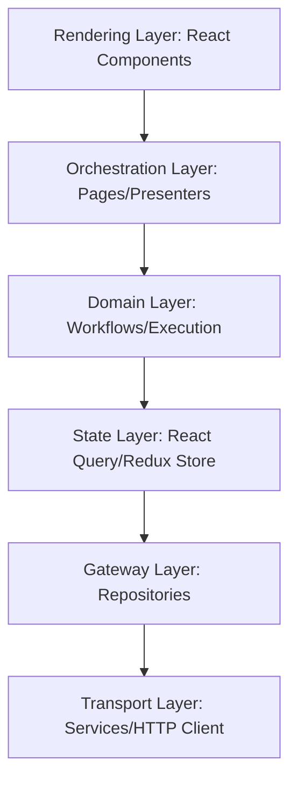

# ADR-010: ZenOS V2 Layered Application & Runtime Architecture

## Status

Approved

## Context

As the ZenOS V2 platform scales, component-centric React patterns (where business logic, state caching, API integration, and rendering reside inside components and hooks) inevitably lead to structural drift, visual regressions, service-hook abuse, and untestable "god-components".

To achieve an enterprise-ready, white-labelable frontend platform, we have refactored React to serve exclusively as a **Rendering Engine** nested within a robust, Hexagonal, and Layered Application Architecture.

---

## Architecture Breakdown



### 1. The Rendering Layer (`components/`)

- **Responsibility**: Accessible layout structures (WCAG compliant), DOM semantics, local visual interactions, and responsive rendering.
- **Invariant**: Absolutely zero backend orchestration, database querying, or state persistence.

### 2. The Orchestration Layer (`pages/` & `views/`)

- **Responsibility**: Acts as Presenters. Connects UI components to active domain workflows, passes layout slot contexts, and manages layout grid assemblies.

### 3. The Domain Execution Layer (`workflows/`)

- **Responsibility**: Houses pure, framework-agnostic business logic and multi-step transaction steps. Isolates execution semantics from visual rendering.

### 4. The Gateway Layer (`repositories/`)

- **Responsibility**: Stabilizes frontend domain models. Normailzes incoming server Data Transfer Objects (DTOs) and insulates the UI layer from breaking backend schema changes.

### 5. The Server State Layer (`queries/` & `mutations/`)

- **Responsibility**: Orchestrates query key caching, cache invalidation, and data synchronization.

### 6. The Transport Layer (`services/`)

- **Responsibility**: Lower-level networking, fetch routing, header injections, and HTTP client instantiations.

---

## ⚖️ The Invariant: Proportional Complexity Rule

To prevent the architecture from collapsing under the weight of **Over-Abstraction**, we enforce the **Proportional Complexity Balance**:

```txt
   Tiny Interaction (Toggle)  ──►  Hook / Component Layer (Simple UI State)
   Server Synchronization      ──►  Query Layer
   API / Data Normalization    ──►  Repository Layer
   Multi-Step Business Logic   ──►  Workflow Layer
```

- **Anti-Pattern**: Do _not_ scaffold a Service, Repository, Query, and Workflow for simple visual state (e.g. `setDarkMode(true)` or `isModalOpen`). Keep local interaction lightweight.
- **Mandatory Rule**: Any transactional mutations, data conversions, or backend interfaces _must_ pass through a designated Repository to guard UI integrity.

## Consequences

- **Stable Contracts**: Frontend models remain intact even if backend services are refactored or rewritten.
- **Separation of Concerns**: Unlocks robust unit testing on raw javascript workflows and repositories without mock-rendering React components.
- **Clarity of Ownership**: Clear directory patterns eliminate architectural ambiguity for scaling dev teams.
