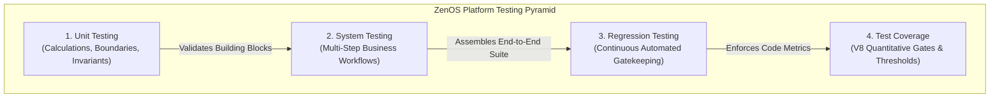

# Platform Testing Strategy & Doctrine

> **Status**: Mandatory Engineering Contract  
> **Scope**: Testing Doctrine across ZenOS, Core Engines, and ERP Modules  
> **Applicability**: Domain Logic, Form-Core, Table-Core, Shell, and HRMIS / ERP Features  

---

## 1. Core Testing Doctrine

All systems in ZenOS **MUST** remain independently testable. Implicit runtime coupling between layers is strictly prohibited.

### Layer-by-Layer Verification Contracts:
* **Domain Layer**: Testable with **zero mocks**, zero DOM, zero framework imports (Node/V8 pure). Business rules and mathematical formulas MUST be verified in isolation.
* **Use Case / Application Layer**: Testable with mocked external dependencies (repositories, network APIs, storage). Orchestration workflows are verified without real databases.
* **Presenters & UI Surfaces**: Testable directly from props without requiring a global form provider or running backend server.
* **ViewModels**: Testable without rendering JSX (pure state transitions, action dispatching).
* **Reducers & State Machines**: Deterministic, pure, and free of side effects.
* **Controllers & Orchestrators**: Orchestration-testable through contract interfaces.

---

## 2. The Four Testing Concepts in ZenOS

In software development, **Unit Testing**, **System Testing**, **Regression Testing**, and **Test Coverage** are four foundational concepts. They serve distinct purposes, but together they ensure reliable, maintainable enterprise software.

| Concept Type | Primary Question | What Does It Verify? | Scope | Nature |
|---|---|---|:---:|:---:|
| **Unit Testing** | *Does this individual piece of code work correctly?* | A pure calculation function, domain entity, hook, or component in isolation. | Small | Testing Approach |
| **System Testing** | *Does the complete system work correctly?* | The end-to-end multi-step business workflow as an integrated system. | Large | Testing Approach |
| **Regression Testing** | *Did a new change break something that previously worked?* | Existing functionality across dependent modules after a modification. | Varies | Testing Approach |
| **Test Coverage** | *How much of the code or functionality have we tested?* | The quantitative measurement of code exercised during execution. | Global | Quantitative Measurement |

> [!IMPORTANT]
> **Key Distinction**: Unit testing, system testing, and regression testing describe **testing approaches** (how and what you test). Test coverage is a **measurement** (how much code your tests execute).



---

## 3. Unit Testing: Pure Calculations & Boundaries

Unit testing verifies the correctness of an isolated, small unit of code independently of the rest of the application.

### Qualities of a Good Unit Test:
1. **Tests one clearly defined behavior**.
2. **Deterministic**: Produces the exact same result every time.
3. **Blazing Fast**: Runs in single-digit milliseconds; pure V8 execution.
4. **Independent**: No network requests, real databases, or browser DOM dependencies.
5. **Boundary-Exhaustive**: Tests normal happy paths, edge boundaries (0 values, max limits), and invalid negative inputs.

### HRMIS Example 1: Working Hours Calculation (`attendance.utils.ts`)

```typescript
export function calculateWorkingHours(
  checkInMinutes: number,
  checkOutMinutes: number,
  breakMinutes: number = 0
): number {
  if (checkInMinutes < 0 || checkInMinutes >= 1440 || checkOutMinutes < 0 || checkOutMinutes >= 1440) {
    throw new RangeError("Timestamps must be within a valid 24-hour day (0 - 1439 minutes).");
  }

  // Handle overnight graveyard shifts crossing midnight (e.g., 22:00 to 06:00)
  const duration = checkOutMinutes >= checkInMinutes
    ? checkOutMinutes - checkInMinutes
    : (1440 - checkInMinutes) + checkOutMinutes;

  const payableMinutes = Math.max(0, duration - Math.max(0, breakMinutes));
  return Math.round((payableMinutes / 60) * 100) / 100;
}
```

#### Unit Test Suite (`attendance.utils.test.ts`):
```typescript
describe("calculateWorkingHours", () => {
  it("calculates standard 9:00 AM to 5:00 PM shift correctly", () => {
    // 540 = 09:00, 1020 = 17:00
    expect(calculateWorkingHours(540, 1020)).toBe(8);
  });

  it("returns zero when check-in and check-out are identical", () => {
    expect(calculateWorkingHours(540, 540)).toBe(0);
  });

  it("accurately handles overnight graveyard shifts crossing midnight", () => {
    // 1320 = 22:00, 360 = 06:00 (next day)
    expect(calculateWorkingHours(1320, 360)).toBe(8);
  });

  it("deducts break duration correctly", () => {
    expect(calculateWorkingHours(540, 1020, 45)).toBe(7.25);
  });

  it("clamps to zero when break duration exceeds shift duration", () => {
    expect(calculateWorkingHours(540, 600, 90)).toBe(0);
  });

  it("throws RangeError on negative or invalid minutes", () => {
    expect(() => calculateWorkingHours(-10, 500)).toThrow(RangeError);
  });
});
```

### HRMIS Example 2: Leave Quota & Net Salary Units

```typescript
export function getLeaveStatus(requestedDays: number, availableBalance: number): "APPROVED" | "REJECTED" {
  if (requestedDays < 0) throw new RangeError("Requested days cannot be negative.");
  return requestedDays <= availableBalance ? "APPROVED" : "REJECTED";
}

export function calculateNetSalary(params: {
  basicSalary: number;
  overtimePay: number;
  unpaidLeaveDeduction: number;
  taxDeduction: number;
}): number {
  const { basicSalary, overtimePay, unpaidLeaveDeduction, taxDeduction } = params;
  if (basicSalary < 0 || overtimePay < 0 || unpaidLeaveDeduction < 0 || taxDeduction < 0) {
    throw new RangeError("Salary figures cannot be negative.");
  }
  const grossEarnings = basicSalary + overtimePay;
  const totalDeductions = unpaidLeaveDeduction + taxDeduction;
  return Math.max(0, grossEarnings - totalDeductions);
}
```

---

## 4. System Testing: Multi-Step Business Workflows

System testing verifies whether the application works correctly as an integrated system, coordinating across schemas, calculated fields, dependent visibility, validation, and audit logging.

### Canonical HRMIS Payroll System Workflow:
In ZenOS HRMIS, an end-to-end payroll calculation follows this multi-tier pipeline:

```
[1. Employee Setup]
    basicSalary: ₹30,000, hourlyRate: ₹200, dailyRate: ₹1,000
           │
           ▼
[2. Attendance Module]
    overtimeHours: 10 hrs ──► Formula: overtimePay = 10 × 200 = ₹2,000
           │
           ▼
[3. Leave Module]
    unpaidLeaveDays: 1 day ──► Formula: unpaidLeaveDeduction = 1 × 1,000 = ₹1,000
           │
           ▼
[4. Tax & Net Calculation]
    taxDeduction: ₹1,500
    netSalary = 30,000 + 2,000 - 1,000 - 1,500 = ₹29,500
           │
           ▼
[5. Governance & Visibility]
    totalDeductions (₹2,500) >= ₹1,000 ──► highDeductionAlert triggers visible
           │
           ▼
[6. Audit Trail]
    All state mutations logged chronologically in audit history
```

**Implementation Reference**: [`src/core/form-core/__tests__/hrmis-system-workflow.test.ts`](../../src/core/form-core/__tests__/hrmis-system-workflow.test.ts).

---

## 5. Regression Testing: Guarding Shared Foundations

Regression testing ensures that new features, bug fixes, or legacy code deprecations do not break existing functionality across the platform.

### High-Risk Blast Radii in ZenOS:
* Modifications to `FormCore` state transitions affect all forms across ERP modules.
* Modifications to `@ui/form/fields` affect all form layouts, modals, and drawers.
* Modifications to attendance or leave calculators affect payroll and tax computations.

### Automated Regression Suites:
ZenOS runs automated regression suites in CI/CD before any merge:

```bash
# Run core engine regression suite (37 files, 313 tests)
npm run test:form-core

# Run UI component regression suite
npm run test:component -- src/shared/ui/form

# Run entire platform regression gate
npm run test:all
```

---

## 6. Test Coverage: Quantitative Measurement via V8

Test coverage measures what percentage of statements, branches, functions, and lines are exercised by the test suite.

### Baseline Coverage Thresholds:
For core packages (`src/core/form-core`), the following thresholds are formally enforced by Vitest V8:

```typescript
// projects/form-core/vitest.config.ts
coverage: {
  provider: 'v8',
  reporter: ['text', 'json', 'html', 'lcov'],
  include: ['src/core/form-core/**/*.{ts,tsx}'],
  exclude: [
    'src/core/form-core/**/*.test.{ts,tsx}',
    'src/core/form-core/__tests__/**',
    'src/core/form-core/test-utils.ts',
  ],
  thresholds: {
    statements: 70, // Minimum 70% statement coverage
    branches: 70,   // Minimum 70% branch coverage
    functions: 60,  // Minimum 60% function coverage
    lines: 70,      // Minimum 70% line coverage
  },
}
```

### Running Coverage:
```bash
# Execute V8 coverage reporting for form-core
npm run test:form-core:coverage
```

---

## 7. Quality Gates & PR Checklist Verification

Before submitting or approving a Pull Request affecting platform cores:

1. **Domain Isolation**:
   - [ ] No framework or ORM imports in `src/core/`.
   - [ ] Pure business rules tested with 0 mocks.
2. **Boundary Testing**:
   - [ ] Edge cases covered: zero values, negative timestamps, overflow caps.
3. **Workflow Integrity**:
   - [ ] System test verifies multi-step data flow and reactive formulas.
4. **Regression & Coverage**:
   - [ ] All regression suites pass (`npm run test:form-core`).
   - [ ] Coverage meets or exceeds all formal thresholds (`npm run test:form-core:coverage`).
