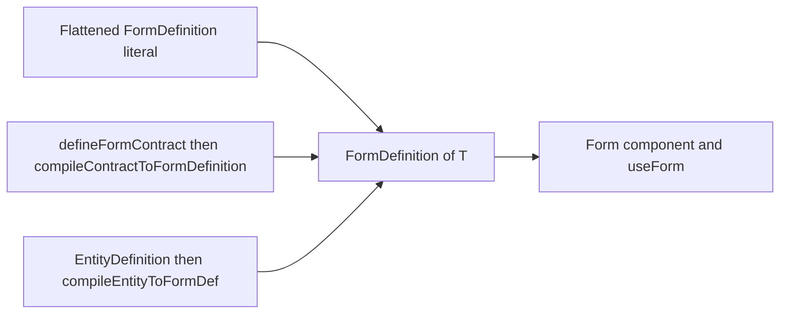
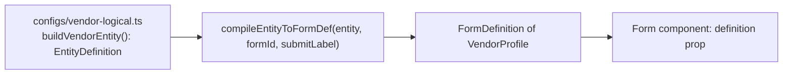

# Typed Contracts and the MDAP Compiler

The Zenith Form Architecture accepts three authoring paths. All three converge on one runtime artifact, `FormDefinition`, which `<Form>` and `useForm` consume. This guide documents the typed-contract path (`defineFormContract`) and the MDAP/EntityDefinition path (`compileEntityToFormDef`), and reconciles both with the flattened `FormDefinition` literal taught in [QUICK_START.md](./QUICK_START.md) Pattern 1.

Every signature below is copied from source. Links are relative to `frontend/docs/form/`.

---

## 1. Three authoring paths

### 1.1 Path comparison

| Path | Best for | Entry API | Doc link |
|---|---|---|---|
| (a) Flattened `FormDefinition` literal (current default) | Hand-authored forms, quick iteration, no compiler step | Object literal → `<Form definition={...}>` or `useForm(definition, ...)` | [QUICK_START.md](./QUICK_START.md) Pattern 1 |
| (b) Typed contracts | Compile-time value model shared across components and hooks | `defineFormContract(contract)` → `compileContractToFormDefinition(contract)` | [./reference/11-TYPES_CONTRACTS.md](./reference/11-TYPES_CONTRACTS.md) |
| (c) MDAP `EntityDefinition` | Layered authoring (content, behavior, surface, presentation) and schemas produced by tooling or remote metadata | `compileEntityToFormDef(entity, formId, submitLabel)` | [./reference/10-SHARED_UTILS.md](./reference/10-SHARED_UTILS.md) |

The flattened literal is the documented default: [QUICK_START.md](./QUICK_START.md) Pattern 1 passes a `FormDefinition` object straight into `<Form>`. Paths (b) and (c) are optional typed and layered pathways to the same object, not replacements for it.

### 1.2 Convergence



One facade accepts any of the three. [useFormFacade.ts](../../src/shared/ui/form/hooks/useFormFacade.ts) takes exactly one of `entity`, `contract`, or `definition` and returns `formProps` ready to spread onto `<Form>`; it throws when none is supplied.

```ts
const { formProps } = useFormFacade<VendorProfile>({ entity: vendorEntity });
```

`useMDAPForm` and `useEntityForm` are deprecated aliases of `useFormFacade` ([useMDAPForm.ts](../../src/shared/ui/form/hooks/useMDAPForm.ts)).

---

## 2. Typed contracts

Defined in [contract.ts](../../src/shared/ui/form/types/contract.ts). A contract is a strongly-typed authoring object that compiles by cast into a `FormDefinition`.

### 2.1 `defineFormContract`

```ts
export function defineFormContract<
  const TFields extends TypedFieldContract<any>,
  const TForm extends FormDefinitionContract<TFields>
>(contract: TForm): TForm
```

Identity builder. The `const` type parameters force literal inference of field names, `type`, `component`, and `options`, which is what makes `InferFormValues` (2.3) precise. Without it, `name` widens to `string` and the inferred data model collapses.

### 2.2 `compileContractToFormDefinition`

```ts
export function compileContractToFormDefinition<
  const TForm extends FormDefinitionContract<any>
>(contract: TForm): FormDefinition<InferFormValues<TForm>>
```

Implementation is a cast: `return contract as unknown as FormDefinition<InferFormValues<TForm>>`. Nothing is normalized or validated at compile time, so the contract must already satisfy the runtime `FormDefinition` shape. The result is passed directly to `<Form definition={...} />`.

### 2.3 `InferFormValues`

```ts
export type InferFormValues<T> = {
  [K in ExtractAllFields<T> as K extends { type: StaticFieldTypeKey } ? never : K["name"]]: ExtractFieldType<K>;
};
```

Builds the form data model from a contract. Fields are collected from both the direct `fields` array and `sections[].fields` via the non-exported helpers `ExtractAllFields`, `ExtractFieldsFromSections`, `ExtractFieldType`, and `StaticFieldTypeKey`.

| Contract member | Inferred value type |
|---|---|
| `{ type: "number" }` | `number` |
| `{ type: "boolean" }` | `boolean` |
| `MultiSelectFieldContract` (`component: "multiselect"`) | option union `O[]` |
| `SelectFieldContract` / `RadioFieldContract` | option union `O` |
| `{ type: "array" }` | `any[]` |
| `{ type: "object" }` | `Record<string, any>` |
| static types (`header`, `button`, `divider`, `message`, ...) | excluded — key removed from the model |
| everything else (`string`, `email`, `date`, ...) | `string` |

### 2.4 Payload and field contracts

| Type | Role |
|---|---|
| `FieldDefinitionPayload` | Discriminated union of `TextFieldContract`, `SelectFieldContract`, `MultiSelectFieldContract`, `RadioFieldContract`, `NumberFieldContract`, `BooleanFieldContract`, `DateFieldContract`, `FileFieldContract`, `StaticFieldContract`, `StructureFieldContract`, `CustomFieldContract` |
| `CustomFieldContract` | Escape hatch: `type: string` plus an index signature, for components outside the built-in union |
| `TypedFieldContract<TName>` | Shared field props (`id`, `name`, `label`, `description`, `helpText`, `required`, `disabled`, `readOnly`, `hidden`, `validation`, `conditions`, `meta`, `layout`) intersected with `FieldDefinitionPayload` |
| `FormSectionContract` | `id`, `title`, `description`, `layout`, `fields`, `subSections`, `nextStep` |
| `FormDefinitionContract` | `id`, `title`, optional `sections`/`fields`/`settings`/`layout`/`style`/`validation`/`events`/`metadata` |

`CustomFieldContract` and `FieldDefinitionPayload` are not re-exported from the `@ui/form` barrel; import them from `@ui/form/types/contract`.

### 2.5 End-to-end example

```tsx
import { z } from "zod";

import { Form, compileContractToFormDefinition, defineFormContract } from "@ui/form";
import type { InferFormValues } from "@ui/form";

const contactContract = defineFormContract({
  id: "contact-form",
  title: "Contact Support",
  submitLabel: "Submit Ticket",
  sections: [
    {
      id: "general",
      title: "Ticket Details",
      fields: [
        {
          id: "email",
          name: "email",
          type: "string",
          component: "email",
          label: "Email Address",
          required: true,
        },
        {
          id: "priority",
          name: "priority",
          type: "string",
          component: "select",
          label: "Urgency Level",
          required: true,
          options: [
            { value: "low", label: "Low Priority" },
            { value: "medium", label: "Medium Priority" },
            { value: "high", label: "Critical" },
          ],
        },
        {
          id: "details",
          name: "details",
          type: "string",
          component: "textarea",
          label: "Issue Description",
        },
      ],
    },
  ],
});

export type ContactFormValues = InferFormValues<typeof contactContract>;
// { email: string; priority: "low" | "medium" | "high"; details: string }

const definition = compileContractToFormDefinition(contactContract);

const contactSchema = z.object({
  email: z.email("Please provide a valid business email"),
  priority: z.enum(["low", "medium", "high"]),
  details: z.string().min(10, "Description must be at least 10 characters"),
});

async function submitTicket(payload: ContactFormValues): Promise<void> {
  await fetch("/api/tickets", {
    method: "POST",
    headers: { "Content-Type": "application/json" },
    body: JSON.stringify(payload),
  });
}

export function ContactPage() {
  return (
    <Form
      definition={definition}
      validationSchema={contactSchema}
      onSubmit={(data) => submitTicket(data)}
    />
  );
}
```

`Form` is generic ([Form.tsx](../../src/shared/ui/form/Form.tsx), [FormProps.ts](../../src/shared/ui/form/FormProps.ts)), so `definition: FormDefinition<ContactFormValues>` fixes `data` in `onSubmit` with no annotation.

The headless hook takes the type parameter explicitly — `useForm<T>` reads `definition: FormDefinition` (not `FormDefinition<T>`), so inference does not flow from the contract:

```tsx
const { values, form, isValid } = useForm<ContactFormValues>(definition, {
  priority: "medium",
});

form.setValue("priority", "high");
const urgency: "low" | "medium" | "high" = values.priority;
```

Zod v4 is installed (`zod@^4.3.6`): use `z.email()`, not `z.string().email()`.

---

## 3. Wizard contracts

### 3.1 `withWizard` and `WizardContractConfig`

```ts
export interface WizardContractConfig {
  enabled?: boolean;
  stepperType?: "sidebar" | "top";
  linear?: boolean;
  initialStepId?: string;
}

export function withWizard<
  const TForm extends FormDefinitionContract<any>
>(config?: WizardContractConfig) {
  return (contract: TForm): TForm => ({
    ...contract,
    settings: {
      ...((contract.settings as Record<string, any>) || {}),
      wizard: {
        enabled: true,
        ...(((contract.settings as any)?.wizard as Record<string, any>) || {}),
        ...config,
      },
    },
  });
}
```

Curried: apply it around `defineFormContract(...)`. Merge order is `enabled: true`, then any pre-existing `settings.wizard`, then `config` — so an explicit `config.enabled === false` or an existing wizard block wins over the default. The input contract is not mutated (covered by [withWizard.test.ts](../../src/shared/ui/form/types/__tests__/withWizard.test.ts)).

Sections are the steps. `FormSectionContract.nextStep` accepts a step id or a resolver over current values; it is wired into the engine pipeline (`form.flow.getNextStep`) that `FormFlow`-era footer components read to advance (see [contract.ts](../../src/shared/ui/form/types/contract.ts) section 4b).

### 3.2 How a wizard contract reaches `<Form>`

| Step | Mechanism | Source |
|---|---|---|
| 1 | `compileContractToFormDefinition(contract)` carries `settings.wizard.enabled: true` | [contract.ts](../../src/shared/ui/form/types/contract.ts) |
| 2 | `<Form>` reads `definition.settings.wizard.enabled` and selects `runtimeMode: "wizard"` | [Form.tsx](../../src/shared/ui/form/Form.tsx) |
| 3 | With no explicit `definition.shell`, the shell is generated from `settings.wizard.stepperType` | [wizard-shell-factory.ts](../../src/shared/ui/form/shell/wizard-shell-factory.ts) |
| 4 | The shell renders `FormStepper` (sidebar or top) and filters hidden steps | [FormStepper.tsx](../../src/shared/ui/form/shell/FormStepper.tsx), props in [./reference/07-COMPONENTS.md](./reference/07-COMPONENTS.md) |
| 5 | `FlowProxy.getNextStep(currentStepId)` resolves `section.nextStep` (function → string → sequential `rootSections` → `null`) | [flow-proxy.ts](../../src/core/form-core/flow-proxy.ts), documented in [./reference/02-REGISTRIES.md](./reference/02-REGISTRIES.md) |

### 3.3 Example: multi-step onboarding

```tsx
import { Form, compileContractToFormDefinition, defineFormContract, withWizard } from "@ui/form";
import type { InferFormValues } from "@ui/form";

const onboardingContract = withWizard({ stepperType: "sidebar", linear: true })(
  defineFormContract({
    id: "onboarding",
    title: "New Account Onboarding",
    submitLabel: "Create Account",
    sections: [
      {
        id: "account",
        title: "Account",
        fields: [
          {
            id: "email",
            name: "email",
            type: "string",
            component: "email",
            label: "Work Email",
            required: true,
          },
          {
            id: "password",
            name: "password",
            type: "string",
            component: "password",
            label: "Password",
            required: true,
          },
        ],
      },
      {
        id: "organization",
        title: "Organization",
        fields: [
          {
            id: "company",
            name: "company",
            type: "string",
            label: "Company Name",
            required: true,
          },
          {
            id: "size",
            name: "size",
            type: "string",
            component: "select",
            label: "Team Size",
            required: true,
            options: [
              { value: "1-10", label: "1-10 people" },
              { value: "11-50", label: "11-50 people" },
              { value: "51+", label: "51+ people" },
            ],
          },
        ],
        nextStep: (values) => (values.size === "51+" ? "billing" : "review"),
      },
      {
        id: "billing",
        title: "Billing",
        fields: [
          {
            id: "plan",
            name: "plan",
            type: "string",
            component: "radio",
            label: "Plan",
            options: [
              { value: "standard", label: "Standard" },
              { value: "enterprise", label: "Enterprise" },
            ],
          },
        ],
      },
      {
        id: "review",
        title: "Review",
        fields: [
          {
            id: "notes",
            name: "notes",
            type: "string",
            component: "textarea",
            label: "Notes",
          },
        ],
      },
    ],
  })
);

export type OnboardingValues = InferFormValues<typeof onboardingContract>;

const definition = compileContractToFormDefinition(onboardingContract);

export function OnboardingPage() {
  return (
    <Form
      definition={definition}
      onSubmit={(data) => createAccount(data)}
    />
  );
}

async function createAccount(payload: OnboardingValues): Promise<void> {
  await fetch("/api/accounts", { method: "POST", body: JSON.stringify(payload) });
}
```

The stepper renders automatically: no `FormStepper` import is required inside `<Form>`. The same contract can be fed to `useFormFacade({ contract })` instead of compiled manually.

### 3.4 Known limits

- `WizardContractConfig.initialStepId` is stamped onto `settings.wizard`, but the runtime seeds the first step from the first rendered step node (`initialStepId: nodes[0]?.id` in [useFormCore.ts](../../src/shared/ui/form/hooks/useFormCore.ts)). Order sections to control the starting step.
- Doc comments in [useFormFacade.ts](../../src/shared/ui/form/hooks/useFormFacade.ts) and [useMDAPForm.ts](../../src/shared/ui/form/hooks/useMDAPForm.ts) mention `<FormFlow>` and `useFormFlow`. No such component or hook is exported anywhere in `src/` — wizard rendering is handled by `<Form>` itself. Treat those comment references as historical.

---

## 4. The MDAP path

### 4.1 `EntityDefinition`

```ts
export interface EntityDefinition<
  TData extends Record<string, any> = Record<string, any>,
> {
  id: string;
  name: string;
  version?: string;
  content: ContentDefinition<TData>;
  behavior?: BehaviorDefinition<TData>;
  surface?: SurfaceDefinition;
  presentation?: PresentationDefinition;
  forms?: Record<string, FormDefinition<TData>>;
}
```

Source: [application.ts](../../src/shared/ui/form/types/application.ts). `content` is required; behavior, surface, and presentation are optional layers. `ContentDefinition` requires `id` and `title` and holds `sections`/`fields` ([content.ts](../../src/shared/ui/form/types/content.ts)).

### 4.2 `compileEntityToFormDef`

```ts
export function compileEntityToFormDef<T extends Record<string, any>>(
  entity: EntityDefinition<T>,
  formId: string,
  submitLabel: string
): FormDefinition<T>
```

Source: [mdap-compiler.ts](../../src/shared/ui/form/utils/mdap-compiler.ts). Behavior:

| Step | Effect |
|---|---|
| 1 | Copies `entity.content.sections`, stamping an empty `meta.events` object on each field |
| 2 | Projects `entity.surface.ui` (`shell`, `density`, `maxHeight`) and `entity.presentation.style` into a `FormUIConfig` |
| 3 | Calls `fuseSchema(flatContent, uiConfig)`, then sets `id = formId` and `submitLabel` |
| 4 | When `behavior.pipeline.middleware` is present, wires the callbacks sequentially into `events.onSubmit` |

### 4.3 Pipeline



The scaffold generator emits exactly this chain: `*-logical.ts` builds the entity, `*-surface.ts` builds `SurfaceDefinition`/`PresentationDefinition`, and `*-schema.ts` calls `compileEntityToFormDef` (see [TOOLING.md](./TOOLING.md) section 1).

### 4.4 Export status and type gaps

`compileEntityToFormDef` is still exported from the live barrel [index.ts](../../src/shared/ui/form/index.ts): `export { compileEntityToFormDef } from "./utils/mdap-compiler"` (line 270). Both import styles are in use:

```ts
import { compileEntityToFormDef } from "@ui/form";
import { compileEntityToFormDef } from "@ui/form/utils/mdap-compiler";
```

Two caveats, both verified against source:

- [schema-factory.ts](../../src/shared/ui/form/utils/schema-factory.ts) declares a second, file-local `compileEntityToFormDef(entity, options: { formId; submitLabel?; cancelLabel?; register? })`. It is **not** barrel-exported; the barrel resolves to the positional form above. Import the subpath if the options-object variant is required.
- The compiler reads `entity.surface.ui` and `behavior.pipeline.middleware`. Neither member is declared on `SurfaceDefinition` or `BehaviorDefinition` ([surface.ts](../../src/core/form-core/domain/surface.ts), [behavior.ts](../../src/core/form-core/domain/behavior.ts)), so both accesses report `TS2339` under `tsc -b`. MDAP fixtures in [mdap-form.fixture.ts](../../src/shared/ui/form/tests/mdap/fixtures/mdap-form.fixture.ts) and the scaffold templates use these members at runtime anyway; expect to cast or narrow the entity at the boundary when strict checking matters.

### 4.5 Entity-first React binding

```tsx
const { formProps, isSubmitting } = useFormFacade<VendorProfile>({
  entity: vendorEntity,
  formId: "vendor-onboarding-form",
  submitLabel: "Save Vendor",
  onSuccess: (data) => invalidateVendor(data),
});

return <Form {...formProps} />;
```

`useFormFacade` compiles the entity internally, projects `layers` (content/behavior/surface/presentation) as the public boundary, and wraps submission in a React Query mutation ([useFormFacade.ts](../../src/shared/ui/form/hooks/useFormFacade.ts)).

---

## 5. Schema composition helpers

| Helper | Signature | Use when |
|---|---|---|
| `fuseSchema` | `fuseSchema<T>(skeleton: FormDefinition<T>, uiConfig: UIConfiguration): FormDefinition<T>` | You already hold a logical skeleton and a UI overlay and want the raw merge with no registration |
| `createFormDefinition` | `createFormDefinition<T>(skeleton: FormDefinition<T>, uiConfig?: FormUIConfig, options?: { formId?: string }): FormDefinition<T>` | One-shot fuse that also stamps `id` and registers in `schemaRegistry` — the default for ViewModels |
| `createSchemaFactory` | `createSchemaFactory<T, P>(skeleton: FormDefinition<T>, ui: (...args: P) => UIConfiguration, options?: { formId?: string; transform?: (skeleton: FormDefinition<T>) => FormDefinition<T> }): (...args: P) => FormDefinition` | The UI overlay depends on arguments (per record, per locale, per mode); build once, call many |
| `createSimpleForm` | `createSimpleForm<T>(options: SimpleFormOptions<T>): FormDefinition<T>` | Two to five field dialogs and rename panels; a single section, no layering, no separate `*-logical` files |

Sources: [schema-fusion.ts](../../src/shared/ui/form/utils/schema-fusion.ts), [schema-factory.ts](../../src/shared/ui/form/utils/schema-factory.ts), [createSimpleForm.ts](../../src/shared/ui/form/utils/createSimpleForm.ts). All four are barrel-exported from [index.ts](../../src/shared/ui/form/index.ts).

```ts
import { createFormDefinition } from "@ui/form";

const definition = createFormDefinition(
  onboardingSkeleton,
  { settings: { density: "compact" }, sections: { account: { layout: { type: "card" } } } },
  { formId: "onboarding" }
);
```

`fuseSchema` normalizes legacy UI overlays (`fieldConfig`, `gridColumn: "span 6"`) through `normalizeUIConfig` before merging, on the canonical 12-column grid. `UIConfiguration` is a deprecated alias of `FormUIConfig`, retained so existing `fuseSchema` call sites type-check.

---

## 6. Relationship to the archive

[../archive/form-v1/README.md](../archive/form-v1/README.md) states the opposite mandate: forms **must** be authored as `EntityDefinition` objects, and manually written `FormDefinition` objects passed to `<Form>` are called out as a violation of the MDAP architecture.

That mandate is superseded for current work:

| Statement in the v1 archive | Status |
|---|---|
| "You must author your forms using the `EntityDefinition` interface" | Superseded — the flattened literal is the current default ([QUICK_START.md](./QUICK_START.md) Pattern 1) |
| Flattened `FormDefinition` implementations "violate the architecture" | Superseded — flattened definitions are the documented default path |
| Compile every entity with `compileEntityToFormDef()` | Still valid — the MDAP path remains available and barrel-exported (4.4) |

Contracts and MDAP remain optional typed and layered/remote-metadata pathways. Read the archive for historical context on the four-layer model; do not treat its authoring rules as binding. The v2 entry points are [FORM_ARCHITECTURE.md](./FORM_ARCHITECTURE.md) and [QUICK_START.md](./QUICK_START.md).

---

## 7. Backend metadata

For schemas that arrive over the wire rather than being authored in TypeScript, normalize before rendering:

```ts
import { BackendMetadataNormalizer } from "@ui/form";
import type { BackendSchemaMetadata } from "@ui/form";

const schema: BackendSchemaMetadata = {
  entity: "vendor",
  title: "Vendor",
  fields: [
    { name: "vendorName", type: "varchar", label: "Vendor Name", required: true, maxLength: 120 },
    { name: "active", type: "boolean", label: "Active" },
  ],
};

const definition = BackendMetadataNormalizer.normalizeToFormDefinition(schema);
```

| Method | Result |
|---|---|
| `normalizeToContent(backendSchema)` | Layer 1 `ContentDefinition`: backend type mapped to canonical type (`varchar`/`text` → `text`, `int`/`decimal` → `number`, `bool` → `checkbox`, `date` → `date`, `select`/`enum` → `select`), `required` from `required ?? nullable === false`, generated `required`/`maxLength`/`minLength`/`min`/`max` rules, raw backend type preserved under `metadata.backendType` |
| `normalizeToFormDefinition(backendSchema)` | Wraps `normalizeToContent` into a `FormDefinition` with `id` = entity and fields attached under both `content` and top-level `fields` |

Source: [backend-normalizer.ts](../../src/core/form-core/backend-normalizer.ts), documented in [./reference/02-REGISTRIES.md](./reference/02-REGISTRIES.md) section 7. The class and both metadata types are exported from the barrel ([index.ts](../../src/shared/ui/form/index.ts), line 250).

For dynamic header metadata (name-keyed records, groups, per-field UI overrides), the parallel entry point is `MetaSchemaBridge.compileToFormDefinition(metaSchema, uiOverrides?, slots?)`, plus `compileToFields`, `compileToSections`, `compileToRenderDefinition`, and `compileToTableColumns`. See [./reference/10-SHARED_UTILS.md](./reference/10-SHARED_UTILS.md).

---

## 8. Choosing a path and troubleshooting

### 8.1 Choosing

| Situation | Path |
|---|---|
| New form, single surface, no shared value model needed | Flattened literal (QUICK_START Pattern 1) |
| The same values type flows into hooks, subcomponents, and submit handlers | Typed contract (2) |
| A stepper/flow form where sections are steps with branching | Typed contract + `withWizard` (3) |
| Schemas generated by tooling, or content/behavior/surface/presentation authored separately | MDAP entity (4) |
| Schema comes from a REST/GraphQL/database response | `BackendMetadataNormalizer` or `MetaSchemaBridge` (7) |
| Two to five fields in a modal | `createSimpleForm` (5) |
| ViewModel owns a skeleton plus a reusable UI overlay | `createFormDefinition` / `createSchemaFactory` (5) |

### 8.2 Troubleshooting

| Symptom | Likely cause | Fix |
|---|---|---|
| `InferFormValues` keys are `string`, values are `string` | Contract passed to `defineFormContract` without literal inference, or fields declared outside the helper | Wrap the object in `defineFormContract(...)`; keep field arrays inline so `const` type parameters apply (2.1) |
| A field is missing from the inferred model | Static field type (`button`, `header`, `divider`, ...) is excluded by design | Model it as a real value field, or read it from the contract directly (2.3) |
| `<Form>` renders no stepper | `settings.wizard.enabled` is not `true` | Apply `withWizard()` or set `settings.wizard.enabled: true` before compiling (3.1, 3.2) |
| Stepper renders but the first step is wrong | `initialStepId` is not consumed by the runtime | Reorder sections; the first rendered step node wins (3.4) |
| `import { compileEntityToFormDef } from "@ui/form"` resolves to the wrong signature | Both the barrel (positional) and `schema-factory.ts` (options object) declare the name | Import `@ui/form` or `@ui/form/utils/mdap-compiler` for positional; import `@ui/form/utils/schema-factory` explicitly for options (4.4) |
| `tsc -b` reports `Property 'ui' does not exist on type 'SurfaceDefinition'` or `'middleware' does not exist` | Declared MDAP layer types lag the runtime compiler | Cast or narrow the entity at the boundary; the runtime shape is documented in 4.2 (4.4) |
| Definition compiles but every field renders unstyled / unmerged | `fuseSchema` never ran, or the UI overlay keys do not match | Match sections by `section.id` and fields by `field.name` (or `id`/`key`); prefer `createFormDefinition` (5) |
| Backend schema renders as raw text everywhere | Types not mapped from the wire format | Run `BackendMetadataNormalizer.normalizeToFormDefinition` first (7) |
| An archived doc says flattened definitions are forbidden | v1 archive mandate | Superseded — flattened is the default (6) |
| `useFormFacade` throws `requires one of: entity, contract, or definition` | The hook received none of its three sources | Pass exactly one of `entity`, `contract`, or `definition` (1.2) |

---

**See also:**

- [QUICK_START.md](./QUICK_START.md) — flattened `FormDefinition` patterns and headless `useForm`
- [FORM_ARCHITECTURE.md](./FORM_ARCHITECTURE.md) — layers, dependency boundaries, execution models
- [TOOLING.md](./TOOLING.md) — scaffold generator, dev tools, tests, visual builder
- [./reference/11-TYPES_CONTRACTS.md](./reference/11-TYPES_CONTRACTS.md) — contract, layout, and application type signatures
- [./reference/10-SHARED_UTILS.md](./reference/10-SHARED_UTILS.md) — `fuseSchema`, `createSimpleForm`, `compileEntityToFormDef`, `MetaSchemaBridge`
- [./reference/02-REGISTRIES.md](./reference/02-REGISTRIES.md) — `FlowProxy`, schema registry, backend normalizer, test utilities
- [./reference/07-COMPONENTS.md](./reference/07-COMPONENTS.md) — `Form`, `FormStepper`, shell composition
- [./reference/04-DOMAIN_TYPES.md](./reference/04-DOMAIN_TYPES.md) — `FormDefinition`, section, and field domain types
- [../archive/form-v1/README.md](../archive/form-v1/README.md) — archived v1 authoring mandate (superseded, section 6)
