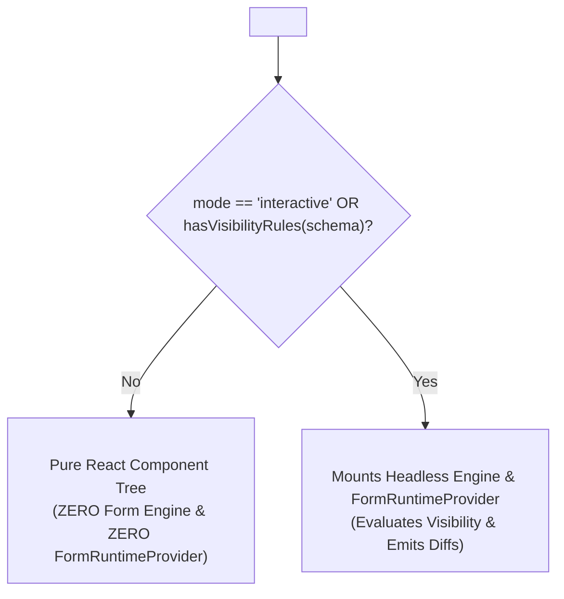

# Zenith DetailRenderer Specification & Guide

The `DetailRenderer` component provides a definition-driven presentation layer for rendering structured entity data, order summaries, profile inspectors, and read-only records **without wrapping them in `<form>` elements**.

---

## 1. Architectural Intent & Invariants

In modern web applications, entity detail pages (e.g. Order Inspection, Customer Profile, Product Specifications) often share schemas with edit forms. However, wrapping read-only views in HTML `<form>` tags introduces accessibility and semantic defects:
- Screen readers announce forms with inputs and submission hints.
- Unnecessary event handlers and headless engine instances consume memory.
- Default submit actions trigger unintended browser reloads.

### Canonical Invariants
1. **Semantic HTML**: Renders purely using `<article>`, `<section>`, `<dl>`, `<dt>`, `<dd>`, and `<div>`. **Zero `<form>` elements** are created.
2. **Option Badge Projection**: Select and radio fields project raw scalar IDs (e.g. `"active"`, `"tier_1"`) into formatted semantic status badges rather than raw internal keys via `DetailValueDisplay`.
3. **Headless Engine & Context Optimization**: In `mode="display"` (default), the headless form engine and all 10 `FormRuntimeProvider` context providers are **completely omitted** unless conditional visibility rules exist in the schema.
4. **Single-Diff Change Emission**: In `mode="interactive"`, `onChange` emits exactly once per user-modified field, never re-emitting stale diffs against baseline data.
5. **Layout Flexibility**: Supports three distinct layouts (`cards`, `key-value`, `flat`) and three density tokens (`compact`, `comfortable`, `spacious`).

---

## 2. Component Modes & Dual Execution Pipeline



### `mode="display"` (Default)
- For static inspection, audit logs, and summary views.
- Skips mounting the form engine and `FormRuntimeProvider` completely if no fields have conditional `visibility` or `rules`.
- Form fields are projected into read-only formatters (`DetailValueDisplay`) and key-value rows.
- Ideal for high-density tables, drawer side sheets, and modal inspectors.

### `mode="interactive"`
- For standalone editable widgets embedded directly in entity headers or summary cards (e.g., inline status toggles, quick assign dropdowns, range throttles).
- Mounts an isolated headless boundary (`DetailRuntimeBoundary`) with single-emission baseline diffing, operating cleanly without a `<form>` element.

---

## 3. Layout Styles & Density Scaling

`DetailRenderer` adapts to different visual contexts via `layoutStyle`:

| Layout Style | Characteristic | Best Used For |
|---|---|---|
| `layoutStyle="cards"` *(default)* | Elevated card containers (`DetailKeyDetailsCard`) grouped by schema sections with dividers. | Full-page specifications, dashboards, customer 360 profiles. |
| `layoutStyle="key-value"` | Compact two-column definition list (`DetailKeyValueRow` with horizontal alignment). | Infrastructure node telemetry, server specs, side drawers. |
| `layoutStyle="flat"` | Minimalist borderless container without card elevations. | Modal dialogs, embedded preview cards, print views. |

### Density Tokens
- `density="compact"`: `py-1 px-2.5`, smaller typography for data-dense telemetry.
- `density="comfortable"` *(default)*: Balanced padding and typography for enterprise views.
- `density="spacious"`: `py-4 px-6`, expanded line height for inspection dialogs.

---

## 4. Compound Subcomponents

`DetailRenderer` exports standalone subcomponents attached as compound properties for ergonomic discovery:

| Compound Component | Standalone Symbol | Description |
|---|---|---|
| `DetailRenderer.Header` | `DetailHeader` | Page/card header with badge icon, title, subtitle, status pills, and tags. |
| `DetailRenderer.KeyDetailsCard` | `DetailKeyDetailsCard` | Elevated card container for high-priority entity metrics and metadata. |
| `DetailRenderer.BottomActions` | `DetailBottomActions` | Action bar with optional sticky positioning and responsive layout. |
| `DetailRenderer.KeyValueRow` | `DetailKeyValueRow` | Semantic `<dt>`/`<dd>` row with horizontal or vertical alignment. |
| `DetailRenderer.ValueDisplay` | `DetailValueDisplay` | Formatting utility for dates, currency, boolean checks, and badges. |

*(Note: The legacy dictionary `DetailRenderers` is preserved for backward compatibility).*

---

## 5. Structural & Field Slots

`DetailRenderer` provides 4 top-level layout slots via the `slots` prop:
- `slots.headerSlot`: Injects content above the primary detail layout (or overrides auto-generated header).
- `slots.mediaSlot`: Renders hero images, previews, or file galleries between header and details.
- `slots.actionSlot`: Contextual action bars, automatically wrapped in `DetailBottomActions`.
- `slots.footerSlot`: Trailing action bars, pagination, or audit summaries.

### Schema Slot Injection
When a field definition specifies `type: "slot"` or `component: "slot"`:
```tsx
const schema: FormDefinition = {
  id: "order-summary",
  sections: [
    {
      id: "items",
      fields: [
        { id: "customerName", name: "customerName", type: "text", label: "Customer" },
        { id: "timeline", name: "timeline", type: "slot", label: "Order Timeline" },
      ],
    },
  ],
};

<DetailRenderer
  definition={schema}
  data={orderData}
  slots={{
    timeline: <OrderTimeline events={orderData.events} />,
  }}
/>
```

---

## 6. Complete Usage Example

```tsx
import React from "react";
import { DetailRenderer, type DetailDefinition } from "@ui/form";

type ClusterData = {
  name: string;
  region: string;
  clusterId: string;
  tier: "prod" | "stage";
  capacity: number;
  autoScale: boolean;
};

const clusterDefinition: DetailDefinition<ClusterData> = {
  id: "cluster-detail",
  title: "Cloud Infrastructure Cluster",
  fields: [
    {
      id: "specs_section",
      name: "specsSection",
      type: "section",
      label: "Cluster Specifications",
      fields: [
        { id: "clusterId", name: "clusterId", type: "text", label: "Cluster UUID" },
        {
          id: "tier",
          name: "tier",
          type: "select",
          label: "Environment Tier",
          options: [
            { value: "prod", label: "Production (Zero-Downtime)" },
            { value: "stage", label: "Staging" },
          ],
        },
        { id: "capacity", name: "capacity", type: "number", label: "vCPU Capacity" },
        { id: "autoScale", name: "autoScale", type: "switch", label: "Auto-Scaling Enforced" },
      ],
    },
  ],
};

export function ClusterInspector({ cluster }: { cluster: ClusterData }) {
  return (
    <div className="p-6 max-w-4xl mx-auto">
      <DetailRenderer
        definition={clusterDefinition}
        data={cluster}
        mode="display"
        layoutStyle="cards"
        density="comfortable"
        slots={{
          headerSlot: (
            <DetailRenderer.Header
              title={cluster.name}
              subtitle={`Region: ${cluster.region}`}
              badgeIcon="server"
              status={{ label: "HEALTHY", variant: "success" }}
              tags={["Kubernetes v1.31", "Zero-Trust Mesh"]}
            />
          ),
          actionSlot: (
            <div className="flex items-center justify-between w-full">
              <span className="text-xs text-muted-foreground">Updated 2m ago</span>
              <div className="flex gap-2">
                <button type="button" className="btn btn-secondary">Export Metrics</button>
                <button type="button" className="btn btn-primary">Upgrade Node Pool</button>
              </div>
            </div>
          ),
        }}
      />
    </div>
  );
}
```

---

## 7. React 19 & Storybook Compatibility Note

In Storybook stories using `DetailRenderer` with React 19, passing JSX element slots inside object props (e.g. `slots={{ headerSlot: <Header /> }}`) triggers deep Fiber graph traversal if dynamic JSX source generation is active.

Always configure the story or global parameters with:
```typescript
parameters: {
  docs: {
    source: {
      type: "code",
    },
  },
}
```

---

## 8. Modular Architecture & File Structure

`DetailRenderer` is decomposed into focused, single-responsibility modules following Clean Architecture, DDD-lite, and SOLID principles:

```text
src/shared/ui/form/detail/
├── types.ts                                # Core contracts (DetailRendererProps, DetailRendererSlots, etc.)
├── DetailRenderer.tsx                      # Root entrypoint: schema normalization & pipeline dispatch
├── index.ts                                # Public barrel export
├── components/                             # Standalone visual subcomponents (SRP)
│   ├── DetailHeader.tsx                    # Concentric hero header with icon badge & status
│   ├── DetailKeyDetailsCard.tsx            # Elevated section card container
│   ├── DetailKeyValueRow.tsx               # Two-column definition list row (<dt>/<dd>)
│   ├── DetailBottomActions.tsx             # 48px touch-safe responsive action bar
│   ├── DetailValueDisplay.tsx              # Secure value renderer with protocol allowlisting
│   └── index.ts
├── formatters/                             # Pure domain logic (0 UI/React dependencies)
│   ├── display-model.ts                    # normalizeDisplayModel, isSafeUrl, isSafeEmail, isSafePhone
│   └── index.ts
├── runtime/                                # Dual Execution Pipeline
│   ├── DetailRendererView.tsx              # Pure display projection (<article>, zero FormRuntimeProvider)
│   ├── DetailRuntimeBoundary.tsx           # Headless engine mount boundary (useForm, diff tracking)
│   ├── DetailFieldList.tsx                 # Recursive field list & layout style dispatcher
│   └── index.ts
└── DetailRenderers.tsx                     # Backward-compatible re-export barrel & dictionary
```

---

## 9. Security & Protocol Sanitization

`DetailValueDisplay` protects against Cross-Site Scripting (XSS) by validating links with `isSafeUrl`:
- **Allowed Schemes**: `https:`, `http:`, and internal paths starting with `/`.
- **Blocked Schemes**: `javascript:`, `data:`, `vbscript:`, and protocol-relative `//` URLs.
- **Safe Fallback**: Unsafe links are rendered as harmless mono plain text rather than clickable `<a>` tags.

---

**See also:**
- [Architecture Guide: DETAIL_RENDERER_ARCHITECTURE.md](../DETAIL_RENDERER_ARCHITECTURE.md) (Clean Architecture & separation rationale)
- [Field System Guide: FIELD_SYSTEM_ARCHITECTURE.md](../FIELD_SYSTEM_ARCHITECTURE.md) (Atoms, Static, Structures, Wrapped Fields)
- [Props Reference: reference/07-COMPONENTS.md](./reference/07-COMPONENTS.md)
- [Form Architecture: FORM_ARCHITECTURE.md](./FORM_ARCHITECTURE.md)
