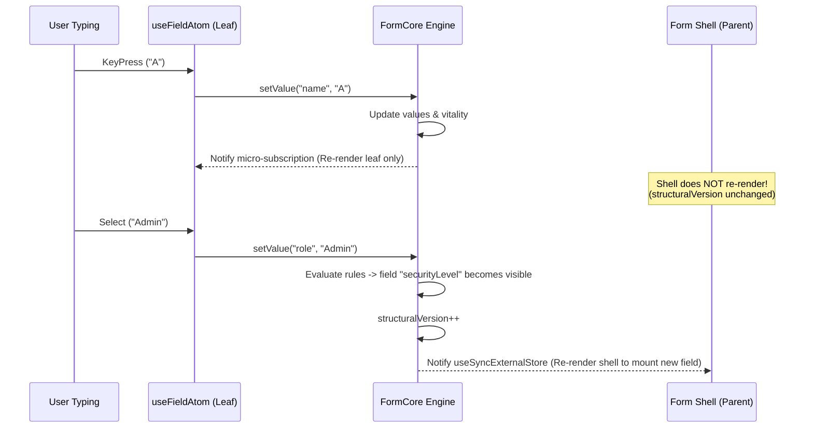

# Zenith Form Architecture (v2) Specification

This document defines the canonical architecture for forms, detail presentation, and field components in the Zenith design platform.

---

## 1. Architectural Foundations & Principles

The architecture follows **Domain-Driven Design (DDD-lite)** and **Clean Architecture (Hexagonal / Onion)** principles:

1. **Clean Inward Dependency Flow**: Dependencies flow inward only. Domain entities and engines know nothing of UI components, DOM elements, React hooks, or styling tokens.
2. **Single Responsibility Principle (SRP)**:
   - The **Headless Engine** owns values, state transitions, validation rules, dirty flags, and undo history.
   - The **Adapters** bridge headless reactive state to React micro-subscriptions.
   - The **Presentation Shells** manage layouts, navigation (wizards), surface containers, and slot composition.
   - The **Field Decorators** manage accessible labels, error badges, icons, and density tokens.
3. **Open-Closed Principle (OCP)**: New field types, layout renderers, and style adapters plug into extensible registries (`defaultRegistry`, `manifestRegistry`) without modifying core engines.
4. **Liskov Substitution Principle (LSP)**: All atomic input components conform to identical visual shell invariants via `withFieldShell` (`withAtom`).
5. **Interface Segregation Principle (ISP)**: Micro-hooks (`useField`, `useWatch`, `useFieldAtom`) expose only the granular slices of state required by leaf nodes, preventing full-form re-render cascades.

---

## 2. The 4 Canonical Architectural Layers

```mermaid
flowchart TD
    subgraph Layer1["Layer 1 — Headless Domain (`src/core/form-core`)"]
        FormCore["FormCore (State Machine)"]
        FormEntity["Form (Facade)"]
        StateManager["FormStateManager (5V State Matrix)"]
        VisibilityEngine["FormVisibility (Conditional Rules)"]
        ValidationEngine["FormValidator (Async / Sync)"]
        HistoryModule["FormHistory (Undo / Redo)"]
        CircuitBreaker["CircuitBreaker (Fault Recovery)"]
    end

    subgraph Layer2["Layer 2 — Application & Adapters (`src/shared/ui/form/hooks`, `context`)"]
        ReactAdapter["ReactFormAdapter"]
        UseForm["useForm (Primary Consumer Hook)"]
        ShellRuntime["useFormCore (Orchestrator Hook)"]
        RuntimeProviders["FormRuntimeProvider / FormOrchestratorContext"]
        MicroHooks["useFieldAtom / useWatch / useController"]
    end

    subgraph Layer3["Layer 3 — Presentation Surfaces (`src/shared/ui/form`)"]
        FormRoot["<Form /> (Complete Interactive Shell)"]
        FormRenderer["<FormRenderer /> (Lightweight Dynamic Layout)"]
        DetailRenderer["<DetailRenderer /> (Zero-Form Display & Widgets)"]
        FormComposer["<FormComposer /> (Layout Tree Composer)"]
    end

    subgraph Layer4["Layer 4 — Visual Fields & DCS (`src/shared/ui/form/fields`, `structure`)"]
        FieldRouter["FieldRouter / Field Controller (<Field />)"]
        FieldShellDecorator["withFieldShell (Visual Shell Decorator)"]
        FieldShellComponent["<FieldShell /> (Composite Layout Wrapper)"]
        AtomicInputs["Atomic Input Primitives (TextField, SelectField, ComboBox, etc.)"]
    end

    Layer1 --> Layer2
    Layer2 --> Layer3
    Layer3 --> Layer4
```



### Layer 1: Headless Domain (`src/core/form-core`)
- **Location**: `src/core/form-core/`
- **Invariants**:
  - Zero imports from `react`, `react-dom`, `@heroui`, `lucide-react`, or Tailwind.
  - 100% testable in pure Node.js environments.
- **Responsibilities**:
  - Maintains form values, validity, visibility, and vitality (`5V State Matrix`).
  - Evaluates business rules, conditional logic, and cross-field constraints.
  - Manages atomic undo/redo snapshots via `FormHistory`.
  - Isolates faulty evaluation errors via `CircuitBreaker`.

### Layer 2: Application & Adapters
- **Location**: `src/shared/ui/form/hooks/`, `src/shared/ui/form/context/`, `src/core/form-core/react-adapter.ts`
- **Responsibilities**:
  - Bridges headless events to React's scheduler via `useSyncExternalStore`.
  - Exposes `useForm` for component lifecycle management.
  - Exposes `useFormCore` to wire up wizards, overlays, and imperative handles.
  - Provides scoped contexts (`FormRuntimeProvider`, `SurfaceProvider`, `WizardProvider`).

### Layer 3: Presentation Surfaces
- **Location**: `src/shared/ui/form/Form.tsx`, `FormRenderer.tsx`, `detail/DetailRenderer.tsx`
- **Responsibilities**:
  - `<Form />`: Full enterprise shell with submission handling, validation error focus jumping, modal shells, and wizard navigation.
  - `<FormRenderer />`: Lightweight dynamic layout engine for rendering schemas as plain interactive nodes without headers, footers, or `<form>` wrappers.
  - `<DetailRenderer />`: Formless entity visualization and standalone interactive widgets rendered as semantic `<article>` and `<div>` elements with zero `<form>` containers and zero form runtime provider overhead in display mode.

#### Presentation Surface Decision Matrix

| Dimension | `<Form />` | `<FormRenderer />` | `<DetailRenderer />` |
|---|---|---|---|
| **Primary Intent** | Complete enterprise form workflow with submit button and step flow. | Embeddable interactive field composition within custom client containers. | Read-only entity inspection, audit drawers, or standalone formless widgets. |
| **DOM Root** | `<form role="form" onSubmit={...}>` | Fragment / `<div>` container | Semantic `<article data-detail-renderer="true">` |
| **Field Format** | Interactive editable inputs with validation rings. | Interactive editable inputs with validation rings. | Formatted read-only values (`DetailValueDisplay`) & badges. |
| **Engine Runtime** | Full `FormRuntimeProvider` (all 10 context managers). | Full `FormRuntimeProvider` (all 10 context managers). | Bypasses `FormRuntimeProvider` in display mode; mounts bridge only for interactive mode. |
| **Full Guide** | [QUICK_START.md](./QUICK_START.md) | [FORM_ARCHITECTURE.md](./FORM_ARCHITECTURE.md) | [DETAIL_RENDERERS.md](./DETAIL_RENDERERS.md) & [DETAIL_RENDERER_ARCHITECTURE.md](../DETAIL_RENDERER_ARCHITECTURE.md) |

### Layer 4: Visual Fields & DCS
- **Location**: `src/shared/ui/form/fields/`, `src/shared/ui/form/hoc/`, `src/shared/ui/form/structure/`
- **Responsibilities**:
  - `withFieldShell` (`withAtom`): Decorates primitive inputs with the "Wrapper Trinity":
    1. `OuterWrapper`: Prefix/suffix adornments, clear actions, password reveal toggles.
    2. `InputWrapper`: Accessible labels, required indicators, error reservations, validation hints.
    3. `Box`: Responsive density tokens (`compact`, `comfortable`, `spacious`) and CSS variables.
  - Autonomous fallback: Synthesizes a valid `FormField` when fields are invoked standalone without a parent form engine.

---

## 3. Dual-Path Execution Model

The system supports two complementary paths for rendering UI:

### Path A: Declarative Schema-Driven Path
```tsx
const definition: FormDefinition = {
  id: "user-profile",
  sections: [
    {
      id: "personal",
      title: "Personal Information",
      fields: [
        { id: "name", name: "name", type: "text", label: "Full Name", required: true },
        { id: "role", name: "role", type: "select", label: "Role", options: [...] },
      ],
    },
  ],
};

// Rendered via Form or FormRenderer
<Form definition={definition} onSubmit={handleSave} />
```

### Path B: Autonomous Standalone Direct Path
```tsx
import { FormTextField, FormSelectField } from "@ui/form";

function StandaloneProfileForm() {
  const [role, setRole] = useState("developer");

  return (
    <div className="space-y-4">
      <FormTextField
        name="name"
        label="Full Name"
        placeholder="Enter your name"
        required
      />
      <FormSelectField
        name="role"
        label="Role"
        value={role}
        onChange={setRole}
        options={[
          { value: "developer", label: "Software Engineer" },
          { value: "designer", label: "Product Designer" },
        ]}
      />
    </div>
  );
}
```
In Path B:
- No `definition` object is required.
- `withFieldShell` synthesizes a canonical `FormField` on the fly using `getFieldOptions`, `getFieldPlaceholder`, and `getFieldIcon`.
- When rendered outside a form orchestrator, fields manage internal reactive state while respecting controlled `value` and `onChange` props.

---

## 4. Engine Lifecycle Semantics (`initialData`)

A frequent flaw in React form engines is recreating the entire form instance when `initialData` object references fluctuate across re-renders.

### Invariants
1. **Engine Identity Stability**: The `Form` instance (`FormCore`) is instantiated once per form schema structure (`schemaSignature`). Inline object references like `initialData={{ foo: "bar" }}` do **not** destroy the engine.
2. **Pristine Synchronization**: When `initialData` values change (e.g. from an asynchronous server fetch), all **pristine** fields automatically update to the new server values.
3. **Dirty Field Protection (`preserve-dirty`)**: By default (`initialDataSyncMode: "preserve-dirty"`), active user edits on dirty fields are **preserved** and never overwritten by subsequent background server refreshes.
4. **Lifecycle Modes**:
   - `"preserve-dirty"` (default): Updates pristine fields, preserves dirty fields.
   - `"force-reset"`: Resets all values and clears dirty flags with new data.
   - `"ignore"`: Freezes form values on mount; subsequent prop updates are ignored.

---

## 5. React Performance Shielding



1. **Micro-Subscriptions**: Leaf fields subscribe to individual field state via `form.subscribeToField(fieldId)`. Typing does not trigger re-renders in sibling fields or parent containers.
2. **Release of the Parking Brake**: The parent `<Form />` shell subscribes only to `form.structuralVersion`. Keystrokes do not re-render the parent container unless visibility or structure actually changes.
3. **Stable Fallbacks**: Uncontrolled props fall back to module-level constants, preventing reference invalidation cycles: `<FormRenderer />` uses an immutable `EMPTY_DATA = Object.freeze({})`, while `<DetailRenderer />` uses a plain (unfrozen) module-level `EMPTY_DATA` — both are reference-stable.

---

## 6. Testing Architecture & Quality Assurance (The 4 Tiers)

`Form-Core` adheres strictly to the platform-wide [ZenOS 4-tier testing doctrine](../architecture/10-testing-rules.md) (ZenOS is the name of the overall platform; this form subsystem is the Zenith Form Architecture), ensuring architectural consistency and quantitative gatekeeping.


1. **Unit Testing (Isolated Logic & Edge Boundaries)**:
   - Domain calculations, condition operators, and validator functions are tested with zero mocks and zero DOM overhead.
   - Invariant and boundary coverage: Zero inputs, negative value guards, monthly overtime caps, cyclic midnight shift calculations (e.g., 22:00 to 06:00), and deduction clamping.
   - Implementation suite: [`src/core/form-core/__tests__/hrmis-attendance-payroll.test.ts`](../../src/core/form-core/__tests__/hrmis-attendance-payroll.test.ts) (22 unit tests).

2. **System Testing (Multi-Step ERP Business Workflows)**:
   - Exercises the complete headless state engine across real-world multi-step enterprise workflows: Employee Setup → Attendance Recording → Leave Deduction → Net Salary Computation → Conditional Visibility Alerts → Audit Logging.
   - Validates that calculated formulas (`Basic: ₹30,000` + `OT: ₹2,000` - `Unpaid Leave: ₹1,000` - `Tax: ₹1,500` = `₹29,500`) cascade correctly through reactive dependency graphs.
   - Implementation suite: [`src/core/form-core/__tests__/hrmis-system-workflow.test.ts`](../../src/core/form-core/__tests__/hrmis-system-workflow.test.ts).

3. **Regression Testing (Automated Gatekeeping)**:
   - Continuous automated verification across all 37 test files (313 tests) covering primitive migration guards, reactive engines, schema normalization, and wizard lifecycles.
   - Command: `npm run test:form-core`.

4. **Test Coverage Analysis (V8 Metrics & CI Thresholds)**:
   - V8 quantitative code coverage is enforced across the `src/core/form-core` package.
   - Formal Thresholds: Statements >= 70%, Branches >= 70%, Functions >= 60%, Lines >= 70%.
   - Command: `npm run test:form-core:coverage`.

---

**See also:** [./reference/00-INDEX.md](./reference/00-INDEX.md) (API reference) · [./QUICK_START.md](./QUICK_START.md) · [./VALIDATION_GUIDE.md](./VALIDATION_GUIDE.md) · [../architecture/10-testing-rules.md](../architecture/10-testing-rules.md) (testing doctrine)
