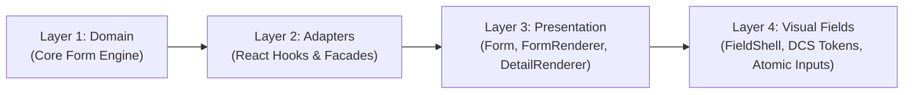

# Zenith Form Architecture (v2) Documentation

Documentation for the Zenith Form Architecture — a clean-architecture, headless form platform built on Domain-Driven Design (DDD-lite), SOLID principles, and framework-free state execution.

> **Branding note:** "Zenith" names this form subsystem (Zenith Form Architecture, ZenithTable). "ZenOS" names the overall platform (governance, ADRs, platform-wide testing doctrine).

---

## 1. Guides

| Guide | Description | Target Audience |
|---|---|---|
| **[Architecture Guide](./FORM_ARCHITECTURE.md)** | Specification of the 4 canonical layers, dependency boundaries, headless engine, and execution models. | Architects, Senior Engineers |
| **[Quick Start Guide](./QUICK_START.md)** | Recipe guide for the 5 primary patterns: schema-driven forms, renderers, standalone fields, controllers, and headless hooks. | Feature Developers |
| **[Validation Guide](./VALIDATION_GUIDE.md)** | Validation modes, Zod/Yup/custom adapters, declarative rules, the `DetailedError` model, programmatic control, and validation UX. | Feature Developers |
| **[Persistence & URL Sync](./PERSISTENCE_AND_URL_SYNC.md)** | Draft save/restore/clear with storage adapters, and URL search-param synchronization for forms and filters. | Feature Developers |
| **[Arrays & Repeaters](./ARRAYS_AND_REPEATERS.md)** | Dynamic list fields: `useFormArray`, engine row APIs, repeater identity, rendering, and array validation. | Feature Developers |
| **[Permissions & Navigation](./PERMISSIONS_AND_NAVIGATION.md)** | Field-level permissions (`edit`/`view`/`hidden`), the `PermissionProvider`, and dirty-form navigation guards. | Feature Developers, Reviewers |
| **[Contracts & MDAP](./CONTRACTS_AND_MDAP.md)** | Typed form contracts (`defineFormContract`, `withWizard`, `InferFormValues`) and the MDAP `EntityDefinition` compiler path. | Architects, Senior Engineers |
| **[Tooling](./TOOLING.md)** | `pnpm scaffold:form`, DevTools, debug overlays, testing utilities, and the visual form builder. | All Engineers |
| **[Detail Renderers Guide](./DETAIL_RENDERERS.md)** | Specification for `<DetailRenderer />`, compound subcomponents, semantic display without `<form>`, and slots. | UI Engineers |
| **[Detail Architecture & Separation](../DETAIL_RENDERER_ARCHITECTURE.md)** | Clean Architecture, DDD-lite bounded context rationale, and SOLID separation roadmap for `<DetailRenderer />`. | Architects, Senior Engineers |
| **[Field System Architecture](../FIELD_SYSTEM_ARCHITECTURE.md)** | The 4-tier taxonomy: Atoms, Static Fields, Structures (Wrapper Trinity), and Wrapped Fields. | All Engineers, UI Designers |
| **[Field Design System & Styling Spec](../FIELD_DESIGN_SYSTEM_AND_STYLING_SPEC.md)** | Token-first styling architecture, optical baseline alignment, and WAI-ARIA standards for controls. | UI Engineers, Design System |
| **[Field Presentation & Rendering](../FIELD_PRESENTATION_AND_RENDERING_ARCHITECTURE.md)** | Deep audit of native behavior vs. UI separation, rendering pipeline, and decoupling blueprint. | UI Engineers, Architects |
| **[LLSD Component Naming & JSDoc Registry](./LLSD_COMPONENT_NAMING.md)** | Intent-revealing taxonomy, canonical symbol names, compatibility aliases, and JSDoc contracts. | All Engineers, Code Reviewers |
| **[Testing & Quality Doctrine](../architecture/10-testing-rules.md)** | Mandatory 4-tier testing doctrine with V8 coverage gates. | All Engineers, QA |
| **[Legacy v1 Archive](../archive/form-v1/README.md)** | Archived legacy v1 MDAP documentation (historical context only). | Maintenance Reference |

---

## 2. API Reference

Exhaustive file-by-file, symbol-by-symbol reference for the entire platform — start at the **[Reference Index](./reference/00-INDEX.md)**.

| Area | Entry point |
|---|---|
| Engine & facade (`FormCore`, `Form`) | [reference/01-ENGINE.md](./reference/01-ENGINE.md) |
| Registries, proxies, validation/condition stacks | [reference/02-REGISTRIES.md](./reference/02-REGISTRIES.md) |
| Engine modules (state, validator, visibility, ...) | [reference/03-MODULES.md](./reference/03-MODULES.md) |
| Domain types (`FormField`, `FormDefinition`, ...) | [reference/04-DOMAIN_TYPES.md](./reference/04-DOMAIN_TYPES.md) |
| Adapters & core utilities | [reference/05-ADAPTERS_UTILS.md](./reference/05-ADAPTERS_UTILS.md) |
| Hooks (all 30+) | [reference/06-HOOKS.md](./reference/06-HOOKS.md) |
| Components (`Form`, `FormRenderer`, `DetailRenderer`) | [reference/07-COMPONENTS.md](./reference/07-COMPONENTS.md) |
| Field catalog (50 registered types, shells, layouts) | [reference/08-FIELD_CATALOG.md](./reference/08-FIELD_CATALOG.md) |
| Providers & contexts (all 22) | [reference/09-PROVIDERS.md](./reference/09-PROVIDERS.md) |
| Shared utilities | [reference/10-SHARED_UTILS.md](./reference/10-SHARED_UTILS.md) |
| Types & contracts | [reference/11-TYPES_CONTRACTS.md](./reference/11-TYPES_CONTRACTS.md) |

---

## 3. Core Highlights

1. **Strict Inward Dependency Flow**: Core domain state and business validation rules (`src/core/form-core`) have **zero** dependencies on React, the DOM, or UI frameworks.
2. **Dual-Path Execution**:
   - **Declarative Schema Path**: Define structured models (`FormDefinition`) rendered with `<Form />` or `<FormRenderer />`.
   - **Autonomous Direct Path**: Drop standalone visual fields (`<FormTextField />`, `<FormSelectField />`) directly into JSX with zero boilerplate and full reactivity.
3. **Optimized Zero-Form Display**: `<DetailRenderer />` renders rich read-only entity layouts and definition badges with pure semantic `<article>` and `
` markup, completely skipping both the headless engine and `FormRuntimeProvider` (omitting 10 form contexts) in display mode unless conditional visibility rules exist.
4. **Stable Engine Lifecycles**: Engine instances remain decoupled from inline object references (`initialData`), preserving active user typing on dirty fields while synchronizing background server updates.
5. **4-Tier Testing & Quality Gates**: Verified via isolated unit calculations (overnight shifts, boundary overdrafts), end-to-end multi-step system workflows (e.g. Employee → Attendance → Leave → Net Salary ₹29,500), a 37-file regression suite (`npm run test:form-core`), and automated V8 coverage gates (`npm run test:form-core:coverage`).
