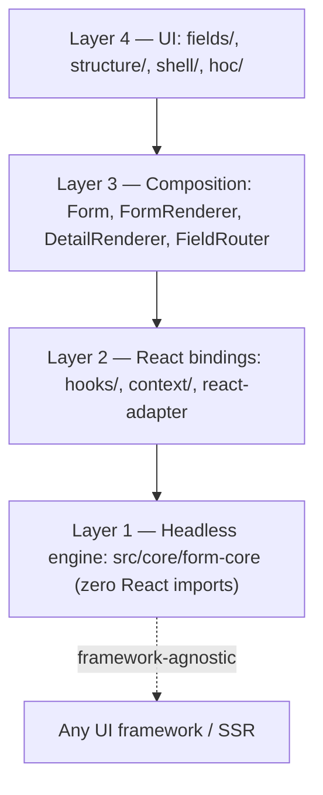

# Zenith Form Architecture — API Reference Index

Exhaustive, file-by-file and symbol-by-symbol reference for the Zenith Form Architecture (v2). Every exported class, function, hook, component, and type in the form platform is documented with its signature as declared in source.

This suite is the *reference* layer of the documentation. For narrative guides, recipes, and architecture rationale, start at the [documentation index](../README.md).

---

## 1. Conventions

- **Signatures are copied from source.** Where a declaration lacks an explicit return-type annotation, the docs document it as declared rather than inferring a name.
- **Source links are relative** from this directory: e.g. `[engine.ts](../../../src/core/form-core/engine.ts)`.
- **Code examples import from `@ui/form`** (alias for `src/shared/ui/form`); form-core internals are shown with their in-repo import style.
- **Zod examples use Zod v4 APIs** (`z.email()`, not `z.string().email()`).

---

## 2. File index

| File | Covers | Start here if you want to |
|---|---|---|
| [01-ENGINE.md](./01-ENGINE.md) | `FormCore` engine, `Form` facade, `IFormCore` contract, `ReactFormAdapter`, internal state types (5V matrix) | Understand the headless engine API |
| [02-REGISTRIES.md](./02-REGISTRIES.md) | Schema/Manifest/Validation/Condition/Injection registries, condition & value & flow proxies, backend normalizer, test utilities | Extend field types, validation, or conditions |
| [03-MODULES.md](./03-MODULES.md) | All 19 engine modules: state manager, validator, execution, visibility, remote options, persistence, history, circuit breaker, transactions, repeaters, resolver, errors | Study engine internals or debug behavior |
| [04-DOMAIN_TYPES.md](./04-DOMAIN_TYPES.md) | All 21 domain type files: `FormField`, `FormDefinition`, `DetailedError`, `ValidationRule`, conditions, typed paths, formatters, governance | Look up a type's shape |
| [05-ADAPTERS_UTILS.md](./05-ADAPTERS_UTILS.md) | Core `ZodValidationAdapter`, shared `validateZodSchema`/`validateYupSchema`, accessibility, expressions, normalization, i18n | Wire a custom validation source |
| [06-HOOKS.md](./06-HOOKS.md) | Every exported hook: `useForm`, URL sync, arrays, permissions, fields, watch, external-store, deprecated aliases | Find the hook for a task |
| [07-COMPONENTS.md](./07-COMPONENTS.md) | `Form`, `FormRenderer`, `DetailRenderer`, controllers, guard, state components, shell parts, routing, tooling entry points | Find a component's props |
| [08-FIELD_CATALOG.md](./08-FIELD_CATALOG.md) | Wrapped fields, 21 primitive fields, structure fields, 50 registered manifest types, `FieldShell`/`withFieldShell`, layout renderers, registries | Find a field type or style a field |
| [09-PROVIDERS.md](./09-PROVIDERS.md) | All 22 context files: runtime, permission, data source, action, routing, shell, theme, spacing + provider nesting map | Know where to mount a provider |
| [10-SHARED_UTILS.md](./10-SHARED_UTILS.md) | Draft persistence helpers, a11y runtime, focus trap, SSR compat, MDAP schema fusion/compilers, options resolution, internal utils index | Call a utility directly |
| [11-TYPES_CONTRACTS.md](./11-TYPES_CONTRACTS.md) | `defineFormContract`, `withWizard`, `InferFormValues`, layout & shell types, `EntityDefinition`, re-export shims | Build a typed form contract |

---

## 3. Source map

```
src/core/form-core/                 # Layer 1 — headless engine (zero React imports)
├── engine.ts          (1,757 ln)   #   FormCore composition root
├── form.ts              (350 ln)   #   Form facade
├── form-interface.ts    (182 ln)   #   IFormCore contracts
├── react-adapter.ts     (293 ln)   #   engine state → React props
├── int-types.ts         (330 ln)   #   5V state matrix types
├── SchemaRegistry.ts    ManifestRegistry.ts
├── validation-{adapter,proxy,registry}.ts
├── condition-{proxy,registry}.ts   value-proxy.ts  flow-proxy.ts
├── injection-registry.ts  composite-registry.ts  backend-normalizer.ts
├── index.ts                          # root barrel
├── domain/            (21 files, 2,432 ln)   # type-model leaf layer
├── modules/           (19 files, 5,361 ln)   # engine services
├── adapters/          (zod-adapter.ts)
├── utils/             (7 files, 375 ln)      # pure helpers (internal)
└── __tests__/         (28 files, 5,157 ln)

src/shared/ui/form/                 # Layers 2–4 — React bindings & UI
├── hooks/             # useForm + 30 hooks            → 06-HOOKS.md
├── components/  detail/  fields/  structure/  shell/   → 07/08
├── context/           (22 files)                     → 09-PROVIDERS.md
├── utils/  types/  registry/  layout/  hoc/  styles/  → 10/11/08
├── manifest/default-manifests.ts  (side-effect, 50 types)
├── builder/  tools/  adapters/  atoms/                → 07-COMPONENTS.md, TOOLING.md
└── index.ts                              # public barrel (@ui/form)
```

---

## 4. Layer dependency flow



Strict inward dependency: nothing in `src/core/form-core` imports React (one type-only `React.ComponentType` reference in `ManifestRegistry.ts` is erased at runtime).

---

## 5. Suggested reading order

1. **New to the platform:** [../QUICK_START.md](../QUICK_START.md) → [../FORM_ARCHITECTURE.md](../FORM_ARCHITECTURE.md) → [01-ENGINE.md](./01-ENGINE.md)
2. **Building a feature:** [06-HOOKS.md](./06-HOOKS.md) → [07-COMPONENTS.md](./07-COMPONENTS.md) → [08-FIELD_CATALOG.md](./08-FIELD_CATALOG.md)
3. **Extending the engine:** [02-REGISTRIES.md](./02-REGISTRIES.md) → [03-MODULES.md](./03-MODULES.md) → [04-DOMAIN_TYPES.md](./04-DOMAIN_TYPES.md)
4. **Task-focused guides:** [../VALIDATION_GUIDE.md](../VALIDATION_GUIDE.md), [../PERSISTENCE_AND_URL_SYNC.md](../PERSISTENCE_AND_URL_SYNC.md), [../ARRAYS_AND_REPEATERS.md](../ARRAYS_AND_REPEATERS.md), [../PERMISSIONS_AND_NAVIGATION.md](../PERMISSIONS_AND_NAVIGATION.md), [../CONTRACTS_AND_MDAP.md](../CONTRACTS_AND_MDAP.md), [../TOOLING.md](../TOOLING.md)

---

**See also:** [../README.md](../README.md) (documentation index) · [../FORM_ARCHITECTURE.md](../FORM_ARCHITECTURE.md) (architecture spec) · [../archive/form-v1/README.md](../../archive/form-v1/README.md) (legacy v1)
