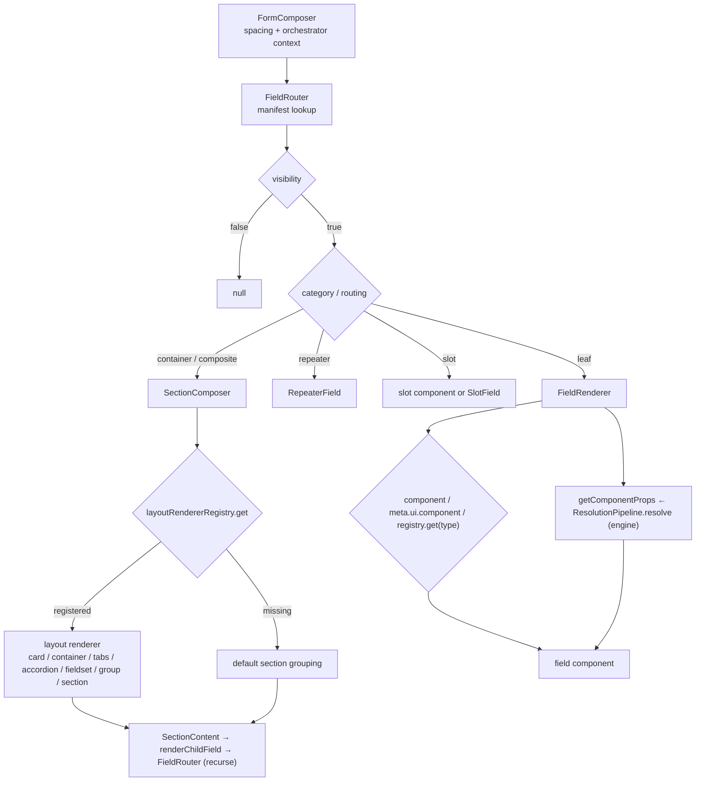

# Zenith Form Field Catalog

Catalog of the field system for the Zenith Form Architecture: wrapped autonomous fields, primitive inputs, structure/container fields, manifest type registrations, the field shell and its HOCs, wrapper primitives, layout renderers, registries, and the routing pipeline.

Import convention: the `@ui/form` barrel re-exports `Field`, `ControlledField`, `UncontrolledField`, `withAtom`, `withFieldShell`, the registry types, and the registry factories. Wrapped fields, primitives, structure components, layout modules, and registry sources are imported from subpaths of the same alias (e.g. `@ui/form/fields/wrapped-fields`, `@ui/form/structure/FieldShell`).

---

## 1. Wrapped autonomous fields

[wrapped-fields.ts](../../../src/shared/ui/form/fields/wrapped-fields.ts) pre-wraps every design-system input with `withAtom`, so each export carries the Wrapper Trinity (`OuterWrapper` surface, `InputWrapper` label/feedback, `Box` density tokens) and can run standalone — with no `Form` parent — by keeping local state.

| Export | Wraps | `withAtom` options | Props summary |
|---|---|---|---|
| `FormTextField` | `TextField` | defaults (`showLabel: true`, `wrapOuter: true`) | `BaseFieldProps<string \| number>` + `InputHTMLAttributes`; search callbacks (`onSearch`, `onDebouncedSearch`, `debounceMs`, `searchOnType`), `syncMode` |
| `FormTextareaField` | `TextareaField` | defaults | `BaseFieldProps<string>` + `TextareaHTMLAttributes` |
| `FormSelectField` | `SelectField` | defaults | `BaseFieldProps<string \| number>` + `options: FieldOption[]`, `isLoading`, `placeholder` |
| `FormAutocompleteField` | `AutocompleteField` | defaults | `BaseFieldProps<string \| number>` + `options: FieldOption[]`, `isLoading` |
| `FormNumberInputField` | `NumberInputField` | defaults | `BaseFieldProps<number>` + `InputHTMLAttributes`; `min`, `max`, `step` |
| `FormCheckboxField` | `CheckboxField` | `{ showLabel: false, wrapOuter: false }` | `BaseFieldProps<boolean>` + `indeterminate`, `variant: "default" \| "card" \| "tile"` |
| `FormRadioField` | `RadioField` | `{ wrapOuter: false }` | `BaseFieldProps<string>` + `options`, `variant: "default" \| "card" \| "tile" \| "segmented"` |
| `FormSwitchField` | `SwitchField` | `{ showLabel: false, wrapOuter: false }` | `BaseFieldProps<boolean>` + `size: "sm" \| "md" \| "lg"`, `variant: "default" \| "card"` |
| `FormRangeField` | `RangeField` | `{ wrapOuter: false }` | `BaseFieldProps<number>` + `min`, `max`, `step`, `unit` |
| `FormFileField` | `FileField` | `{ wrapOuter: false }` | `BaseFieldProps<any>` + `multiple`, `accept`, `variant: "dropzone" \| "compact"`, `maxSizeMB` |
| `FormMultiSelectField` | `MultiSelectField` | `{ wrapOuter: false }` | `BaseFieldProps<any[]>` + `options`, `disabled`, `required` |
| `FormPhoneField` | `PhoneField` | defaults | `BaseFieldProps<string>` + `InputHTMLAttributes`; country-code segmented value |
| `FormCodeInputField` | `CodeInputField` | `{ wrapOuter: false }` | `BaseFieldProps<string>` + `length: number` (segment count) |
| `FormSearchInputField` | `SearchInputField` | `{ showLabel: false, wrapOuter: false }` | `BaseFieldProps<string \| number>` + clear action (`onClear`) |
| `FormTableFilterField` | `TableFilterField` | `{ showLabel: false, wrapOuter: false }` | `BaseFieldProps<string \| number>` + clear action; default placeholder `"Filter records... (⌘K)"` |
| `FormButtonField` | `ButtonField` | `{ showLabel: false, wrapOuter: false }` | `ButtonFieldProps`: `variant`, `color`, `size`, `onClick`, `loading`, content slots |

Re-exports from the same module:

| Re-export | Source |
|---|---|
| `Field`, `ControlledField`, `UncontrolledField` | [Field.tsx](../../../src/shared/ui/form/fields/Field.tsx) → [WrapperFields.tsx](../../../src/shared/ui/form/fields/WrapperFields.tsx) |
| `FieldShell` | [structure/FieldShell.tsx](../../../src/shared/ui/form/structure/FieldShell.tsx) |
| `withAtom`, `withFieldShell` | [hoc/withAtom.tsx](../../../src/shared/ui/form/hoc/withAtom.tsx) |

Behavior notes:

- Options control shell chrome: `showLabel: false` suppresses the label node; `wrapOuter: false` skips `OuterWrapper`, which also strips `startContent` / `endContent` / `prefix` / `suffix` from the child props so slots render exactly once.
- Idempotency: an already-wrapped component (`__isAtomWrapped`) is returned unchanged by a second `withAtom(...)` call.
- Autonomy: when the orchestrator has no `getComponentProps` (Storybook, isolated render), the wrapper holds `standaloneValue` state and forwards `onChange`; inside a form the engine value/onChange win.
- Composition bypass: inside a `FieldShell` or another atom (`FieldCompositionContext.mode` is `"managed"` or `"primitive"`), the wrapper renders only the inner input.
- Static bypass: `field.headless`, or a `static` category field with `wrapOuter: false`, renders inside a minimal `form-field-container` div without `InputWrapper` / `FieldFeedback`.

```tsx
import { FormTextField, FormSelectField, FormSwitchField } from "@ui/form/fields/wrapped-fields";

export function IdentityBlock() {
  return (
    <>
      <FormTextField name="email" label="Email" placeholder="ada@example.com" required />
      <FormSelectField
        name="role"
        label="Role"
        options={[
          { label: "Engineer", value: "engineer" },
          { label: "Analyst", value: "analyst" },
        ]}
      />
      <FormSwitchField name="active" label="Active" />
    </>
  );
}
```

---

## 2. Primitive fields

Headless atomic inputs under `fields/primitive/`. Each accepts the shared base contract (`BaseFieldProps`, aliased `AtomicFieldProps`) and renders inside a shell when wrapped, or bare when used directly.

### 2.1 Catalog

| Field | Component | Purpose | Source |
|---|---|---|---|
| Text | `TextField` | Single-line input for `text` / `email` / `password` / `url` / `number`; view-mode text rendering, `syncMode: "blur"` uncontrolled path, ARIA wiring from shell context | [TextField.tsx](../../../src/shared/ui/form/fields/primitive/TextField.tsx) |
| Textarea | `TextareaField` | Multi-line text with `TextareaHTMLAttributes` passthrough | [TextareaField.tsx](../../../src/shared/ui/form/fields/primitive/TextareaField.tsx) |
| Number | `NumberInputField` | Numeric entry with `min` / `max` / `step` and number coercion | [NumberInputField.tsx](../../../src/shared/ui/form/fields/primitive/NumberInputField.tsx) |
| Select | `SelectField` (+ `Select`, `SelectTrigger`, `SelectMenu`, `SelectOption`, `SelectContext`, `useSelect`) | Single-select ARIA combobox: option resolution (`prop → field.options → field.properties.options`), loading state, validation hints | [SelectField.tsx](../../../src/shared/ui/form/fields/primitive/SelectField.tsx) |
| Multi-select | `MultiSelectField` | Multiple selection over `any[]` values | [MultiSelectField.tsx](../../../src/shared/ui/form/fields/primitive/MultiSelectField.tsx) |
| Autocomplete | `AutocompleteField` | Searchable single-select with async option loading | [AutocompleteField.tsx](../../../src/shared/ui/form/fields/primitive/AutocompleteField.tsx) |
| Checkbox | `CheckboxField` | Boolean control with `indeterminate` and `default` / `card` / `tile` variants | [CheckboxField.tsx](../../../src/shared/ui/form/fields/primitive/CheckboxField.tsx) |
| Radio | `RadioField` | Option group with `default` / `card` / `tile` / `segmented` variants | [RadioField.tsx](../../../src/shared/ui/form/fields/primitive/RadioField.tsx) |
| Switch | `SwitchField` | Boolean toggle with `size` and `default` / `card` variants | [SwitchField.tsx](../../../src/shared/ui/form/fields/primitive/SwitchField.tsx) |
| Range | `RangeField` | Numeric slider with `min` / `max` / `step` / `unit` | [RangeField.tsx](../../../src/shared/ui/form/fields/primitive/RangeField.tsx) |
| File | `FileField` | Upload control with `dropzone` / `compact` variants, `accept`, `multiple`, `maxSizeMB` | [FileField.tsx](../../../src/shared/ui/form/fields/primitive/FileField.tsx) |
| Image | `ImageField` | Image presentation for image-shaped values | [ImageField.tsx](../../../src/shared/ui/form/fields/primitive/ImageField.tsx) |
| Phone | `PhoneField` | Phone entry with a country-code segment (`+1`, `+44`, `+91`, `+61`, `+81`) and combined E.164-style value | [PhoneField.tsx](../../../src/shared/ui/form/fields/primitive/PhoneField.tsx) |
| Search | `SearchInputField` | Search box with clear button and focus restoration | [SearchInputField.tsx](../../../src/shared/ui/form/fields/primitive/SearchInputField.tsx) |
| Table filter | `TableFilterField` | Filter input with default placeholder and clear action | [TableFilterField.tsx](../../../src/shared/ui/form/fields/primitive/TableFilterField.tsx) |
| Code input | `CodeInputField` | Segmented single-value code input (`length` segments) | [CodeInputField.tsx](../../../src/shared/ui/form/fields/primitive/CodeInputField.tsx) |
| Button | `ButtonField` | Action node bound to `onClick` / `onChange` with `variant`, `color`, `size`, `loading` | [ButtonField.tsx](../../../src/shared/ui/form/fields/primitive/ButtonField.tsx) |
| Static fields | `HeaderField`, `ParagraphField`, `DividerField`, `HtmlField` | Value-less display nodes (`StaticFieldProps`: `field`, `label`, `description`, `isEditor`) | [StaticFields.tsx](../../../src/shared/ui/form/fields/primitive/StaticFields.tsx) |
| Advanced barrel | re-exports `SwitchField`, `RangeField`, `FileField`, `MultiSelectField` | Back-compat entry point for the advanced input set | [AdvancedFields.tsx](../../../src/shared/ui/form/fields/primitive/AdvancedFields.tsx) |
| Identity atoms | `FormDivider`, `SocialAuthButtons` | Registry targets for `divider` / `divider-label` and `social` | [IdentityAtoms.tsx](../../../src/shared/ui/form/fields/identity/IdentityAtoms.tsx) |
| Types | `BaseFieldProps`, `AtomicFieldProps`, `DetailedFieldError` | Shared prop contract for every primitive | [types.ts](../../../src/shared/ui/form/fields/primitive/types.ts) |

Files without components: `types.ts`, `utils/dropdown-anchor.ts`, `__tests__/`. Manifest-only types that have **no** primitive component in this directory — `signature`, `rating`, `rich-text`, `formatted-number`, `message`, `qr-code`, `tooltip`, `spacer`, `progress-line`, `progress-circle` — are listed in section 4 with their resolution note.

### 2.2 Shared base props (`BaseFieldProps` / `AtomicFieldProps`)

Copied from [types.ts](../../../src/shared/ui/form/fields/primitive/types.ts):

```ts
export interface BaseFieldProps<V = unknown> {
  // ── 1. The Canonical Form Definition Trinity ───────────────────────
  name?: string;                 // data-binding key, e.g. "email", "address.city"
  type?: string;                 // semantic data type, e.g. "text", "number", "select"
  component?: string | React.ComponentType<any>; // presentation override

  // ── 2. Identification & Accessibility ─────────────────────────────
  id?: string;                   // DOM id, defaults to name
  label?: string | TranslatedText;
  placeholder?: string | TranslatedText;
  description?: string | TranslatedText;
  helperText?: string | TranslatedText;

  // ── 3. State & Change Handling ────────────────────────────────────
  value?: V | null | undefined;
  defaultValue?: V;
  onChange?: (val: V) => void;
  onBlur?: (e?: React.FocusEvent<any>) => void;
  onFocus?: (e?: React.FocusEvent<any>) => void;

  // ── 4. Constraints & Feedback ─────────────────────────────────────
  required?: boolean;
  disabled?: boolean;
  readOnly?: boolean;
  error?: string | boolean;
  errorMessage?: string;
  errors?: ReadonlyArray<DetailedFieldError>;

  // ── 5. Visual Surface & Slots ─────────────────────────────────────
  startContent?: ReactNode;
  endContent?: ReactNode;
  leftContent?: ReactNode;
  rightContent?: ReactNode;
  prefix?: ReactNode;
  suffix?: ReactNode;
  density?: "compact" | "comfortable" | "spacious";
  className?: string;
  styles?: Record<string, string | undefined>;

  // ── 6. Advanced Engine Synchronization & Slots ────────────────────
  showPassword?: boolean;
  syncMode?: "keystroke" | "blur" | "manual";
  onClear?: () => void;
  isInvalid?: boolean;
  isEmpty?: boolean;
  version?: number;
  conflict?: { serverValue: any; clientValue: any; fieldId: string } | null;
  onSearch?: (query: string) => void;
  isLoading?: boolean;
  componentProps?: Record<string, unknown>;

  // ── 7. Full Backward Compatibility with FormField & Layout ────────
  field?: Partial<FormField>;
  layout?: Partial<FieldLayout>;
  [key: string]: unknown;
}

export type AtomicFieldProps<V = unknown> = BaseFieldProps<V>;
```

`DetailedFieldError` is `{ code: string; message: string; fieldId: string; details?: unknown }`.

### `TextField`

Purpose: generic text-family input (text, email, password, url, number) with view-mode rendering, blur-sync uncontrolled support, and ARIA attributes sourced from `FieldShellContext`.

Props beyond `BaseFieldProps<string | number>`:

| Prop | Type | Default | Description |
|---|---|---|---|
| `labelPlacement` | `string` | — | Shell label placement override. |
| `isLoading` | `boolean` | — | Loading flag accepted by the shell/adapter layer. |
| `dataPath`, `stateKey`, `rowGroup` | `string` | — | Engine resolution metadata consumed by the adapter. |
| `inputProps` | `any` | — | Legacy raw input props bag. |
| `touched`, `dirty`, `focused` | `boolean` | — | Engine vitality flags forwarded for presentation. |
| `tabIndex` | `number` | — | Focus order. |
| `onSearch`, `onDebouncedSearch`, `debounceMs`, `searchOnType` | `(val?: string) => void`, `(val?: string) => void`, `number`, `boolean` | — | Search-mode callbacks and debouncing. |
| `onClear` | `() => void` | — | Clear action hook. |
| `React.InputHTMLAttributes<HTMLInputElement>` | — | — | Remaining native input attributes are spread onto `<input>`. |

Behavior: `type` drives `inputType` (`password` toggles through `showPassword`); `layout.min/max/step` map to native attributes; `mode: "view"` renders a read-only text div with `••••••••` for passwords; shell-derived `aria-describedby`, `aria-invalid`, `aria-errormessage`, and `aria-keyshortcuts` are applied.

### `SelectField`

Purpose: single-selection control with ARIA combobox semantics, keyboard navigation, and validation hints.

Props beyond `BaseFieldProps<string | number>`:

| Prop | Type | Default | Description |
|---|---|---|---|
| `options` | `FieldOption[]` | `field.options ?? field.properties.options ?? []` | Choice list; schema options are the fallback. |
| `isLoading` | `boolean` | `false` | Loading state for the menu. |
| `disabled` | `boolean` | `field.disabled ?? false` | Disables the trigger. |
| `placeholder` | `string` | `"Select..."` (from `layout.placeholder` / `field.properties.placeholder` when given) | Trigger placeholder. |

Exports alongside it: `SelectContext`, `useSelect()`, `Select`, `SelectTrigger`, `SelectMenu`, `SelectOption` — the composable primitives the field itself is built from.

### `PhoneField`

Purpose: phone entry split into a fixed country-code segment and the local number, stored as one combined string.

Props: `BaseFieldProps<string>` plus `React.InputHTMLAttributes<HTMLInputElement>`, with no phone-specific additions. Supported codes are the module constant `COUNTRY_CODES` (`+1`, `+44`, `+91`, `+61`, `+81`). Behavior: the code is derived from `value` on mount and whenever `value` changes; the displayed number is `value` with the leading code stripped; `onChange` receives the selected code concatenated with the typed number; `mode: "view"` renders the value as text.

```tsx
import { TextField, SelectField, PhoneField } from "@ui/form/fields/primitive";

<TextField name="email" type="email" label="Email" required />
<SelectField
  name="country"
  label="Country"
  options={[{ label: "India", value: "IN" }]}
/>
<PhoneField name="mobile" label="Mobile" value="+919876543210" onChange={() => {}} />
```

---

## 3. Structure/container fields

Children-rendering fields under `fields/structure/`. All structural components accept `StructuralFieldProps`.

Shared contract copied from [types.ts](../../../src/shared/ui/form/fields/structure/types.ts):

```ts
export interface StructuralFieldProps {
  field: FormField;
  className?: string;
  children?: React.ReactNode;
  styles?: {
    base?: string;
    label?: string;
    description?: string;
    wrapper?: string;
    [key: string]: string | undefined;
  };
}
```

| Field | Component | Purpose | Source |
|---|---|---|---|
| Accordion | `AccordionField` | Collapsible container; `customData.defaultOpen` / `layout.defaultOpen` seeds state, registers with `LayoutManager` (`useAccordionNode`) for imperative open/close | [AccordionField.tsx](../../../src/shared/ui/form/fields/structure/AccordionField.tsx) |
| Card | `CardField` (+ `CardWrapper`, `CardHeader`, `CardTitle`, `CardDescription`, `CardBody`, `CardFooter`) | Elevated container with `elevation: "none" \| "sm" \| "md" \| "lg"` and composable card parts | [CardField.tsx](../../../src/shared/ui/form/fields/structure/CardField.tsx) |
| Container | `ContainerField` | Generic box-model container; maps `field.properties` (`display`, `gap`, `gridCols`) onto `Grid` / `Flex` / `Box` from `@ui/layout` | [ContainerField.tsx](../../../src/shared/ui/form/fields/structure/ContainerField.tsx) |
| Fieldset | `FieldsetField` | Semantic `<fieldset>` + `<legend>` grouping with description; screen-reader group context | [FieldsetField.tsx](../../../src/shared/ui/form/fields/structure/FieldsetField.tsx) |
| Group | `GroupField` | Labeled horizontal row of child fields; children drop individual labels; gap from `customData.gap` | [GroupField.tsx](../../../src/shared/ui/form/fields/structure/GroupField.tsx) |
| Repeater | `RepeaterField` | Dynamic array rows; requires `getComponentProps`, optional `visibility`; virtualized with `@tanstack/react-virtual` for large datasets | [RepeaterField.tsx](../../../src/shared/ui/form/fields/structure/RepeaterField.tsx) |
| Slot | `SlotField` | Portal for `field.meta.ui.component` or `field.componentProps.component`; renders a function component with `{ field, ...rest }`, an element as-is, and a dev-only dashed error box when no component is provided | [SlotField.tsx](../../../src/shared/ui/form/fields/structure/SlotField.tsx) |
| Tabs | `TabsField` | Tab panel renderer: each child field becomes a panel titled by `field.label`; ARIA tabs pattern with arrow/Home/End keys; `LayoutManager` registration via `useTabsNode` | [TabsField.tsx](../../../src/shared/ui/form/fields/structure/TabsField.tsx) |
| Barrel | `LayoutFields` | Re-exports `CardWrapper`, `CardHeader`, `CardTitle`, `CardDescription`, `CardBody`, `CardFooter`, `CardField`, `ContainerField` | [LayoutFields.tsx](../../../src/shared/ui/form/fields/structure/LayoutFields.tsx) |

Related layout concepts without a dedicated structure file:

| Concept | Where it lives | Notes |
|---|---|---|
| Section | `SectionRenderer` in [layout/layout-renderers.tsx](../../../src/shared/ui/form/layout/layout-renderers.tsx) | `section` is routed to `SectionComposer`, which resolves the registered renderer |
| Grid / Flex | `Grid`, `Flex` from `@ui/layout`, used by `ContainerField` | Manifest keys `grid` / `flex` are layout registrations (section 4), not components |
| Split | `generateDefaultSplitShell` in [shell/split-shell-factory.ts](../../../src/shared/ui/form/shell/split-shell-factory.ts) | A `split` container config (`splitRatio`, `topContent`, `leftContent`, `rightContent`) becomes a shell tree |
| Tabs layout | `TabsRenderer` in [layout/layout-renderers.tsx](../../../src/shared/ui/form/layout/layout-renderers.tsx) | Selected when `layout.type` resolves to `tabs` |

```tsx
import { AccordionField } from "@ui/form/fields/structure/AccordionField";

<AccordionField field={{ id: "advanced", name: "advanced", type: "accordion", label: "Advanced", customData: { defaultOpen: true } } as any}>
  {/* children rendered when open */}
</AccordionField>
```

---

## 4. Registered manifest types

Registrations executed by [default-manifests.ts](../../../src/shared/ui/form/manifest/default-manifests.ts) (side-effect import from the barrel). `registerDefaultManifests()` calls `registerFields` five times and `registerLayouts` once.

- Field manifests: 46 keys — 5 primitive domain types, 16 input, 14 static, 6 container, 5 composite.
- Layout manifests: 10 keys — `grid`, `flex`, `block`, `card`, `container`, `accordion`, `tabs`, `fieldset`, `group`, `repeater`, of which 6 overlap field manifests.
- Unique type keys: **50** (`grid`, `flex`, `block`, `tabs` exist only as layout registrations; `tabs` is also an alias of `tab`).

| Type | Category | Component / resolver note |
|---|---|---|
| `accordion` | container | `AccordionField` (eager registry) and layout renderer `AccordionRenderer` |
| `address-group` | composite | container routing → `SectionComposer`; engine-expanded composite, no registry entry |
| `array` | input | leaf; no registry entry — `component` / `meta.ui.component` override, else `text` fallback |
| `autocomplete` | input | `withAtom(AutocompleteField)` eager; instance defaults: String matching, client search, clearable |
| `block` | container (layout only) | no registered renderer — `SectionComposer` default grouping |
| `boolean` | input | leaf; no registry entry — override with `switch` / `checkbox` component |
| `branch-address-group` | composite | container routing → `SectionComposer`; no registry entry |
| `button` | static | `withAtom(ButtonField, { showLabel: false, wrapOuter: false })` eager |
| `card` | container | `CardField` eager registry + layout renderer `CardRenderer` |
| `checkbox` | input | `withAtom(CheckboxField, { showLabel: false, wrapOuter: false })` eager |
| `container` | container | `ContainerField` eager registry + layout renderer `ContainerRenderer` |
| `divider` | static | `FormDivider` identity atom; `wrapper.enabled: false` |
| `divider-label` | static | `FormDivider` identity atom; `wrapper.enabled: false` |
| `fieldset` | composite | `FieldsetField` eager registry + layout renderer `FieldsetRenderer` |
| `file` | input | `withAtom(FileField, { wrapOuter: false })` eager |
| `flex` | container (layout only) | no registered renderer — default grouping; `ContainerField` maps flex properties |
| `formatted-number` | input | leaf; no registry entry — override required |
| `grid` | container (layout only) | no registered renderer; `SectionComposer` falls back to default grouping with a 12-column layout config |
| `group` | composite | `GroupField` eager registry + layout renderer `GroupRenderer` |
| `header` | static | `withAtom(HeaderField, { showLabel: false, wrapOuter: false })` eager |
| `html` | static | `withAtom(HtmlField, { showLabel: false, wrapOuter: false })` eager |
| `image` | static | `withAtom(ImageField, { showLabel: false, wrapOuter: false })` eager |
| `message` | static | leaf; no registry entry — override required |
| `multiselect` | input | `withAtom(MultiSelectField)` eager; instance default `selection.mode: "multiple"` |
| `number` | input | `withAtom(NumberInputField)` eager (registry aliases `number_input`, `number-input`) |
| `object` | input | leaf; no registry entry — override required |
| `paragraph` | static | `withAtom(ParagraphField, { showLabel: false, wrapOuter: false })` eager |
| `progress-circle` | static | leaf; no registry entry — override required |
| `progress-line` | static | leaf; no registry entry — override required |
| `qr-code` | static | leaf; no registry entry — override required |
| `radio` | input | `withAtom(RadioField, { wrapOuter: false })` eager; instance default String matching |
| `range` | input | `withAtom(RangeField, { showLabel: false, wrapOuter: false })` eager |
| `rating` | input | leaf; no registry entry — override required; excluded from native DOM delegation |
| `repeater` | composite | `routing: "repeater"` → `RepeaterField` directly (registry bypassed) |
| `rich-text` | input | leaf; no registry entry — override required; excluded from native DOM delegation |
| `search_input` | input | `withAtom(SearchInputField, { showLabel: false, wrapOuter: false })` eager; manifest wrapper `showLabel: false` |
| `section` | container | `routing: "container"` → `SectionComposer` → layout renderer `SectionRenderer` |
| `select` | input | `withAtom(SelectField)` eager; instance defaults String matching, single, clearable |
| `signature` | input | leaf; no registry entry — override required; excluded from native DOM delegation |
| `slot` | container | `routing: "slot"` → `SlotField` (eager, `withAtom(SlotField, { showLabel: false, wrapOuter: false })`) or an orchestrator slot component |
| `social` | static | `SocialAuthButtons` identity atom; `wrapper.enabled: false` |
| `spacer` | static | leaf; no registry entry — override required |
| `string` | input | leaf; no registry entry — `RegistryStore.get` warns and falls back to `text` |
| `switch` | input | `withAtom(SwitchField, { showLabel: false, wrapOuter: false })` eager |
| `tab` | container | `TabsField` eager; manifest alias `tabs` |
| `table_filter` | input | `withAtom(TableFilterField, { showLabel: false, wrapOuter: false })` eager; manifest wrapper `showLabel: false` |
| `tabs` | container (layout only + `tab` alias) | `TabsField` eager registry and layout renderer `TabsRenderer` |
| `text` | input | `withAtom(TextField)` eager; manifest aliases `email`, `password`, `phone`, `url`, `date`, `datetime`, `time` |
| `textarea` | input | `withAtom(TextareaField)` eager |
| `tooltip` | static | leaf; no registry entry — override required |

Capability presets applied to every manifest: `INPUT` (`hasValue`, `hasValidity`, `hasVisibility`, `hasView`, `hasVitality`), `STATIC` and `CONTAINER` (no value/validity/vitality), `COLLECTOR` (validity derived from children). Container manifests declare `layout.acceptsChildren`, `childLayoutMode`, and `defaultColumns` (12).

---

## 5. FieldShell and withFieldShell

### `FieldShell`

The composite interaction surface. It assembles the Wrapper Trinity — `FieldLabel`, `OuterWrapper`, `InputWrapper`, `FieldFeedback` — publishes `FieldShellContext`, and emits the `data-field-*` attribute set.

Source: [structure/FieldShell.tsx](../../../src/shared/ui/form/structure/FieldShell.tsx)

```ts
export interface FieldShellProps {
  // ── 1. The Canonical Form Definition Trinity ───────────────────────
  name?: string;
  type?: string;
  component?: string | React.ComponentType<any>;

  // ── 2. Identification & Accessibility ─────────────────────────────
  id?: string;
  label?: string | TranslatedText;
  placeholder?: string | TranslatedText;
  description?: string | TranslatedText;
  helperText?: string | TranslatedText;

  // ── 3. Constraints & Validation ───────────────────────────────────
  required?: boolean;
  disabled?: boolean;
  readOnly?: boolean;
  error?: boolean | string;
  errorMessage?: string;
  errors?: readonly DetailedError[];

  // ── 4. Layout & Surface Configuration ─────────────────────────────
  labelPlacement?: "top" | "side" | "hidden" | "inline";
  tooltip?: string | TranslatedText;
  labelAction?: { href: string; label: string | TranslatedText };
  startContent?: React.ReactNode;
  endContent?: React.ReactNode;
  prefix?: React.ReactNode;
  suffix?: React.ReactNode;
  density?: "compact" | "comfortable" | "spacious";
  wrapOuter?: boolean;
  showLabel?: boolean;
  className?: string;
  styles?: {
    base?: string;
    label?: string;
    inputWrapper?: string;
    innerWrapper?: string;
    contentWrapper?: string;
    description?: string;
    errorMessage?: string;
    [key: string]: string | undefined;
  };

  // ── 5. Backward Compatibility Slots ───────────────────────────────
  field?: Partial<FormField>;
  layout?: Partial<FieldLayout>;
  children: React.ReactNode;
  [key: string]: unknown;
}
```

Behavior notes:

- Defaults: `labelPlacement: "top"`, `wrapOuter: true`, `showLabel: true`, `styles: {}`; `type` falls back to `field.type ?? "text"` and `id` to `field.id ?? name`.
- `prefix` / `suffix` are legacy aliases for `startContent` / `endContent`.
- Multi-target `aria-describedby` is composed from `${id}-help`, `${id}-error`, `${id}-tooltip` depending on helper, error, and tooltip presence.
- `ariaKeyShortcuts` (from `field.properties`, `layout`, or the field itself) registers a focus command in the global event registry for the field's id and unregisters it on unmount.
- Root attributes: `data-testid={field-${id}}`, `data-field-id`, `data-field-name`, `data-field-type`, `data-field-component`, `data-density`, `data-state` (`invalid` / `valid`), `data-disabled`, `data-readonly`, `data-required`.
- `FieldCompositionContext` is set to `{ mode: "managed" }`, which prevents nested `withAtom` wrappers from double-wrapping.

### 5.1 `withAtom` / `withFieldShell`

Source: [hoc/withAtom.tsx](../../../src/shared/ui/form/hoc/withAtom.tsx)

```ts
export const withFieldShell = withAtom; // line 526 — exact identity alias
```

| Export | Contract |
|---|---|
| `withAtom(Component, options?)` | `(Component: React.ComponentType<any>, options?: WithAtomOptions) => FieldComponent`. Applies the Wrapper Trinity and maps presentation data (intent, variant, layout) to style slots. Returns the input unchanged when `Component.__isAtomWrapped` is set. |
| `withFieldShell` | Alias of `withAtom`, preserving function identity (line 526). |

`WithAtomOptions`:

| Option | Type | Default | Description |
|---|---|---|---|
| `showLabel` | `boolean` | `true` | Whether `FieldShell` renders the label node. |
| `wrapOuter` | `boolean` | `true` | Whether `OuterWrapper` renders and consumes content slots. |

`DirectFieldProps<TValue>` — the direct invocation contract for wrapped fields outside a schema:

```ts
export interface DirectFieldProps<TValue = any> {
  name: string;
  id?: string;
  type?: FieldType | string;
  label?: React.ReactNode;
  placeholder?: string;
  value?: TValue;
  defaultValue?: TValue;
  onChange?: (value: TValue) => void;
  onBlur?: () => void;
  disabled?: boolean;
  readOnly?: boolean;
  required?: boolean;
  error?: boolean;
  errorMessage?: string;
  errors?: readonly DetailedError[];
  helpText?: React.ReactNode;
  tooltip?: React.ReactNode;
  density?: "compact" | "comfortable" | "spacious";
  showLabel?: boolean;
  options?: readonly any[];
  startContent?: React.ReactNode;
  endContent?: React.ReactNode;
  startIcon?: string | React.ReactNode;
  endIcon?: string | React.ReactNode;
  className?: string;
  styles?: Record<string, string | undefined>;
}
```

`WithAtomInjectedProps` — what the HOC injects:

```ts
export interface WithAtomInjectedProps {
  field: FormField;
  layout?: ReturnType<typeof getFieldLayout>;
  styles?: Record<string, string | undefined>;
  error?: boolean;
  errorMessage?: string;
  errors?: readonly DetailedError[];
  showPassword?: boolean;
  tabIndex?: number;
}
```

Wrapper Trinity inside the HOC:

1. `OuterWrapper` — prefix/suffix adornments, icon registry lookup, clear actions, password reveal toggle; consumes `startContent` / `endContent` exclusively when `wrapOuter !== false`.
2. `InputWrapper` — accessible label placement, required indicator, error space reservation.
3. `Box` — density tokens (`compact`, `comfortable`, `spacious`) and CSS variables; `forcedDensity` lets a structure component push density onto atomic children.

Additional behavior: slot resolution order for content is prop → `componentProps` → `properties` → `meta.ui` → icon registry; vertical margins are stripped when the orchestrator declares `spacingAuthority: "gap"`; inline-edit mode (`field.meta.ui.inlineEditable`) wraps the shell in an orchestrator provider with `mode: "edit"`.

### 5.2 `withViewModel`

Data-binding counterpart of `withAtom`, in [hoc/withViewModel.tsx](../../../src/shared/ui/form/hoc/withViewModel.tsx):

```ts
export function withViewModel<P extends { field: FormField }>(
  Component: React.ComponentType<P>
): React.ComponentType<P>;
```

Binds a presentation component to `useFieldViewModel(field.id)`: flattens engine `inputProps` (value, onChange, onBlur, onFocus, error, errorMessage, errors), forwards remote options/loading/search callbacks, and bridges slot props (`startContent`, `endContent`, `leftContent`, `rightContent`). The result is memoized and forwards `ref`.

```tsx
import { withFieldShell, DirectFieldProps } from "@ui/form";
import { TextField } from "@ui/form/fields/primitive/TextField";

const ShellTextField = withFieldShell(TextField);

<ShellTextField
  name="email"
  label="Email"
  required
  density="compact"
  endContent={<span>?</span>}
/>
```

---

## 6. Wrapper primitives

### 6.1 Structure wrappers (`structure/`)

| Component | Props | Source |
|---|---|---|
| `FieldLabel` | `field?: Partial<FormField>`; `id?: string`; `name?: string`; `label?: string \| TranslatedText`; `required?: boolean`; `type?: string`; `properties?: Record<string, any>`; `meta?: Record<string, any>`; `styles?: { label?: string; [key: string]: string \| undefined }`; `showLabel?: boolean`; `hideTooltip?: boolean` | [FieldLabel.tsx](../../../src/shared/ui/form/structure/FieldLabel.tsx) |
| `FieldFeedback` | `field?: Partial<FormField>`; `id?: string`; `name?: string`; `description?: string \| TranslatedText`; `helperText?: string \| TranslatedText`; `error?: string \| boolean`; `errorMessage?: string`; `errors?: readonly DetailedError[]`; `styles?: { description?: string; errorMessage?: string }` | [FieldFeedback.tsx](../../../src/shared/ui/form/structure/FieldFeedback.tsx) |
| `InputWrapper` | `field?: Partial<FormField>`; `children: React.ReactNode`; `label?: React.ReactNode`; `feedback?: React.ReactNode`; `labelPlacement?: "top" \| "side" \| "hidden" \| "inline"`; `error?: string \| boolean`; `styles?: any`; `align?: "left" \| "right" \| "center"`; `reserveErrorSpace?: boolean` | [InputWrapper.tsx](../../../src/shared/ui/form/structure/InputWrapper.tsx) |
| `OuterWrapper` | `field?: Partial<FormField>`; `type?: string`; `density?: "compact" \| "comfortable" \| "spacious"`; `children: React.ReactNode`; `className?: string`; `styles?: any`; `startContent?: React.ReactNode`; `endContent?: React.ReactNode` | [OuterWrapper.tsx](../../../src/shared/ui/form/structure/OuterWrapper.tsx) |

Roles: `FieldLabel` renders header text, required asterisk, tooltip, and `labelAction` link; `FieldFeedback` renders description/helper text plus error and validation hints with ARIA live semantics; `InputWrapper` positions label and feedback around the control per `labelPlacement` and reserves error space; `OuterWrapper` owns the single surface border, focus glow, and content slots.

### 6.2 Atoms (`atoms/`)

| Component | Props | Source |
|---|---|---|
| `FieldIcon` | `iconName?: string`; `className?: string` | [FieldIcon.tsx](../../../src/shared/ui/form/atoms/FieldIcon.tsx) |
| `FieldTooltip` | `text?: string`; `className?: string` | [FieldTooltip.tsx](../../../src/shared/ui/form/atoms/FieldTooltip.tsx) |
| `HelpText` | `text: string \| readonly string[]`; `id?: string`; `ariaLabel?: string`; `className?: string` | [HelpText.tsx](../../../src/shared/ui/form/atoms/HelpText.tsx) |
| `ValidationHints` | `hints?: string[]` (interface `ValidationHintsProps`, module-local) | [ValidationHints.tsx](../../../src/shared/ui/form/atoms/ValidationHints.tsx) |

```tsx
import { FieldLabel, FieldFeedback, InputWrapper, OuterWrapper } from "@ui/form/structure/FieldShell"; // reachable through the shell module graph
import { HelpText } from "@ui/form/atoms/HelpText";

<HelpText text={["Minimum 8 characters", "Include one number"]} id="password-help" />
```

---

## 7. Layout renderers

### 7.1 `LayoutRendererRegistry`

Plugin registry mapping layout type strings to components, replacing an if/else chain in `SectionComposer`.

Source: [layout/LayoutRendererRegistry.ts](../../../src/shared/ui/form/layout/LayoutRendererRegistry.ts)

```ts
export interface LayoutRendererContext {
  getComponentProps: (id: string) => any;
  visibility?: Record<string, boolean>;
  spacing?: SpacingConfig;
  parentLayout?: any;
  renderSectionContent: React.ComponentType<{
    children: React.ReactNode;
    layoutConfig?: any;
    headless?: boolean;
  }>;
  renderChildField: RenderChildFieldFn;
}

export interface LayoutRendererProps {
  field: FormField;
  children: React.ReactNode;
  context?: LayoutRendererContext;
  styles?: Record<string, any>;
  className?: string;
}

export type LayoutRenderer = React.ComponentType<LayoutRendererProps>;
```

| Method | Signature | Purpose |
|---|---|---|
| `register` | `(type: string, renderer: LayoutRenderer) => void` | Adds or replaces one renderer |
| `registerMany` | `(entries: Record<string, LayoutRenderer>) => void` | Batch registration |
| `get` | `(type: string) => LayoutRenderer \| undefined` | Lookup used by `SectionComposer` |
| `has` | `(type: string) => boolean` | Existence check |
| `getAll` | `() => Record<string, LayoutRenderer>` | Full snapshot |

### 7.2 Registered renderers

Seven renderers are registered by [layout-renderers.tsx](../../../src/shared/ui/form/layout/layout-renderers.tsx) through `layoutRendererRegistry.registerMany`:

| Layout type | Renderer | Delegates to |
|---|---|---|
| `card` | `CardRenderer` | `CardField` |
| `container` | `ContainerRenderer` | `ContainerField` |
| `tabs` | `TabsRenderer` | `TabsField` (renders per-child panels) |
| `accordion` | `AccordionRenderer` | `AccordionField` |
| `fieldset` | `FieldsetRenderer` | `FieldsetField` |
| `group` | `GroupRenderer` | `GroupField` |
| `section` | `SectionRenderer` | inline section chrome (title, description, content) |

### 7.3 `SectionComposer`

Resolves the layout config, renders child fields through the routed field renderer, and picks a layout renderer (or the default grouping fallback).

Source: [layout/SectionComposer.tsx](../../../src/shared/ui/form/layout/SectionComposer.tsx)

| Prop | Type | Default | Description |
|---|---|---|---|
| `field` | `FormField` | — | Container/composite node; children come from `field.fields`. Required. |
| `getComponentProps` | `(fieldId: string) => any` | — | Deprecated; resolved from `usePrimitiveRuntime()`. |
| `visibility` | `Record<string, boolean>` | — | Deprecated; resolved from context. |
| `spacing` | `SpacingConfig` | — | Spacing configuration for children. |
| `parentLayout` | `RuntimeLayoutConfig` | — | Parent layout used for column sizing. |
| `dcsStyles` | `any` | — | Design-system style overrides for the section shell. |

Behavior: `field.layout.type` wins when present; otherwise structural types (`card`, `container`, `accordion`, `fieldset`, `group`, `tabs`, `steps`, `block`) derive their layout type from `field.type`, and everything else defaults to `{ type: "grid", columns: 12 }`. `group` and `tabs` own their child layout; other containers wrap children in `SectionContent`. When `layoutRendererRegistry.get(layoutType)` returns `undefined`, the composer renders its default heading/content grouping.

```tsx
import { SectionComposer } from "@ui/form/layout/SectionComposer";

<SectionComposer field={sectionNode} spacing={spacing} parentLayout={{ type: "grid", columns: 12 }} />
```

---

## 8. Registries

### 8.1 Field component registry contract

Source: [fields/registry.tsx](../../../src/shared/ui/form/fields/registry.tsx)

```ts
export type FieldComponent = ComponentType<
  FieldComponentProps & { ref?: Ref<unknown> } & Record<string, unknown>
>;
```

### 8.2 `RegistryStore`

Dynamic plugin registry for components plus typed field contracts.

Source: [registry/RegistryStore.ts](../../../src/shared/ui/form/registry/RegistryStore.ts)

```ts
export interface FieldDefinition<TRaw = any, TProps = any> {
  type: string;
  schema: z.ZodSchema<TRaw>;
  mapper: (raw: TRaw) => TProps;
  component: React.ComponentType<TProps>;
  defaultValue: any;
}
```

| Method | Signature | Behavior |
|---|---|---|
| `register` | `(type: string, component: FieldComponent) => void` | Eagerly maps a type to a component (legacy API) |
| `registerMany` | `(fields: Record<string, FieldComponent>) => void` | Batch variant of `register` |
| `get` | `(type: string) => FieldComponent` | Resolves a component; unknown types log a console warning and fall back to `text` |
| `clone` | `() => RegistryStore` | Deep-copies components and definitions for per-form scoping |
| `getAll` | `() => Record<string, FieldComponent>` | Snapshot used for context mapping |
| `registerDefinition` | `(definition: FieldDefinition<any, any>) => void` | Stores a contract and registers its component |
| `validateRaw` | `(type: string, raw: any) => boolean` | Zod-parses a raw payload against the contract schema; `true` when no schema is attached |
| `mapProps` | `(type: string, raw: any) => any` | Applies the contract mapper; returns raw props on failure with an error log |
| `getDefaultValue` | `(type: string) => any` | Contract default value, or `undefined` |
| `overrideDefinition` | `(type: string, context: string, definition: FieldDefinition) => void` | Stores a `type::context` scoped contract (tenant/form overrides) |
| `resolveDefinition` | `(type: string, context?: string) => FieldDefinition \| undefined` | Context-scoped lookup with unscoped fallback |
| `render` | `(rawField: { type: string; ... }, context?: string) => React.ReactElement` | Contract render path: Zod verification → mapper → component; emits bordered warning/error elements for unknown types or invalid payloads |
| `has` | `(type: string) => boolean` | Component or contract presence check |

### 8.3 `LazyRegistryStore`

Extends `RegistryStore` with deferred component loading.

Source: [registry/LazyRegistryStore.tsx](../../../src/shared/ui/form/registry/LazyRegistryStore.tsx)

| Method | Signature | Behavior |
|---|---|---|
| `registerLazy` | `(type: string, importer: LazyImporter) => void` | Defers `import()` until first `get(type)` |
| `get` | `(type: string) => FieldComponent` | Eager entry first, then a `React.lazy` wrapper with a pulse skeleton fallback, then base `get` (warning + `text` fallback) |
| `preload` | `(type: string) => Promise<boolean>` | Forces one lazy load; `false` when no loader exists |
| `preloadMany` | `(types: string[]) => Promise<number>` | Parallel preload; resolves to the count of successful loads |
| `getLazyTypes` | `() => string[]` | Registered but not yet loaded types |
| `getEagerTypes` | `() => string[]` | Eagerly registered types |
| `merge` | `(other: RegistryStore) => void` | Merges components and, for lazy stores, their loaders |
| — | private `resolveLazy`, `createLazyComponent`, `createFallbackComponent` | Loader caching, `Suspense` wrapper (`displayName: LazyField(type)`, `__isLazy`), and the load-error fallback element (`data-testid={lazy-load-error-${type}}`) |

### 8.4 Registry factories

Source: [fields/lazy-registry-builder.ts](../../../src/shared/ui/form/fields/lazy-registry-builder.ts)

| Export | Signature | Behavior |
|---|---|---|
| `createDefaultRegistry` | `() => LazyRegistryStore` | Builds the code-split registry: eager core plus lazy `code` |
| `createSplitRegistry` | alias of `createDefaultRegistry` | Discoverability alias |
| `createMinimalRegistry` | `() => LazyRegistryStore` | Eager core only, no lazy loaders |
| `preloadFieldTypes` | `(registry: LazyRegistryStore, fieldTypes: string[]) => Promise<void>` | Route-level warm-up via `registry.preloadMany` |
| `defaultRegistry` | `LazyRegistryStore` | Singleton used by `<Form>` when `FormProps.registry` is absent |

Eager core keys: `text`, `email`, `password`, `textarea`, `number`, `number_input`, `number-input`, `select`, `autocomplete`, `async-select`, `multiselect`, `checkbox`, `radio`, `switch`, `range`, `file`, `phone`, `search_input`, `table_filter`, `button`, `image`, `header`, `paragraph`, `html`, `divider`, `divider-label`, `social`, `container`, `card`, `accordion`, `fieldset`, `group`, `slot`, `tab`, `tabs`. Lazy loader: `code` → `CodeInputField`.

```tsx
import { createDefaultRegistry, defaultRegistry, preloadFieldTypes } from "@ui/form";
import type { RegistryStore } from "@ui/form";

const registry: RegistryStore = createDefaultRegistry();
await preloadFieldTypes(registry as any, ["code"]);
```

---

## 9. Routing flow



Steps:

1. `FormComposer` measures fields, computes spacing, and publishes orchestrator context.
2. `FieldRouter` reads `manifestRegistry.getField(field.type)` for `category` and `routing` (default `leaf`).
3. Category decides the renderer: `container` / `composite` → `SectionComposer`, `routing: "repeater"` → `RepeaterField`, `routing: "slot"` → slot component, otherwise `FieldRenderer`.
4. `SectionComposer` resolves the layout config, picks a registered layout renderer (or its default grouping), and recurses into children through the routed field renderer.
5. `FieldRenderer` resolves the component (explicit `component`, legacy/`meta.ui.component` override, then registry lookup by type) and renders it with props produced by `getComponentProps`, whose values come from the engine's `ResolutionPipeline.resolve` ([resolution-pipeline.ts](../../../src/core/form-core/modules/resolution-pipeline.ts)) — the visibility gate, view-state projection, and capability-gated input props of a single render pass.

```tsx
import { FormComposer } from "@ui/form";

<FormComposer fields={normalizedNodes} parentLayout={{ type: "grid", columns: 12 }} />
```

---

**See also:**

- [01-ENGINE.md](01-ENGINE.md) — headless engine, `FormCore`, and the 5V state matrix feeding `ResolutionPipeline`
- [02-REGISTRIES.md](02-REGISTRIES.md) — schema and manifest registry contracts
- [03-MODULES.md](03-MODULES.md) — engine modules including resolution and visibility
- [04-DOMAIN_TYPES.md](04-DOMAIN_TYPES.md) — `FormField`, `FormDefinition`, and `FieldType`
- [05-ADAPTERS_UTILS.md](05-ADAPTERS_UTILS.md) — style adapters, layout generators, and normalization helpers
- [06-HOOKS.md](06-HOOKS.md) — `useForm`, `useFieldViewModel`, and `useController`
- [07-COMPONENTS.md](07-COMPONENTS.md) — form, renderer, shell, and state components
- [08-FIELD_CATALOG.md](08-FIELD_CATALOG.md) — this file
- [09-PROVIDERS.md](09-PROVIDERS.md) — orchestrator, registry, and layout providers that carry routing context
- [10-SHARED_UTILS.md](10-SHARED_UTILS.md) — shared utilities used by fields and shells
- [11-TYPES_CONTRACTS.md](11-TYPES_CONTRACTS.md) — shared types and cross-module contracts
