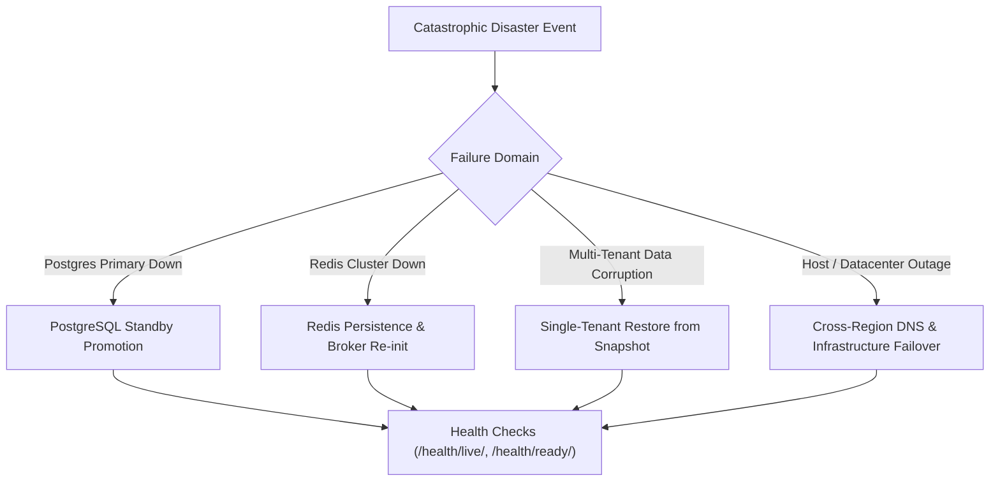

# ZenOS Disaster Recovery (DR) Runbook

## 1. Disaster Recovery Objectives (SLAs)

| Metric | Target | Definition |
| :--- | :--- | :--- |
| **RTO (Recovery Time Objective)** | **$\le 30$ minutes** | Maximum acceptable duration the system can remain offline. |
| **RPO (Recovery Point Objective)** | **$\le 5$ minutes** | Maximum acceptable age of data lost in a catastrophic disaster. |

---

## 2. Disaster Scenarios & Immediate Runbooks



---

### Scenario A: PostgreSQL Primary Database Outage

**Symptoms:** Core API returns 500 errors; health check `/health/ready/` returns 503; logs show `psycopg2.OperationalError: could not connect to server`.

1. **Verify Database Service Status:**
   ```bash
   docker compose ps postgres
   # Check logs
   docker compose logs --tail=50 postgres
   ```
2. **Promote Hot Standby Replica (if running replica):**
   ```bash
   # In PostgreSQL hot-standby container:
   pg_ctl promote -D /var/lib/postgresql/data
   ```
3. **Repoint Web & Celery Services:**
   Update `DATABASE_URL` in `.env.prod` to point to the promoted replica host and restart containers:
   ```bash
   docker compose up -d --no-deps web celery_default celery_beat
   ```

---

### Scenario B: Redis Broker & Cache Outage

**Symptoms:** Celery tasks stall; `/health/ready/` fails on cache check; session lookups fail.

1. **Restart Redis Service with Append-Only File (AOF) Recovery:**
   ```bash
   docker compose restart redis
   ```
2. **Verify Redis Responsiveness:**
   ```bash
   redis-cli -u redis://localhost:6379/0 ping
   # Expected: PONG
   ```
3. **Inspect Celery Queue Backlog:**
   ```bash
   docker compose exec web celery -A backend inspect active
   ```
4. **Purge Broken Queue if Corrupt (Emergency Only):**
   ```bash
   # Caution: Drops unacknowledged messages
   docker compose exec web celery -A backend purge -f
   ```

---

### Scenario C: Single Tenant Data Corruption
If a single tenant's data was corrupted or deleted without affecting other tenants:

1. **Do NOT restore the entire database** (which would overwrite other tenants' recent transactions).
2. **Restore the snapshot to a temporary recovery database:**
   ```bash
   createdb -h localhost -U postgres recovery_db
   pg_restore -d recovery_db /var/backups/latest_snapshot.dump
   ```
3. **Extract & Restore Tenant-Scoped Records:**
   ```sql
   -- Export corrupted tenant records from recovery database
   \copy (SELECT * FROM users_user WHERE tenant_company_id = 'target_uuid') TO '/tmp/tenant_users.csv' WITH CSV HEADER;
   
   -- Re-import into production database
   \copy users_user FROM '/tmp/tenant_users.csv' WITH CSV HEADER;
   ```
4. **Invalidate Tenant Cache:**
   ```bash
   redis-cli -u redis://localhost:6379/0 del "tenant_manifest:target_uuid"
   ```
