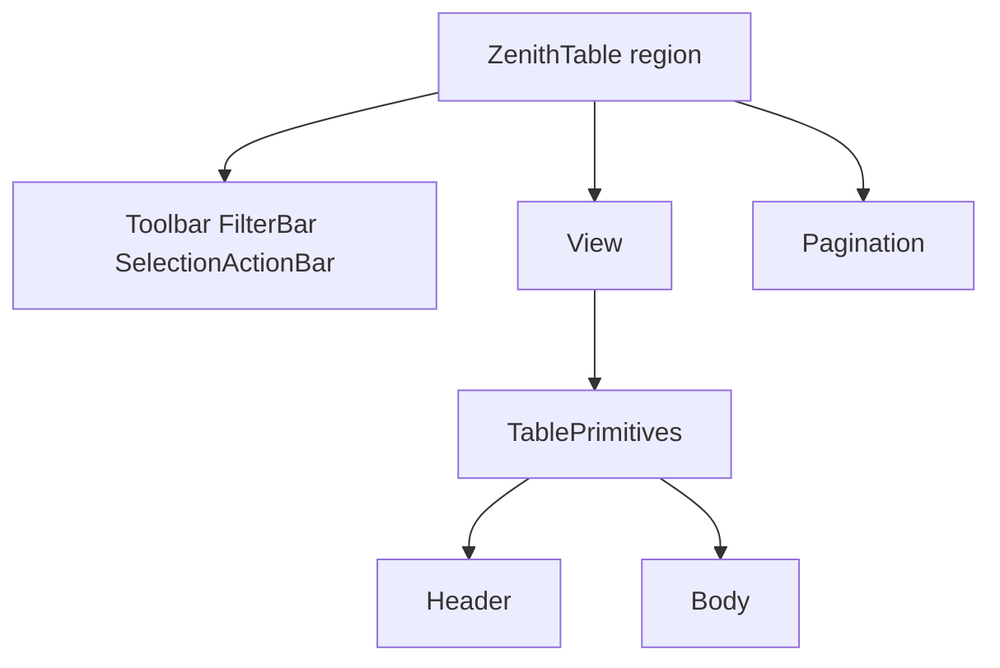
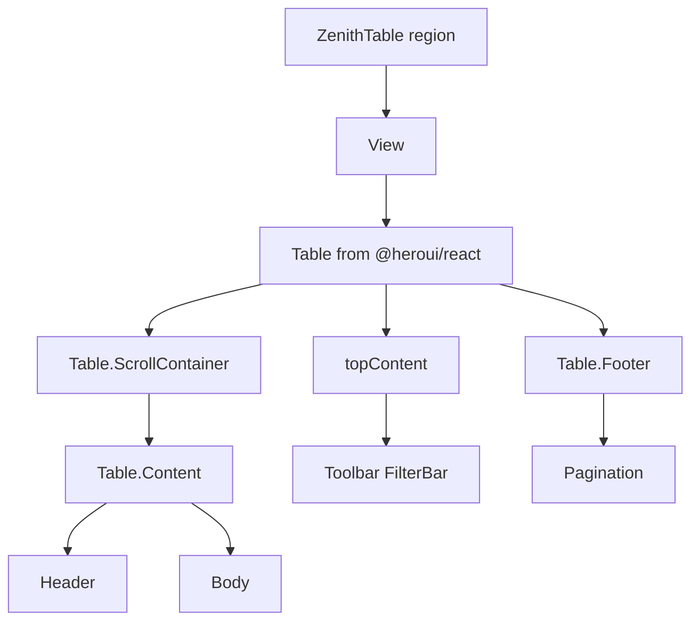

# v2 target folders

Organizing rule for the **existing** v1 core. Source under `@shared/ui/table` is **not** moved. Use this map when adding files or reading the tree.

Shipping paths: [v1 README — runtime folders](../v1/README.md#layers). Plugin attach rules: [Plugins](./PLUGINS.md). Target View paint: [Plugins — HeroUI](./PLUGINS.md#heroui-paint).

## Target tree

```text
@shared/ui/table/
  kernel/          # always-on: controller, engine, url, View/Header/Body chrome
  plugins/         # one folder per capability: logic + optional paint
  registry/        # cell registry + TableCore.register slot
  mdap/            # compileEntityToTableDef (authoring flatten)
```

Kernel is always on. Plugins are opted in. Registries are lookup tables (cells and extra modules). MDAP compiles `TableEntity` → `CompiledTableDef`.

## Transfer map (v1 path → v2 slot)

| v1 today                                                                               | v2 slot                                                                                                                                         |
| -------------------------------------------------------------------------------------- | ----------------------------------------------------------------------------------------------------------------------------------------------- |
| `controller/`, `core/useTanstackAdapter.ts`, `core/table-engine.ts`, physics, contexts | `kernel/`                                                                                                                                       |
| `url/`                                                                                 | `kernel/url/`                                                                                                                                   |
| `ui/ZenithTable.tsx`, Header, Body, View, Pagination, Toolbar, FilterBar               | `kernel/ui/` (chrome, not plugins, not MDAP presentation). Shipping paint: `TablePrimitives`. Target: [HeroUI Table](./PLUGINS.md#heroui-paint) |
| `core/modules/SelectionModule` + `plugins/selection`                                   | `plugins/selection/` (logic + paint together)                                                                                                   |
| `core/modules/FilterModule`                                                            | `plugins/filter/` (logic; FilterBar stays `kernel/ui`)                                                                                          |
| `core/modules/ExportModule`, `ServerExportModule`                                      | `plugins/export/`                                                                                                                               |
| `core/modules/ImportModule`                                                            | `plugins/import/`                                                                                                                               |
| `core/modules/BulkDeleteModule`                                                        | `plugins/bulk-delete/`                                                                                                                          |
| `core/modules/InlineEditModule` + `InlineEditContext` + `InlineEditCell`               | `plugins/inline-edit/`                                                                                                                          |
| `mdap/tableCellRegistry.ts`                                                            | `registry/cells.ts`                                                                                                                             |
| `core/TableCore.ts` `register` / `get`                                                 | `registry/modules.ts`                                                                                                                           |
| `mdap/compileEntityToTableDef.ts`, `table-entity.ts`                                   | `mdap/` (unchanged role)                                                                                                                        |

Typed built-ins on `TableCore` (`Selection`, `Filter`, …) stay the public names. `registry/modules.ts` is only the **untyped** `register`/`get` bag.

## Asymmetry (shipping)

Only **selection** already has a `plugins/` UI package. FilterBar, export progress, and inline cells still sit under `ui/` and `core/`. The map is the rule for a later move; do not treat every folder as a plugin today.

## MDAP × folders

| MDAP                              | Typical slot                              |
| --------------------------------- | ----------------------------------------- |
| [Content](./CONTENT.md)           | `mdap/` + `registry/cells`                |
| [Behavior](./BEHAVIOR.md)         | `kernel/` fetch policy + `plugins/*`      |
| [Surface](./SURFACE.md)           | `kernel/ui` chrome + `kernel/url`         |
| [Presentation](./PRESENTATION.md) | `kernel/ui` tokens / slots — not a plugin |

Excel/sheet is a **sibling host**, not `plugins/excel` or `TableCore.register("excel")`. HeroUI `Table` is the **same** View with different tags — [HeroUI paint](./PLUGINS.md#heroui-paint).

## Host today vs target

**Target**, not shipping. Paint today is [`TablePrimitives`](../../../src/shared/ui/table/ui/TablePrimitives.tsx). Compose snippet: [Plugins](./PLUGINS.md#heroui-paint).

Surface flags still mean “mount this chrome.” **Placement** changes.

**Today (shipping)** — Toolbar / FilterBar / Pagination are **siblings of View**:



**Target** — same chrome into HeroUI slots (`topContent` before `ScrollContainer`, `Table.Footer`):



- `applyHeroSelection(keys)` writes physics. `Set` → `setBulkSelection` / `resetSelection`. HeroUI `"all"` → **PAGE**, not server `ALL`. `selectionMode={enabled ? selectionType : "none"}` from `useSelection({ enabled })`.
- Selection **paint** is HeroUI `Checkbox` `slot="selection"`. `columnDef()` wraps that or is not the DOM.
