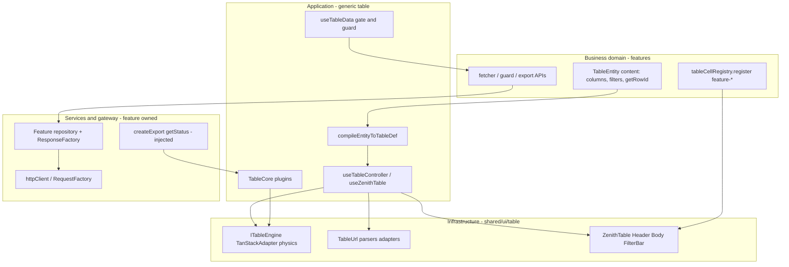

# ZenithTable v2 — Platform layers

Ownership contract. **Who** owns kernel, plugins, and HTTP.

These are **not** the MDAP four. Authoring is [Content](./CONTENT.md) / [Behavior](./BEHAVIOR.md) / [Surface](./SURFACE.md) / [Presentation](./PRESENTATION.md). Physical grouping is [Folders](./FOLDERS.md). Attach rules are [Plugins](./PLUGINS.md). How-to remains [v1](../v1/README.md).

ZenOS layers: [ADR-010](../../adr/010-zenos-layered-architecture-governance.md). A `content.columns` field is domain _data_, compiled by application code, rendered by infrastructure UI.

## Map

## 1. Infrastructure — kernel (zero domain)

Always-on platform inside `@shared/ui/table`. **No `httpClient`, no `/api/v1/...`, no `if (role === "Admin")`.** HTTP envelopes stay out of the table ([v1 rule 1.5](../v1/RULES_AND_ANTI_PATTERNS.md)).

| Area        | Paths                                                                                                                                                                                |
| ----------- | ------------------------------------------------------------------------------------------------------------------------------------------------------------------------------------ |
| Engine      | `core/table-engine.ts`, `core/useTanstackAdapter.ts`, physics store                                                                                                                  |
| URL port    | `url/` (`TableUrlPort`, React Router adapter, parsers, categories)                                                                                                                   |
| Rendering   | `ui/` — compound chrome. Shipping: `TablePrimitives`. Target paint: `import { Table } from "@heroui/react"` on `View` ([Plugins](./PLUGINS.md#heroui-paint)). Engine stays TanStack. |
| UI plugins  | `plugins/selection` — paint for the Selection module                                                                                                                                 |
| Task chrome | `ProgressModal`, CSV helpers (format only)                                                                                                                                           |

URL categories (`url/categories`) are **kernel**, not opt-in plugins. Infrastructure plugins may **render** plugin state. They must not own HTTP.

Invariants: sort, filter, and page are **server-owned**. TanStack does not slice the current `data` array.

## 2. Application — generic orchestration + TableCore plugins

Still domain-agnostic. Coordinates the kernel. **TableCore plugins live here.**

| Piece                             | Role                                                                          |
| --------------------------------- | ----------------------------------------------------------------------------- |
| `useTableController`              | Presenter: engine + URL + fetch status                                        |
| `useZenithTable` / `useMDAPTable` | Application API                                                               |
| `compileEntityToTableDef`         | MDAP flatten — not a plugin                                                   |
| `useTableData`                    | When to call `fetcher` (`guard` / `gate`)                                     |
| `TableCore.*`                     | Opt-in ops: selection, filter write, export, import, bulk delete, inline edit |
| `useExportTask` / `useImportTask` | Generic job machines used **by** ServerExport / Import plugins                |

`useExportTask` is an application job machine. `createExport` / `getStatus` are **service ports** supplied by the feature.

Plugins write engine state or physics. They do not unwrap HTTP envelopes. Logic vs paint: `core/modules/SelectionModule` = behavior; `plugins/selection` = action bar. Do not put fetchers in `plugins/`.

## 3. Services / transport / gateway — feature-owned

The table package has **no** service layer. Features inject functions into `behavior.server` and plugin ports.

| Role        | Where                                                                                                                 |
| ----------- | --------------------------------------------------------------------------------------------------------------------- |
| Transport   | `httpClient`, `RequestFactory`                                                                                        |
| Gateway     | Feature fetcher unwraps with `ResponseFactory.parsePaginated()` → `{ rows, totalCount }`                              |
| Server jobs | `createExport`, `getStatus`, `downloadFile`, `uploadFile`, `bulkDeleteApi` in `features/*/services` (or repositories) |

A plugin that imports `httpClient` is a layer violation.

**Proportional complexity** ([ADR-010](../../adr/010-zenos-layered-architecture-governance.md)): do not invent a repository for a static client demo table. A local `behavior.client.data` array is enough.

## 4. Business domain — `src/features/...`

Owns meaning. Registers plugins. Does not fork the kernel.

- `TableEntity` for that aggregate (users, payroll, invoices)
- `fetcher` / `guard` (e.g. required `branchId`)
- `tableCellRegistry.register("feature-…")` in the feature, not in `shared/ui/table`
- Row types, bulk-delete semantics, domain copy
- Optional `TableCore.register("my-ops", module)` for feature-only ops
- Pages compose `useMDAPTable(entity)` plus chosen plugins (`Listener`, `SelectionActionBar`, ServerExport)

Pages/presenters do not put fetch logic in `ZenithTable.Body`.

## 5. MDAP × platform × plugins

Authoring detail: [Content](./CONTENT.md), [Behavior](./BEHAVIOR.md), [Surface](./SURFACE.md), [Presentation](./PRESENTATION.md). This table is ownership only.

| MDAP             | Platform owner                                           | Plugin?                                                                            |
| ---------------- | -------------------------------------------------------- | ---------------------------------------------------------------------------------- |
| **Content**      | Domain schema + `TableColumnFactory`                     | Cell **renderer** plugins via `tableCellRegistry`                                  |
| **Behavior**     | Domain supplies ports; application runs `gate` / `guard` | TableCore Export / Import / InlineEdit consume ports                               |
| **Surface**      | Application flags; infrastructure mounts chrome          | `SelectionActionBar` is a UI plugin. `FilterBar` is chrome, not `TableCore.Filter` |
| **Presentation** | Infrastructure tokens / visual shortcuts                 | Never a plugin                                                                     |

Easy mix-up: `TableCore.Filter` writes the engine. `FilterBar` is MDAP surface chrome (`content.filters` → `FieldRenderer`).

## Layer violations

| Don't                                          | Do                                                                                               |
| ---------------------------------------------- | ------------------------------------------------------------------------------------------------ |
| `httpClient` inside `TableCore` or `plugins/`  | Inject `fetcher` / `createExport` from the feature                                               |
| `responseMap` on `TableMeta`                   | Unwrap in the feature gateway                                                                    |
| Domain cell JSX on `ColumnDef.cell`            | `tableCellRegistry.register("feature-…")`                                                        |
| Selection / export as `meta.features` booleans | Compose `TableCore.*` under `<Table>` (`urlSync` is the only flag)                               |
| Fetch in `ZenithTable.Body`                    | `behavior.server` + `useTableData`                                                               |
| Excel as `TableCore.register("excel")`         | Sibling sheet host sharing `TableColumnMeta` / save ports — [Plugins](./PLUGINS.md#excel--sheet) |
| HeroUI `Table` as the row/sort/page engine     | Keep `ITableEngine`; HeroUI paints `View` — [Plugins](./PLUGINS.md#heroui-paint)                 |
